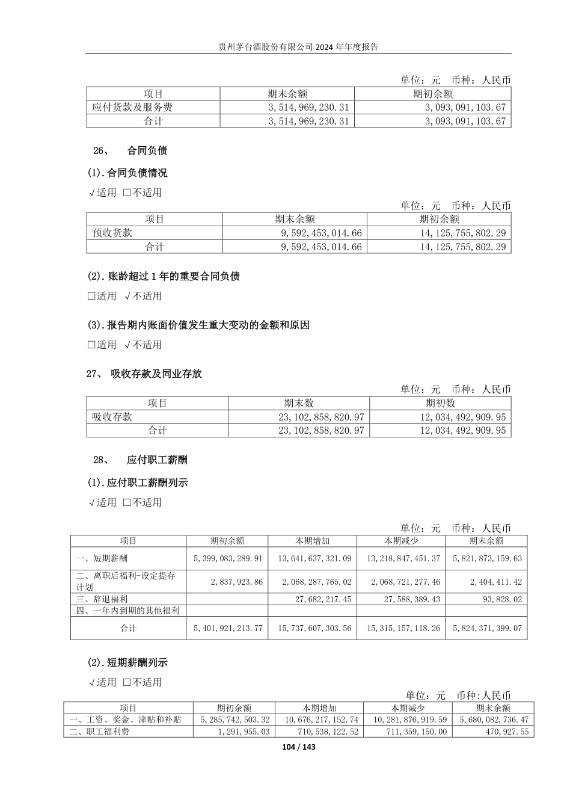

> H01已于2026-10-12由本人完成窗口核验，R2024-08当前Fact。下文为准备时记录；真实结果见../work/h01-20261012/human-confirmation-receipt.json，不重复核验。

# H01：第五次新增原文核验卡

日期2026-10-12。现在只做这张卡：核对一组新增披露，不要求重核旧有效事实，也暂不裁决品牌、需求或投资价值。候选编号 **R2024-08**，当前 **Unknown，待本人核验**。

## 你要核什么

打开[2024年报原PDF](../sources/annual_reports/pdf/600519_2024_贵州茅台_贵州茅台2024年年度报告_2025-04-03.pdf)，看PDF及报告第104页，“26、合同负债”→“(1)合同负债情况”→“预收货款”。表上单位为元、币种人民币。

| 原表栏目 | 我的提取（人民币元） | 日期及主体 |
| --- | --- | --- |
| 期末余额 | 9,592,453,014.66 | 2024-12-31；合并财务报表附注 |
| 期初余额 | 14,125,755,802.29 | 2023-12-31比较列，对应2024期初；同一2024报告 |

第58页合并资产负债表表头明确两期日期、单位和合并主体；第60页合同负债行同额。不要取第62页母公司余额，也不要把同报告比较列说成已核独立2023年报。

## 你现在的操作

1. 核对原PDF中的表名、预收货款行、两期金额、单位；必要时看第58/60页的合并表头及原行。
2. 双击[人工核验入口.cmd](../人工核验入口.cmd)，在“候选核验”把分组切到“全部候选”，搜索 **R2024-08**。核验人填写你本人实际姓名 **lxy**，只选择这一条；确认原文与口径一致后，点 **确认所选为 Fact**。窗口如果已开着，关闭重开会只读刷新候选，不改变旧确认。
3. 回到聊天反馈实际结果；如发现不同，保留Unknown并说明哪处不同，不必猜正确答案。

项目现行AGENTS.md规定原始披露Fact由本人窗口明确确认维护，所以我只准备候选，不代点按钮或把聊天整理冒充窗口事件。你无需编辑JSON；我们随后读取当前事实及新事件继续研究。

实际完成后可这样回复：

> 我已查看2024年报第104页，并核对合并表的日期与主体；预收货款期末9,592,453,014.66元、期初14,125,755,802.29元一致，已在窗口确认R2024-08。原因和品牌判断暂不确认。

如未完成或有差异，可回复：

> H01暂未确认，卡在……／原文与卡片不同的地方是……。

## 我已做的检查与计算

本次动态读取六个ReviewStore接口，未找到这组余额已核准记录；原63条候选文件完整保留，新候选在独立补充账本登记。初版14项预检后，实际安装复查发现并修正旧比较候选集合扩张问题；27项核验接口隔离测试通过，最终复查另存。原行初检覆盖：原行/日期/主体、两期金额与计算、新ID、原63候选绑定和旧Fact逐条保持、13份权威/来源保护等。

Agent复算参考（当前不新增变化Fact）：

- 差额＝9,592,453,014.66−14,125,755,802.29＝**−4,533,302,787.63元**，约−45.33亿元。
- 变化率＝(期末/期初−1)×100＝**−32.09%**（保留两位小数），与第13页展示率一致。

原值核验、比较口径判断和运算结果采用分开记录，不能因机器复算通过就把新变化自动确认。

## 为什么这条能推进第五次

它补充“收入确认—客户预付款—营运资本—现金”的关系。第83页收入政策区分收到订单/款项和交付产品后确认收入；余额是某日尚列为合同负债的存量，不是本年全部收款。

余额下降可能同时受新收预款、交付转收入、退款/其他调整和期末时点影响，分项流量尚未齐备。第13页公司解释为经销商预付货款减少，这只能作为公司说法，不能直接确认终端需求下降或品牌失效。第104页重大变动栏目勾“不适用”不等于余额没有下降，相关适用判断原因不补猜。

本次真实核验产生后，再按与两份第五合同各自的相关性补入过程/现有成果和证据编号；现在没有勾选两稿必补条款，也不预先替第七次制造核验。

## 来源、修正及中间产物

原PDF SHA-256：5299f4940e2ce4e91084b73dc457d558b9d335fa76fbfee6227e4254eb7f4a30。数字以原PDF为中心，不调用网络补证。完整绑定和算术见[候选JSON](../work/h01-20261012/candidate.json)、[准备检查](../work/h01-20261012/preparation-verification.json)及[过程记录](../work/h01-20261012/notes.md)。

修正记录保留：临时将期初简称为2024-01-01，核第58页后改为原表明示2023-12-31比较列；金额/公式未变。表头、母公司排除、重大变动适用栏目及经营解释的限制均保留，未覆盖旧确认。

## H01-C04安装复查与修复

首次将新行直接追加原候选集合时，CH01/02因比较来源绑定范围扩张暂时失效，原值与权威事件未改。已恢复原63候选文件全部字节。新候选放work/additional-evidence-candidates.md，比较绑定继续保护原来源集合；新增披露按自己的原行和PDF指纹核验。准确绑定为原候选集合的行指纹映射及PDF/结构化输入，并非单一MD文件SHA。失败和修复见过程记录。

最终安装后20项检查通过：原六域内容及绑定逐条相同，原CH01/02有效，新增R2024-08仍Unknown；参见[安装后检查](../work/h01-20261012/installed-verification.json)。
