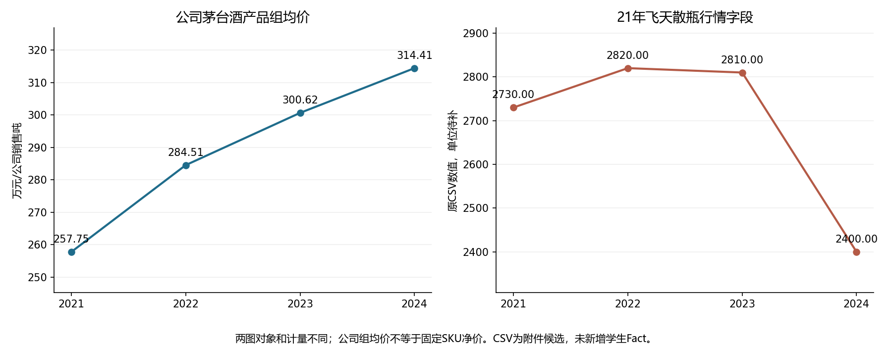

# 补充材料学习与第六七次合同反馈

日期2026-10-12。本轮完成四份新材料的学习/数据审查，按真实第六七次合同扩展研究，合并现有Lec03成果，并更新两份主交接和通用工作台。原件、旧Fact、旧人工身份/时间、10日签署和修正历史保留。

## 当前结果

| 内容 | 具体完成与入口 | 状态/边界 |
| --- | --- | --- |
| 补充讲义 | 219页逐页文字阅读、全部图示概览与公式页放大；[详细学习](../../会话交接/03_补充材料学习与方法修正_20261012.md) | 十讲与原课件方法融合；讲师观点/案例不当公司事实，公式修正留原页 |
| 附件数据 | 138652记录/538序列全量检查，JS/Python独立对照；[数据审查](../work/20261012-supplement/data-guide.md) | 49629条2020—2024主期、71562条更早、17461条后续；无单位/币种/公开日，thscode全空；不自动新Fact |
| 第六次 | [五步、品牌链、护城河三问、风险和交接](../outputs/task06-industry-advantage.md)，[过程](../work/task06-industry-advantage-checks.md) | 已完成内容、完整行业/同业缺口路径及授权签署；新边界与机制最终采纳待人工；不算无分母份额 |
| 第七次 | [原话/支持挑战/替代/最大表述](../work/task07-narrative-audit.md)，合并[现有矩阵](../outputs/lec03-evidence-matrix.md)/[五项成果](../outputs/lec03-stage-deliverables.md) | 内容及签署完成；新增学生本次核验与最终裁决仍待补，T7-3不伪勾；第五次亲查差异带入 |
| 修正与冲突 | [13项登记](../work/20261012-supplement/conflict-register.md)及JSON | 分类保留旧值/位置、核查/运算、处理、影响、状态及待补；已修公式与未决口径分开 |
| 通用工作台 | series-audit命令、未填行业字典、导航及补充方法参考 | 不自动确认Fact，拒绝覆盖源CSV/已有结果，新公司不继承茅台数据/授权 |

本轮执行人与复核人均lxy，2026-10-12，同人复核。依据本人本轮沿用此前要求的授权代填，见[真实授权](../evidence/20261012-execution-authorization.json)、[两份签署账本](../evidence/20261012-contract-signatures.json)。教师批准、新原文亲查和新研究最终裁决没有伪造。

## 对现有研究的影响

公司组ASP增加与特定年份市场报价下降是不同对象，不能互相替代或只取有利数字。Agent本轮建议收窄为“品牌有研究依据，独立可持续净因果未证”，是否修改旧本人暂定品牌判断由人工敲定。库存字段连续五年数值吻合成品＋半成品，不能照供应商“成品”标签推可售积压。行业产量/同比基数缺口在新附件中仍在，不能声称资料补齐。

两图对象和单位不同：左为公司产品组，右为固定21年散瓶报价字段（原单位待补）；图不识别品牌净因果。精确来源与脚本输入见[图数据](../work/20261012-supplement/chart-inputs.json)。2025/26只单独跟踪，不回填原2024判断。期末出厂报价不变不能证明年度实现价无变化，样本均值也不是成交量加权净价。

## 初学者继续操作

先看数据/问题地图 → 打开原页或原行/ID → 补真实字段元数据 → 分清期间/单位/主体/SKU/报价层级 → 同口径计算或写停止 → 支持/挑战/未决/替代分栏 → 核对修正影响 → 人工最终采纳 → 签署/上传/交接。集中待审核项目见[审核卡](20261012-human-review-card.md)，不要求重复核未变旧Fact，也不要求编辑JSON。

## 验证与保留

45项隔离测试通过（旧36项＋CSV/字典9项），126项独立原行/数值/分窗/旧来源绑定与保护检查通过。补充四原件与旧五PDF/八项受保护账本和输入字节保持。六个旧ReviewStore接口本轮有效数16/2/3/15/3/16，年度组有重叠，不报55独立事实。新附件的单位/定义/可比性尚未确认，与机器结构/算术通过分开。

重跑工具：通用series-audit只读原CSV、写新的检查JSON；公司scripts/verify_supplement_20261012.py接受--workspace/--inputs/--output，对当前来源与旧API复查，不写权威事件。作图脚本以chart-inputs.json输入，结果不替代源数。输入、计算、原行、目录、修正及失败过程保留在work/20261012-supplement；本机PDF文字缓存/概览及隔离测试包保留于课件目录忽略的实施包。

通用方法同步Investment_yw_finaltask；本轮合同/公司成果/主交接与来源元信息同步Investment_yw_10-1_begin；本人已于2026-10-12明确选择“仅上传成果，原件保留本地”，完整原补充材料和逐行输入按此决定保留本地，不再待授权。发布结果按实际Git远程校验记录，不强推、不纳入用户其他目录改动。

## 新原稿逐条映射

### 第6次

[本轮签署执行稿](../tasks/executed-20261012/第六次任务合同_贵州茅台行业竞争与竞争优势.md)；原稿SHA 93acb50f2cd9c6977db83c0c69be0b52bda65ff8787556109c801175479c1629。

| 编号 | 原要求 | 本轮结果 | 证据 |
| --- | --- | --- | --- |
| T6-1 | 五步法每步都有具体研究问题、证据或 `Unknown`，未预设行业阶段。 | 底稿核对完成；依据见对应过程/成果/冲突登记 | [work/task06-industry-advantage-checks.md](../work/task06-industry-advantage-checks.md)；[outputs/task06-industry-advantage.md](../outputs/task06-industry-advantage.md)；[work/20261012-supplement/conflict-register.md](../work/20261012-supplement/conflict-register.md) |
| T6-2 | 市场范围写清产品、价格带、客户与地域；市场份额未在缺少同口径分母时计算。 | 底稿核对完成；依据见对应过程/成果/冲突登记 | [work/task06-industry-advantage-checks.md](../work/task06-industry-advantage-checks.md)；[outputs/task06-industry-advantage.md](../outputs/task06-industry-advantage.md)；[work/20261012-supplement/conflict-register.md](../work/20261012-supplement/conflict-register.md) |
| T6-3 | 只选择一项最相关的优势深入核验，未机械罗列七类标签。 | 底稿核对完成；依据见对应过程/成果/冲突登记 | [work/task06-industry-advantage-checks.md](../work/task06-industry-advantage-checks.md)；[outputs/task06-industry-advantage.md](../outputs/task06-industry-advantage.md)；[work/20261012-supplement/conflict-register.md](../work/20261012-supplement/conflict-register.md) |
| T6-4 | 优势来源、作用机制、结果、壁垒、反证与护城河三问都写明证据状态。 | 底稿核对完成；依据见对应过程/成果/冲突登记 | [work/task06-industry-advantage-checks.md](../work/task06-industry-advantage-checks.md)；[outputs/task06-industry-advantage.md](../outputs/task06-industry-advantage.md)；[work/20261012-supplement/conflict-register.md](../work/20261012-supplement/conflict-register.md) |
| T6-5 | 至少一种非原命题的替代解释和 1—3 个有传导关系的风险观察变量已记录。 | 底稿核对完成；依据见对应过程/成果/冲突登记 | [work/task06-industry-advantage-checks.md](../work/task06-industry-advantage-checks.md)；[outputs/task06-industry-advantage.md](../outputs/task06-industry-advantage.md)；[work/20261012-supplement/conflict-register.md](../work/20261012-supplement/conflict-register.md) |
| T6-6 | 新 `Fact` 有一手来源与人工核验；材料不足时留下可操作的证据需求。 | 底稿核对完成；依据见对应过程/成果/冲突登记 | [work/task06-industry-advantage-checks.md](../work/task06-industry-advantage-checks.md)；[outputs/task06-industry-advantage.md](../outputs/task06-industry-advantage.md)；[work/20261012-supplement/conflict-register.md](../work/20261012-supplement/conflict-register.md) |
| T6-7 | 已形成交给第七次的叙事核验问题；没有估值或买卖结论；执行人与复核人签署。 | 底稿核对完成；依据见对应过程/成果/冲突登记 | [work/task06-industry-advantage-checks.md](../work/task06-industry-advantage-checks.md)；[outputs/task06-industry-advantage.md](../outputs/task06-industry-advantage.md)；[work/20261012-supplement/conflict-register.md](../work/20261012-supplement/conflict-register.md) |

原指定阶段成果补充：原稿允许完整缺口替代新行业Fact，已走缺口路径。

### 第7次

[本轮签署执行稿](../tasks/executed-20261012/第七次任务合同_贵州茅台叙事核验.md)；原稿SHA 5237bc4d19110ed6f60eb6f425c5735d472606a341e72384829d1f99e7861035。

| 编号 | 原要求 | 本轮结果 | 证据 |
| --- | --- | --- | --- |
| T7-1 | 管理层原话与机制解释分开；原话可回到批准 PDF 的版本、页码与上下文。 | 底稿核对完成；依据见对应过程/成果/冲突登记 | [work/task07-narrative-audit.md](../work/task07-narrative-audit.md)；[outputs/lec03-evidence-matrix.md](../outputs/lec03-evidence-matrix.md)；[outputs/lec03-stage-deliverables.md](../outputs/lec03-stage-deliverables.md) |
| T7-2 | 已引用第五、六次的实际成果及证据编号；未完成的前置任务没有被假定为已完成。 | 底稿核对完成；依据见对应过程/成果/冲突登记 | [work/task07-narrative-audit.md](../work/task07-narrative-audit.md)；[outputs/lec03-evidence-matrix.md](../outputs/lec03-evidence-matrix.md)；[outputs/lec03-stage-deliverables.md](../outputs/lec03-stage-deliverables.md) |
| T7-3 | 可观察变量写明方向、期间、产品／渠道口径；新增事实经学生回原文核验。 | 原稿新增学生亲查条款待补；本轮新增CSV仅候选 | [work/task07-narrative-audit.md](../work/task07-narrative-audit.md)；[outputs/lec03-evidence-matrix.md](../outputs/lec03-evidence-matrix.md)；[outputs/lec03-stage-deliverables.md](../outputs/lec03-stage-deliverables.md) |
| T7-4 | 支持、挑战、未决、替代解释和反证条件均分别记录，没有只找支持性数字。 | 底稿核对完成；依据见对应过程/成果/冲突登记 | [work/task07-narrative-audit.md](../work/task07-narrative-audit.md)；[outputs/lec03-evidence-matrix.md](../outputs/lec03-evidence-matrix.md)；[outputs/lec03-stage-deliverables.md](../outputs/lec03-stage-deliverables.md) |
| T7-5 | 最大可辩护表述没有超过现有材料的时间、业务范围和因果支持力度；至少一项不足保留为 `Unknown`。 | 底稿核对完成；依据见对应过程/成果/冲突登记 | [work/task07-narrative-audit.md](../work/task07-narrative-audit.md)；[outputs/lec03-evidence-matrix.md](../outputs/lec03-evidence-matrix.md)；[outputs/lec03-stage-deliverables.md](../outputs/lec03-stage-deliverables.md) |
| T7-6 | 已说明哪项问题交给 Lec04—05 继续核验；没有估值或买卖 `Decision`。 | 底稿核对完成；依据见对应过程/成果/冲突登记 | [work/task07-narrative-audit.md](../work/task07-narrative-audit.md)；[outputs/lec03-evidence-matrix.md](../outputs/lec03-evidence-matrix.md)；[outputs/lec03-stage-deliverables.md](../outputs/lec03-stage-deliverables.md) |
| T7-7 | Agent 的检索整理与学生的核验裁决可区分；执行人与复核人签署。 | 底稿核对完成；依据见对应过程/成果/冲突登记 | [work/task07-narrative-audit.md](../work/task07-narrative-audit.md)；[outputs/lec03-evidence-matrix.md](../outputs/lec03-evidence-matrix.md)；[outputs/lec03-stage-deliverables.md](../outputs/lec03-stage-deliverables.md) |

原指定阶段成果补充：outputs/lec03-stage-deliverables.md新增学生本次核验记录待补。

实际上传范围及自动审批拒绝原因见[上传范围记录](20261012-publication-scope.md)。本地原件/原行链接不表示GitHub已有这些载荷。
