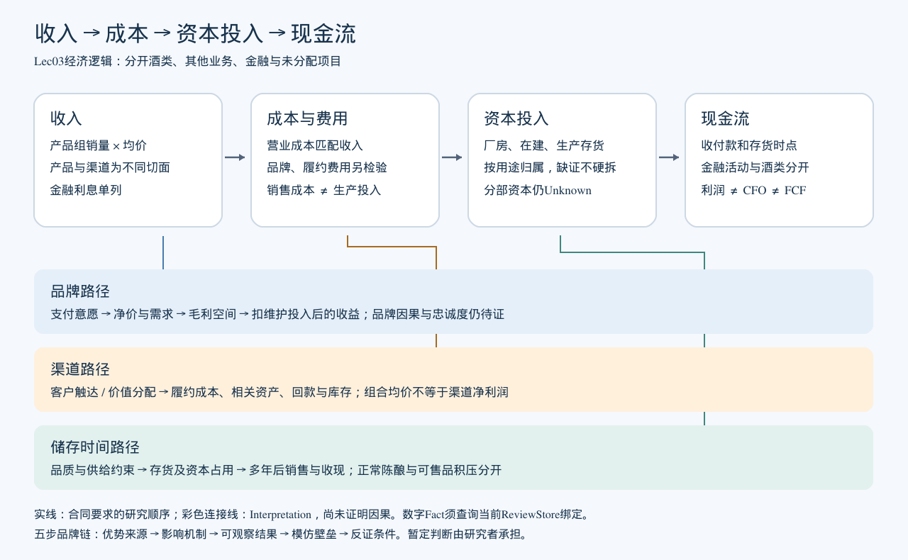

> 2026-10-13当前研究意见：本人已认可修订后的判断并授权写入。截至2024年，茅台酒的高毛利和增收能力保持，2024年增收更多体现为销量扩张；同时，直销组合均价和“21年飞天散瓶”现货价格走弱。因此，品牌支撑收益的解释可以暂定保留，但“品牌定价权全面持续增强”缺乏充分支持。 这是本人采纳的Interpretation，数字来源/计算与机制判断分别记录；旧待裁决文字保留为历史。[真实采纳记录](../evidence/20261013-research-opinion-adoption.json)。

> 2026-10-13当前状态：第七次新增学生核验R2024-07已真实完成，T7-3内容补齐；下文12日及此前待核状态为历史。最大研究表述待本人采纳，窗口身份/时间不改写。

> 2026-10-12当前补充：[第六次行业/优势](task06-industry-advantage.md)、[第七次审计底稿](../work/task07-narrative-audit.md)、[修正冲突登记](../work/20261012-supplement/conflict-register.md)。第五次两稿亲查差异带入；本轮新增学生核验记录未发生，Agent取证/运算和授权签署与人工终判分开。

> 2026-10-10本轮补充：旧核验及内容审核原样保留。当前[逐项合同反馈](../docs/20261010-contract-feedback.md)、[新问题取证](../work/lec03-evidence-expansion.md)、[四环节成果](task05-business-model-map.md)替代下文旧“签署留空/下一步”提示。执行人与复核人本轮均签lxy（同人），不冒充新PDF亲查，新增机制仍由人工最后确认。

# Lec03五项阶段成果（内容验收完成）

本人已审核上一版第3、4节并暂定行业成熟期；Agent按本轮明确授权完成补证、完善与内容核准。10项内容条件已完成，签署仍留空。当前研究入口为[最终结果](lec03-final-results.md)。

## 1. 业务与行业问题清单

| 维度 | 最终问题 | 确定方式 |
| --- | --- | --- |
| B01商业模式 | 如何分开酒类及其他收入、成本、资本占用与现金转换？重点核查品牌、渠道和储存三路径。 | 本人选题，数据及路径解释已核准 |
| I01行业竞争 | 现有年报能支持何种行业阶段及公司竞争位置？按定边界、分阶段、找核心、验逻辑、防风险展开。 | 本人授权Agent定义，本人暂定成熟期，Agent补证 |
| M01竞争优势 | 品牌是否形成定价权？最重要优势按五步链条展开。 | 本人选题并维持暂定有效，逻辑已核准 |

## 2. 叙事—变量—证据矩阵

[当前矩阵](lec03-evidence-matrix.md)区分披露Fact、机制Interpretation及缺证Unknown。每项明确变量/方向/时点/口径、原文定位、替代解释、反方和后续，所有新数字可按[最终报告附录A](lec03-final-results.md)复核。

## 3. 商业模式经济逻辑图

收入→成本→资本投入→现金流是研究顺序，虚线是机制假设。酒类/其他/金融边界、项目直接归属、五年库存和集团金融现金桥接见[最终报告第3节](lec03-final-results.md)。原图保留；不把毛利等同净利润，不把剔除金融后的余额等同准确酒类CFO。

## 4. 竞争优势证据要求表

| 环节 | 本轮结论与证据 | 替代解释、反方证据与支持边界 |
| --- | --- | --- |
| 优势来源 | Interpretation：品牌认知与消费场景认可；Fact：公司明确把品牌列为核心竞争力（D01） | 品质、工艺、环境和文化共同作用；消费者忠诚及支付意愿尚未直接测量 |
| 影响机制 | Interpretation：品牌认可→支付意愿/较低价格敏感性→价格及真实需求→公司保留收益 | 品质、稀缺供给、规格升级、渠道组合可解释表现；公司销售量不是终端售出量 |
| 可观察结果 | Fact：2020—2024茅台酒产品组均价与公司销量均增加，毛利率持续约94%；年度结果见下表 | 产品组统计没有固定SKU；毛利未扣全部期间费用、税费及资本成本，不单独识别品牌因果 |
| 模仿壁垒 | Interpretation：长期品牌心智，品质/储存/勾兑的配套；Fact：连续五份年报披露五年储存及跨年份勾兑安排 | 时间与资本门槛具有合理性；工艺独有性、竞品储备和绕过路径Unknown，不能断言不可复制 |
| 反证条件 | Interpretation：同款净溢价持续收窄、提价后终端量相对下降、维护费用/库存资本吞噬收益或替代品被同等接受时重评 | 检验同规格、渠道、地区与时点，区分正常陈酿和可售品积压；不声称风险已经发生 |

五年产品组均价、销量及毛利见[最终结果第2节](lec03-final-results.md)，本人已通过原品牌链条逻辑。新增五年数字为Agent核准，不伪造本人点击。成本路径与品牌路径分开，生产成本桥接假设仍Unknown。

## 5. 两项真实人工核验记录

| 编号 | 内容与实际行为 | 状态与出处 |
| --- | --- | --- |
| H01 | 本人先前核对公司将品牌列为核心竞争力的原文，及产品/均价毛利、成本计算；当前旧接口重新校验有效。此次又认可第4节数据与路径 | Fact：D01等旧记录；来源2024第8页及原各账本。本人本次答复不扩写为对新五年数据逐项点击 |
| H02 | 本人此次认可上一版第3节逻辑，其中明确保留品牌因果/持续性、消费者忠诚、壁垒独有性等缺证；完整原章节与答复绑定保存 | Unknown：品牌独立因果/忠诚/独有壁垒，当前解释为Interpretation。认可逻辑不把缺证变为Fact |

真实答复、审核提交/章节SHA及Agent补证授权见[内容审核记录](../evidence/lec03-content-review.json)、[被审核章节快照](../evidence/lec03-approved-sections.md)。广义成熟期为本人暂定+Agent年报支持的Interpretation；细分阶段与市占率仍Unknown。

执行人：__________；复核人：__________；签署日期：__________。

[逐项验收](../docs/lec03-acceptance.md)：五项成果和10项内容条件完成；签署最后由本人统一填写。后续细分竞争、成本滚动与分部资本现金验证已安排，未提供Lec04—05独立合同则不编造其交付。

## 2026-10-10四环节与护城河三问补充

[专用四环图和变量表](task05-business-model-map.md)覆盖收入、成本、投入、现金，标明每条关系的已知和缺口。

| 护城河问题 | 现有证据 | 边界/缺口 |
| --- | --- | --- |
| 优势多大 | 五年茅台组毛利約94%，销售量与组ASP有披露结果 | 相对同业净溢价及费用资本后超额收益Unknown，不能把组高毛利直接量化为品牌大小 |
| 持续多久 | 五年公司观察窗及储存工艺披露 | 未来持续年限/消费忠诚与竞争进入未知；年限不外推 |
| 扩张后保持 | 公司产品组销售扩张有原披露，系列和渠道收益结构不同 | 增量净回报及分部再投资未知；不凭总收入增长判可无成本扩张 |

行业五步、反证变量及三轮过程见[扩展取证](../work/lec03-evidence-expansion.md)；重大年度变化/可执行返工卡见[变化表](../work/yearly-changes.md)。原稿新学生亲查条款待补，当前授权执行方式见合同反馈。

本轮执行人签署：lxy；复核人签署：lxy；日期2026-10-10，Agent按本人授权填写，同人复核，原先空栏为历史。

## 第七次新增阶段交付（2026-10-12）

1. 引用[第五次商业模式四环图](task05-business-model-map.md)、[第六次行业五步/优势及三问](task06-industry-advantage.md)，对前置缺口保持明确，不假定新增亲查已完成。
2. 原管理层品牌表述M01-D01由旧真实本人聊天核验，本轮动态有效。新增价格/库存/行业附件只是Agent候选与复算。学生本次新核验记录：**尚未产生，待补**；不从lxy签名生成PDF事件。
3. 明确Unknown：高端酱香细分阶段/需求和份额、同SKU净溢价/终端量、独有壁垒和增量资本回报；供应商成品字段实际定义及行业比较基数。
4. 最大可辩护表述：公司品牌自述及组盈利表现有依据，独立可持续品牌净因果未被识别；新报价下降只提出挑战，不宣称品牌不存在。新解释最终由人工敲定。
5. Lec04—05具体问题：查存货/成本滚动及酒龄、渠道费用归属、在建工程与资本现金、金融现金和经营税费、归母权益/平均资本与利润匹配；不制造完整FCF/ROIC或估值。

本轮执行人签署：lxy；复核人签署：lxy；日期2026-10-12，同人。依据本人接续此前要求的明确指令由Agent填写，不宣称独立复核或新结论已通过。

## 2026-10-12 H01本人新增核验已完成

R2024-08已由本人在窗口确认，当前ReviewStore.facts()有效；2024PDF104页附注26预收货款：期末9,592,453,014.66元，期初14,125,755,802.29元；人民币元、合并口径、同2024报告比较列。窗口事件18，2026-10-12T20:28:01+08:00，保存核验名Leo，原样保留；本人聊天明确反馈核对一致及已在窗口确认。见[真实核验衔接记录](../work/h01-20261012/human-confirmation-receipt.json)。

它补收入确认/营运资本/现金问题，两份第五合同分别引用同一真实事件，不制造两次核验。余额差和−32.09%仍为Agent复算参考，不自动成为新增人工变化Fact；原因、需求和品牌不由本次确认推定。第七次本次新核验与最终裁决仍待补。

## 2026-10-13第七次新增学生原文核验已完成

R2024-07由本人在窗口确认，事件19，2026-10-13T11:06:15+08:00，实际核验名Leo原样保留；当前API有效。2024年报9页酒类主营业务直销收入74,843,327,030.79元、成本3,493,952,839.59元。本人聊天反馈“R2024-07已确认”。见[真实核验记录](../work/h03-20261013/human-confirmation-receipt.json)。

该事件补齐原第七T7-3和本次阶段核验记录，与12日H01的R2024-08分别登记。可观察变量为2024直销收入/成本及渠道毛利：若渠道保留价值的解释成立，需进一步观察同商品渠道净贡献及费用资本后回报，而非只看单年毛利。按已核两项原数算毛利率95.33%为Agent参考，与原表展示相符；渠道费用、产品组合、终端量及净品牌因果仍Unknown。后续查渠道费用归属、回款退货条件、产品销量、库存资本和现金流。

13日补充执行/复核签署：lxy／lxy，2026-10-13，同人；按本人持续授权填写，不替代窗口实际身份、教师批准或新解释裁决。
