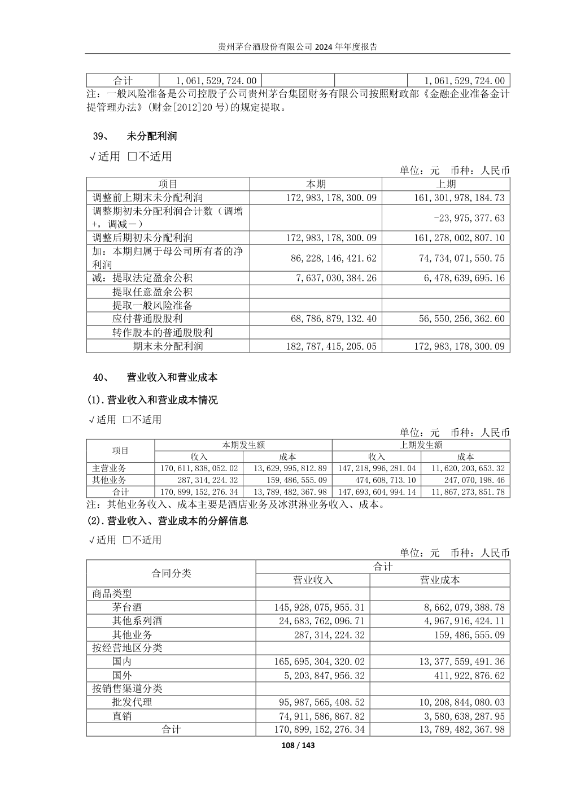

> 2026-10-10本轮该合同逐项复核与签署完成：[反馈及签署执行稿](../docs/20261010-contract-feedback.md)。下文旧待签/阶段日期保留为原工作历史；旧核验记录沿用真实身份，本轮执行/复核均lxy、2026-10-10，同人。签署不消除Unknown或免除新证据挑战。

# 第二次任务：收入与成本结构

> Agent定位、PDF原值对照和结构检查已完成。人工核验状态由统一核验记录更新；未确认条目保留Unknown，合同签署按实际情况另行完成。

2024三维分解为主要交付；2020—2023为教师指定五年资料的补充定位。每个维度单独与自身合计对应，三个重复分解不累加。全部营业收入N组与酒类主营业务R组分开。2020—2022的全部营业收入三维附注未纳入当前机器结构表，保留Unknown，不用酒类表替代。

## 2020年经营分析：酒类主营业务

| 编号 | 年度／期间 | 维度／原项目 | 收入（元） | 成本（元） | PDF页／报告页 | 口径 | 核验／状态 |
| --- | --- | --- | --- | --- | --- | --- | --- |
| R2020-01 | 2020年1—12月 | 合计／酒类 | 94,821,999,102.45 | 8,083,371,418.24 | 8,14,15,95／相同 | 管理层讨论与分析：酒类主营业务分解；不是全部营业收入 | 待核验／Unknown <!-- review-store:status:R2020-01 --> |
| R2020-02 | 2020年1—12月 | 商品类型／茅台酒 | 84,830,936,002.19 | 5,100,340,201.05 | 8,14／相同 | 管理层讨论与分析：酒类主营业务分解；不是全部营业收入 | 待核验／Unknown <!-- review-store:status:R2020-02 --> |
| R2020-03 | 2020年1—12月 | 商品类型／其他系列酒 | 9,991,063,100.26 | 2,983,031,217.19 | 8,14／相同 | 管理层讨论与分析：酒类主营业务分解；不是全部营业收入 | 待核验／Unknown <!-- review-store:status:R2020-03 --> |
| R2020-04 | 2020年1—12月 | 经营地区／国内 | 92,389,735,145.96 | 7,874,927,603.81 | 9,15／相同 | 管理层讨论与分析：酒类主营业务分解；不是全部营业收入 | 待核验／Unknown <!-- review-store:status:R2020-04 --> |
| R2020-05 | 2020年1—12月 | 经营地区／国外 | 2,432,263,956.49 | 208,443,814.43 | 9,15／相同 | 管理层讨论与分析：酒类主营业务分解；不是全部营业收入 | 待核验／Unknown <!-- review-store:status:R2020-05 --> |
| R2020-06 | 2020年1—12月 | 销售渠道／直销 | 13,240,356,503.01 | 579,663,668.13 | 14／相同 | 管理层讨论与分析：酒类主营业务分解；不是全部营业收入 | 待核验／Unknown <!-- review-store:status:R2020-06 --> |
| R2020-07 | 2020年1—12月 | 销售渠道／批发代理 | 81,581,642,599.44 | 7,503,707,750.11 | 14／相同 | 管理层讨论与分析：酒类主营业务分解；不是全部营业收入 | 待核验／Unknown <!-- review-store:status:R2020-07 --> |

## 2021年经营分析：酒类主营业务

| 编号 | 年度／期间 | 维度／原项目 | 收入（元） | 成本（元） | PDF页／报告页 | 口径 | 核验／状态 |
| --- | --- | --- | --- | --- | --- | --- | --- |
| R2021-01 | 2021年1—12月 | 合计／酒类 | 106,059,290,342.18 | 8,890,990,510.72 | 8,15,16,99／相同 | 管理层讨论与分析：酒类主营业务分解；不是全部营业收入 | 待核验／Unknown <!-- review-store:status:R2021-01 --> |
| R2021-02 | 2021年1—12月 | 商品类型／茅台酒 | 93,464,512,115.94 | 5,577,910,539.00 | 8,15／相同 | 管理层讨论与分析：酒类主营业务分解；不是全部营业收入 | 待核验／Unknown <!-- review-store:status:R2021-02 --> |
| R2021-03 | 2021年1—12月 | 商品类型／其他系列酒 | 12,594,778,226.24 | 3,313,079,971.72 | 8,15／相同 | 管理层讨论与分析：酒类主营业务分解；不是全部营业收入 | 待核验／Unknown <!-- review-store:status:R2021-03 --> |
| R2021-04 | 2021年1—12月 | 经营地区／国内 | 103,440,817,492.55 | 8,649,283,176.18 | 8,16／相同 | 管理层讨论与分析：酒类主营业务分解；不是全部营业收入 | 待核验／Unknown <!-- review-store:status:R2021-04 --> |
| R2021-05 | 2021年1—12月 | 经营地区／国外 | 2,618,472,849.63 | 241,707,334.54 | 8,16／相同 | 管理层讨论与分析：酒类主营业务分解；不是全部营业收入 | 待核验／Unknown <!-- review-store:status:R2021-05 --> |
| R2021-06 | 2021年1—12月 | 销售渠道／批发代理 | 82,029,927,984.26 | 7,958,382,622.48 | 9,15／相同 | 管理层讨论与分析：酒类主营业务分解；不是全部营业收入 | 待核验／Unknown <!-- review-store:status:R2021-06 --> |
| R2021-07 | 2021年1—12月 | 销售渠道／直销 | 24,029,362,357.92 | 932,607,888.24 | 9,15／相同 | 管理层讨论与分析：酒类主营业务分解；不是全部营业收入 | 待核验／Unknown <!-- review-store:status:R2021-07 --> |

## 2022年经营分析：酒类主营业务

| 编号 | 年度／期间 | 维度／原项目 | 收入（元） | 成本（元） | PDF页／报告页 | 口径 | 核验／状态 |
| --- | --- | --- | --- | --- | --- | --- | --- |
| R2022-01 | 2022年1—12月 | 合计／酒类 | 123,772,332,348.71 | 9,896,113,336.80 | 8,16,17,100／相同 | 管理层讨论与分析：酒类主营业务分解；不是全部营业收入 | 待核验／Unknown <!-- review-store:status:R2022-01 --> |
| R2022-02 | 2022年1—12月 | 商品类型／茅台酒 | 107,833,685,277.94 | 6,265,810,909.88 | 9,16／相同 | 管理层讨论与分析：酒类主营业务分解；不是全部营业收入 | 待核验／Unknown <!-- review-store:status:R2022-02 --> |
| R2022-03 | 2022年1—12月 | 商品类型／其他系列酒 | 15,938,647,070.77 | 3,630,302,426.92 | 9,16／相同 | 管理层讨论与分析：酒类主营业务分解；不是全部营业收入 | 待核验／Unknown <!-- review-store:status:R2022-03 --> |
| R2022-04 | 2022年1—12月 | 经营地区／国内 | 119,532,752,861.59 | 9,558,682,149.59 | 9,16／相同 | 管理层讨论与分析：酒类主营业务分解；不是全部营业收入 | 待核验／Unknown <!-- review-store:status:R2022-04 --> |
| R2022-05 | 2022年1—12月 | 经营地区／国外 | 4,239,579,487.12 | 337,431,187.21 | 9,16／相同 | 管理层讨论与分析：酒类主营业务分解；不是全部营业收入 | 待核验／Unknown <!-- review-store:status:R2022-05 --> |
| R2022-06 | 2022年1—12月 | 销售渠道／批发代理 | 74,393,594,687.11 | 8,021,891,276.89 | 9,16／相同 | 管理层讨论与分析：酒类主营业务分解；不是全部营业收入 | 待核验／Unknown <!-- review-store:status:R2022-06 --> |
| R2022-07 | 2022年1—12月 | 销售渠道／直销 | 49,378,737,661.60 | 1,874,222,059.91 | 9,16／相同 | 管理层讨论与分析：酒类主营业务分解；不是全部营业收入 | 待核验／Unknown <!-- review-store:status:R2022-07 --> |

## 2023年合并附注：全部营业收入

| 编号 | 年度／期间 | 维度／原项目 | 收入（元） | 成本（元） | PDF页／报告页 | 口径 | 核验／状态 |
| --- | --- | --- | --- | --- | --- | --- | --- |
| N2023-01 | 2023年1—12月 | 商品类型／茅台酒 | 126,589,066,691.89 | 7,445,470,669.11 | 109／相同 | 合并附注：全部营业收入（主营业务+其他业务），不含利息收入 | 待核验／Unknown <!-- review-store:status:N2023-01 --> |
| N2023-02 | 2023年1—12月 | 商品类型／其他系列酒 | 20,629,929,589.15 | 4,174,732,984.21 | 109／相同 | 合并附注：全部营业收入（主营业务+其他业务），不含利息收入 | 待核验／Unknown <!-- review-store:status:N2023-02 --> |
| N2023-03 | 2023年1—12月 | 商品类型／其他业务 | 474,608,713.10 | 247,070,198.46 | 108,109／相同 | 合并附注：全部营业收入（主营业务+其他业务），不含利息收入 | 待核验／Unknown <!-- review-store:status:N2023-03 --> |
| N2023-04 | 2023年1—12月 | 经营地区／国内 | 143,333,311,961.67 | 11,527,282,749.76 | 109／相同 | 合并附注：全部营业收入（主营业务+其他业务），不含利息收入 | 待核验／Unknown <!-- review-store:status:N2023-04 --> |
| N2023-05 | 2023年1—12月 | 经营地区／国外 | 4,360,293,032.47 | 339,991,102.02 | 109／相同 | 合并附注：全部营业收入（主营业务+其他业务），不含利息收入 | 待核验／Unknown <!-- review-store:status:N2023-05 --> |
| N2023-06 | 2023年1—12月 | 销售渠道／批发代理 | 80,336,795,633.78 | 8,699,117,400.66 | 109／相同 | 合并附注：全部营业收入（主营业务+其他业务），不含利息收入 | 待核验／Unknown <!-- review-store:status:N2023-06 --> |
| N2023-07 | 2023年1—12月 | 销售渠道／直销 | 67,356,809,360.36 | 3,168,156,451.12 | 109／相同 | 合并附注：全部营业收入（主营业务+其他业务），不含利息收入 | 待核验／Unknown <!-- review-store:status:N2023-07 --> |
| N2023-08 | 2023年1—12月 | 合计／合计 | 147,693,604,994.14 | 11,867,273,851.78 | 63,108,109／相同 | 合并附注：全部营业收入（主营业务+其他业务），不含利息收入 | 待核验／Unknown <!-- review-store:status:N2023-08 --> |

## 2023年经营分析：酒类主营业务

| 编号 | 年度／期间 | 维度／原项目 | 收入（元） | 成本（元） | PDF页／报告页 | 口径 | 核验／状态 |
| --- | --- | --- | --- | --- | --- | --- | --- |
| R2023-01 | 2023年1—12月 | 合计／酒类 | 147,218,996,281.04 | 11,620,203,653.32 | 9,17,108／相同 | 管理层讨论与分析：酒类主营业务分解；不是全部营业收入 | 待核验／Unknown <!-- review-store:status:R2023-01 --> |
| R2023-02 | 2023年1—12月 | 商品类型／茅台酒 | 126,589,066,691.89 | 7,445,470,669.11 | 9,17,109／相同 | 管理层讨论与分析：酒类主营业务分解；不是全部营业收入 | 待核验／Unknown <!-- review-store:status:R2023-02 --> |
| R2023-03 | 2023年1—12月 | 商品类型／其他系列酒 | 20,629,929,589.15 | 4,174,732,984.21 | 9,17,109／相同 | 管理层讨论与分析：酒类主营业务分解；不是全部营业收入 | 待核验／Unknown <!-- review-store:status:R2023-03 --> |
| R2023-04 | 2023年1—12月 | 经营地区／国内 | 142,868,885,823.91 | 11,280,212,551.30 | 9,17／相同 | 管理层讨论与分析：酒类主营业务分解；不是全部营业收入 | 待核验／Unknown <!-- review-store:status:R2023-04 --> |
| R2023-05 | 2023年1—12月 | 经营地区／国外 | 4,350,110,457.13 | 339,991,102.02 | 9,17／相同 | 管理层讨论与分析：酒类主营业务分解；不是全部营业收入 | 待核验／Unknown <!-- review-store:status:R2023-05 --> |
| R2023-06 | 2023年1—12月 | 销售渠道／批发代理 | 79,986,119,397.90 | 8,569,360,111.66 | 9,17／相同 | 管理层讨论与分析：酒类主营业务分解；不是全部营业收入 | 待核验／Unknown <!-- review-store:status:R2023-06 --> |
| R2023-07 | 2023年1—12月 | 销售渠道／直销 | 67,232,876,883.14 | 3,050,843,541.66 | 9,17／相同 | 管理层讨论与分析：酒类主营业务分解；不是全部营业收入 | 待核验／Unknown <!-- review-store:status:R2023-07 --> |

## 2024年合并附注：全部营业收入

| 编号 | 年度／期间 | 维度／原项目 | 收入（元） | 成本（元） | PDF页／报告页 | 口径 | 核验／状态 |
| --- | --- | --- | --- | --- | --- | --- | --- |
| N2024-01 | 2024年1—12月 | 商品类型／茅台酒 | 145,928,075,955.31 | 8,662,079,388.78 | 108／相同 | 合并附注：全部营业收入（主营业务+其他业务），不含利息收入 | 本人核验／Fact（Leo，2026-10-02T21:06:34+08:00） <!-- review-store:status:N2024-01 --> |
| N2024-02 | 2024年1—12月 | 商品类型／其他系列酒 | 24,683,762,096.71 | 4,967,916,424.11 | 108／相同 | 合并附注：全部营业收入（主营业务+其他业务），不含利息收入 | 本人核验／Fact（Leo，2026-10-02T21:06:45+08:00） <!-- review-store:status:N2024-02 --> |
| N2024-03 | 2024年1—12月 | 商品类型／其他业务 | 287,314,224.32 | 159,486,555.09 | 108／相同 | 合并附注：全部营业收入（主营业务+其他业务），不含利息收入 | 本人核验／Fact（Leo，2026-10-02T21:06:57+08:00） <!-- review-store:status:N2024-03 --> |
| N2024-04 | 2024年1—12月 | 经营地区／国内 | 165,695,304,320.02 | 13,377,559,491.36 | 108／相同 | 合并附注：全部营业收入（主营业务+其他业务），不含利息收入 | 待核验／Unknown <!-- review-store:status:N2024-04 --> |
| N2024-05 | 2024年1—12月 | 经营地区／国外 | 5,203,847,956.32 | 411,922,876.62 | 108／相同 | 合并附注：全部营业收入（主营业务+其他业务），不含利息收入 | 待核验／Unknown <!-- review-store:status:N2024-05 --> |
| N2024-06 | 2024年1—12月 | 销售渠道／批发代理 | 95,987,565,408.52 | 10,208,844,080.03 | 108／相同 | 合并附注：全部营业收入（主营业务+其他业务），不含利息收入 | 待核验／Unknown <!-- review-store:status:N2024-06 --> |
| N2024-07 | 2024年1—12月 | 销售渠道／直销 | 74,911,586,867.82 | 3,580,638,287.95 | 108／相同 | 合并附注：全部营业收入（主营业务+其他业务），不含利息收入 | 待核验／Unknown <!-- review-store:status:N2024-07 --> |
| N2024-08 | 2024年1—12月 | 合计／合计 | 170,899,152,276.34 | 13,789,482,367.98 | 63,108／相同 | 合并附注：全部营业收入（主营业务+其他业务），不含利息收入 | 本人核验／Fact（Leo，2026-10-02T21:07:17+08:00） <!-- review-store:status:N2024-08 --> |

## 2024年经营分析：酒类主营业务

| 编号 | 年度／期间 | 维度／原项目 | 收入（元） | 成本（元） | PDF页／报告页 | 口径 | 核验／状态 |
| --- | --- | --- | --- | --- | --- | --- | --- |
| R2024-01 | 2024年1—12月 | 合计／酒类 | 170,611,838,052.02 | 13,629,995,812.89 | 9,16,17,108／相同 | 管理层讨论与分析：酒类主营业务分解；不是全部营业收入 | 待核验／Unknown <!-- review-store:status:R2024-01 --> |
| R2024-02 | 2024年1—12月 | 商品类型／茅台酒 | 145,928,075,955.31 | 8,662,079,388.78 | 9,16,108／相同 | 管理层讨论与分析：酒类主营业务分解；不是全部营业收入 | 待核验／Unknown <!-- review-store:status:R2024-02 --> |
| R2024-03 | 2024年1—12月 | 商品类型／其他系列酒 | 24,683,762,096.71 | 4,967,916,424.11 | 9,16,108／相同 | 管理层讨论与分析：酒类主营业务分解；不是全部营业收入 | 待核验／Unknown <!-- review-store:status:R2024-03 --> |
| R2024-04 | 2024年1—12月 | 经营地区／国内 | 165,423,308,808.24 | 13,226,875,459.60 | 9,17／相同 | 管理层讨论与分析：酒类主营业务分解；不是全部营业收入 | 待核验／Unknown <!-- review-store:status:R2024-04 --> |
| R2024-05 | 2024年1—12月 | 经营地区／国外 | 5,188,529,243.78 | 403,120,353.29 | 9,17／相同 | 管理层讨论与分析：酒类主营业务分解；不是全部营业收入 | 待核验／Unknown <!-- review-store:status:R2024-05 --> |
| R2024-06 | 2024年1—12月 | 销售渠道／批发代理 | 95,768,511,021.23 | 10,136,042,973.30 | 9,17／相同 | 管理层讨论与分析：酒类主营业务分解；不是全部营业收入 | 待核验／Unknown <!-- review-store:status:R2024-06 --> |
| R2024-07 | 2024年1—12月 | 销售渠道／直销 | 74,843,327,030.79 | 3,493,952,839.59 | 9,17／相同 | 管理层讨论与分析：酒类主营业务分解；不是全部营业收入 | 本人核验／Fact（Leo，2026-10-13T11:06:15+08:00） <!-- review-store:status:R2024-07 --> |

## 分项合计检查

| 年度 | 同口径分解维度 | 收入合计差（元） | 成本合计差（元） | 机器检查 |
| --- | --- | --- | --- | --- |
| 2020 | 商品类型 | 0.00 | 0.00 | 通过 |
| 2020 | 经营地区 | 0.00 | 0.00 | 通过 |
| 2020 | 销售渠道 | 0.00 | 0.00 | 通过 |
| 2021 | 商品类型 | 0.00 | 0.00 | 通过 |
| 2021 | 经营地区 | 0.00 | 0.00 | 通过 |
| 2021 | 销售渠道 | 0.00 | 0.00 | 通过 |
| 2022 | 商品类型 | 0.00 | 0.00 | 通过 |
| 2022 | 经营地区 | 0.00 | 0.00 | 通过 |
| 2022 | 销售渠道 | 0.00 | 0.00 | 通过 |
| 2023 | 商品类型 | 0.00 | 0.00 | 通过 |
| 2023 | 经营地区 | 0.00 | 0.00 | 通过 |
| 2023 | 销售渠道 | 0.00 | 0.00 | 通过 |
| 2023 | 合并附注-商品类型 | 0.00 | 0.00 | 通过 |
| 2023 | 合并附注-经营地区 | 0.00 | 0.00 | 通过 |
| 2023 | 合并附注-销售渠道 | 0.00 | 0.00 | 通过 |
| 2024 | 商品类型 | 0.00 | 0.00 | 通过 |
| 2024 | 经营地区 | 0.00 | 0.00 | 通过 |
| 2024 | 销售渠道 | 0.00 | 0.00 | 通过 |
| 2024 | 合并附注-商品类型 | 0.00 | 0.00 | 通过 |
| 2024 | 合并附注-经营地区 | 0.00 | 0.00 | 通过 |
| 2024 | 合并附注-销售渠道 | 0.00 | 0.00 | 通过 |

21组合计匹配；没有计算增长率、毛利率或占比。待人工核验后再登记Fact。

<!-- review-store:progress:start -->
当前有效Fact为22条；Unknown为47条；已撤回0条；需重新核验0条。共69条候选。 日期自动按Asia/Shanghai记录。合同验收、复核人与正式签署另行完成。

| 编号 | 有效状态 | 核验人 | 核验时间 | 备注／失效原因 |
| --- | --- | --- | --- | --- |
| N2023-01 | Unknown |  |  | 本人核验待完成 |
| N2023-02 | Unknown |  |  | 本人核验待完成 |
| N2023-03 | Unknown |  |  | 本人核验待完成 |
| N2023-04 | Unknown |  |  | 本人核验待完成 |
| N2023-05 | Unknown |  |  | 本人核验待完成 |
| N2023-06 | Unknown |  |  | 本人核验待完成 |
| N2023-07 | Unknown |  |  | 本人核验待完成 |
| N2023-08 | Unknown |  |  | 本人核验待完成 |
| N2024-01 | Fact | Leo | 2026-10-02T21:06:34+08:00 |  |
| N2024-02 | Fact | Leo | 2026-10-02T21:06:45+08:00 |  |
| N2024-03 | Fact | Leo | 2026-10-02T21:06:57+08:00 |  |
| N2024-04 | Unknown |  |  | 本人核验待完成 |
| N2024-05 | Unknown |  |  | 本人核验待完成 |
| N2024-06 | Unknown |  |  | 本人核验待完成 |
| N2024-07 | Unknown |  |  | 本人核验待完成 |
| N2024-08 | Fact | Leo | 2026-10-02T21:07:17+08:00 |  |
| R2020-01 | Unknown |  |  | 本人核验待完成 |
| R2020-02 | Unknown |  |  | 本人核验待完成 |
| R2020-03 | Unknown |  |  | 本人核验待完成 |
| R2020-04 | Unknown |  |  | 本人核验待完成 |
| R2020-05 | Unknown |  |  | 本人核验待完成 |
| R2020-06 | Unknown |  |  | 本人核验待完成 |
| R2020-07 | Unknown |  |  | 本人核验待完成 |
| R2021-01 | Unknown |  |  | 本人核验待完成 |
| R2021-02 | Unknown |  |  | 本人核验待完成 |
| R2021-03 | Unknown |  |  | 本人核验待完成 |
| R2021-04 | Unknown |  |  | 本人核验待完成 |
| R2021-05 | Unknown |  |  | 本人核验待完成 |
| R2021-06 | Unknown |  |  | 本人核验待完成 |
| R2021-07 | Unknown |  |  | 本人核验待完成 |
| R2022-01 | Unknown |  |  | 本人核验待完成 |
| R2022-02 | Unknown |  |  | 本人核验待完成 |
| R2022-03 | Unknown |  |  | 本人核验待完成 |
| R2022-04 | Unknown |  |  | 本人核验待完成 |
| R2022-05 | Unknown |  |  | 本人核验待完成 |
| R2022-06 | Unknown |  |  | 本人核验待完成 |
| R2022-07 | Unknown |  |  | 本人核验待完成 |
| R2023-01 | Unknown |  |  | 本人核验待完成 |
| R2023-02 | Unknown |  |  | 本人核验待完成 |
| R2023-03 | Unknown |  |  | 本人核验待完成 |
| R2023-04 | Unknown |  |  | 本人核验待完成 |
| R2023-05 | Unknown |  |  | 本人核验待完成 |
| R2023-06 | Unknown |  |  | 本人核验待完成 |
| R2023-07 | Unknown |  |  | 本人核验待完成 |
| R2024-01 | Unknown |  |  | 本人核验待完成 |
| R2024-02 | Unknown |  |  | 本人核验待完成 |
| R2024-03 | Unknown |  |  | 本人核验待完成 |
| R2024-04 | Unknown |  |  | 本人核验待完成 |
| R2024-05 | Unknown |  |  | 本人核验待完成 |
| R2024-06 | Unknown |  |  | 本人核验待完成 |
| R2024-07 | Fact | Leo | 2026-10-13T11:06:15+08:00 |  |
| R2024-08 | Fact | Leo | 2026-10-12T20:28:01+08:00 |  |
| R2024-09 | Fact | Leo | 2026-10-13T13:19:33+08:00 |  |
| R2024-10 | Fact | Leo | 2026-10-14T18:47:01+08:00 |  |
| R2024-11 | Fact | leo | 2026-10-14T19:10:40+08:00 | {"channel": "actual-user-chat", "actual_user_reply": "我直接和你核验吧，R2024-11已经核对完毕，核验为正确Fact，核验人为leo", "actor_as_specified": "leo", "client_date": "2026-10-14", "confirmation_context": "上一条已展示R2024-11：2024年报109页，广告宣传费本期1,335,427,201.68／2023比较列1,366,390,834.54元，人民币元、合并年度流量。", "timestamp_meaning": "confirmed_at为程序保存实际聊天核验的时刻，不是窗口点击时刻；用户聊天发送的精确时间未提供。", "boundary": "仅该两期原披露，不确认新运算、全部品牌支出、增长原因或合同签署"} |
| R2024-12 | Fact | leo | 2026-10-14T19:20:59+08:00 | {"channel": "actual-user-chat", "actual_user_reply": "R2024-12：商标许可使用费，人工核验确认完毕，为正确数值", "client_date": "2026-10-14", "reviewer": "leo", "reviewer_basis": "沿用本会话本人上一项明确指定的聊天核验人leo，不修改历史窗口Leo", "confirmation_context": "已展示R2024-12：2024年报110页，本期2,466,052,249.25／上期1,805,818,609.89元，人民币元、合并管理费用、年度发生额。", "timestamp_meaning": "confirmed_at为程序保存时刻；精确聊天发送时间未提供，不伪造窗口点击时间", "boundary": "仅两期原披露值及已展示口径，不新增算术、原因、母集团净收益或签署确认"} |
| R2024-13 | Unknown |  |  | 原表单位万元，不作人民币元；同比和毛利率列本项不顺带核准 |
<!-- review-store:progress:end -->
