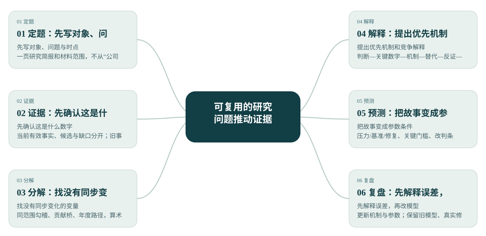
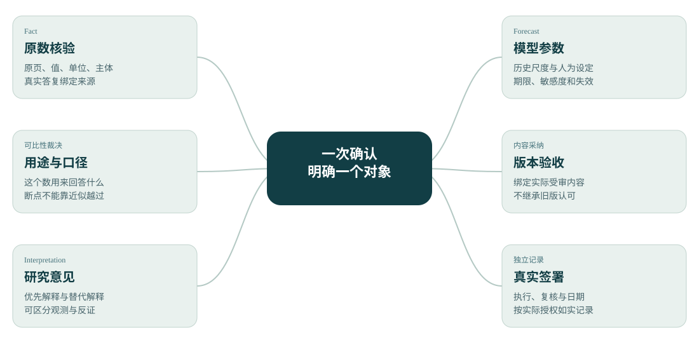

> 当前预测已按t−5基酒原量重算，见[图册V2.2](证券投资分析研究图册_V2.2.html#forecast)和[t−5计算路线](t5预测计算路线.md)。本文保留方法经验，旧预测数值以当前模型替代。

> 当前研究增强见[完整经营故事与合同回答V2.1](研究结论与合同回答_V2.2.html)及[图册V2.1](证券投资分析研究图册_V2.2.html)。本页保留原分析框架和经验。

# 投资分析系统与茅台研究：任务、框架与经验 V2.0

2026-10-25。研究方法与交付稿，不是新事实账本或签署。

茅台先投入原料与时间，经过生产、储存和勾兑，再通过经销与直销卖出。前面的积累能帮助形成产品，却需要后面的客户接受、费用控制和资金回收来兑现。我们现在最关心：新增供给能否以合适的组合价格卖出，并把收益留住。

## 第一次｜把数字放回原页

研究问题：2024年报中营业收入和归母净利润在哪里？

分析动作：定位合并利润表；核报告期、主体、单位、行列和脚注；候选与真实核验分开。

结论：建立公司规模与股东利润的最小起点，不解释经营原因。

疑问：第一次的两项事实不能代表完整商业模式。

成果：[阶段文件](first-analysis.md)；[图册章节](证券投资分析研究图册_V2.0.html#task01)。

## 第二次｜把收入拆成结构

研究问题：卖什么、在哪里卖、通过什么渠道卖？

分析动作：按产品、地区、渠道提取收入与匹配成本，保留合计、空白和原页；本阶段不算比率。

结论：茅台酒是主要收入来源；渠道是同一收入的另一切面。

疑问：跨维度不能相加；产品组不等于单SKU。

成果：[阶段文件](revenue-structure-table.md)；[图册章节](证券投资分析研究图册_V2.0.html#task02)。

## 第三次｜决定数用在哪里

研究问题：哪些收入和利润适合描述集团与母公司股东？

分析动作：并列口径、按研究用途选分母，保留被排除候选及真实修正。

结论：营业收入、营业总收入、合并净利润与归母净利润各有用途。

疑问：排除用途不是原数错误；合并现金配归母利润需另命名。

成果：[阶段文件](metric-scope-decision.md)；[图册章节](证券投资分析研究图册_V2.0.html#task03)。

## 第四次｜确认到底变了多少

研究问题：2024相对同报告比较期是否发生同口径变化？

分析动作：复核两期原值与可比性，再按公式核算变化；原值与变化账本分别维护。

结论：营业收入同比15.71%、归母净利润同比15.38%为已核变化。

疑问：增长本身不能说明品牌或提价；独立2023原报与2024比较列不混称。

成果：[阶段文件](change-verification-record.md)；[图册章节](证券投资分析研究图册_V2.0.html#task04)。

## 第五次｜拼出赚钱过程

研究问题：收入、成本、资本与现金怎样连在一起？

分析动作：四环取证，再用价值创造—交付—获取解释；并行综合稿和拆分稿保留版本差异。

结论：品牌产品、长周期供给和渠道共同解释价值获取；增长需要库存和时间的前置安排。

疑问：需求份额、真实生产成本、完整再投资及实体现金未识别。

成果：[阶段文件](task05-business-model-map.md)；[图册章节](证券投资分析研究图册_V2.0.html#task05)。

## 延伸｜生产库存销售

研究问题：今天生产、储存与扩产，怎样联系未来销售？

分析动作：2015/2016定义断点；库存勾稽；t+5并列；k=0…7与有效n；产能与项目时间桥。

结论：支持时间资本和前置供给；不支持固定“五年转化率”。G6历史有限意见按独立当前绑定读取。

疑问：分龄/等级、损耗勾兑、成熟量与释放安排缺失；2021—2025生产组未走完观察窗。

成果：[阶段文件](student-lag-check.md)；[图册章节](证券投资分析研究图册_V2.0.html#lag)。

## 延伸｜渠道净贡献

研究问题：直销拿回毛利后，净贡献是否增加？

分析动作：十年渠道面板；2022定义断点；midpoint分解；费用率窗口与主营/附注比较。

结论：2025正结构效应+0.3934pp，被渠道内−1.1771pp抵消；总渠道毛利变化−0.7837pp。

疑问：渠道归属费用、回款、履约与库存不足，净贡献方向Unknown；不按收入摊费用。

成果：[阶段文件](student-channel-conclusion.md)；[图册章节](证券投资分析研究图册_V2.0.html#channel)。

## 延伸｜现金与资本

研究问题：利润是否稳定兑现？成熟新增投入回报如何？

分析动作：同范围现金转换、现金余量；逐项选定资本；2008重分类桥；2012金融并表敏感性与年度路径。

结论：连续十年累计合并CFO/全部净利润94.14%；2007—2011代理回报年度波动，端点不能证明持续改善。

疑问：旧权威计算包16个有效年度、9年字段未齐；图册25年对读另有身份；实体FCFF/真实ROIC/成熟增量回报Unknown。

成果：[阶段文件](student-cash-conclusion.md)；[图册章节](证券投资分析研究图册_V2.0.html#cash)。

## 第六次｜把优势放进竞争

研究问题：在哪个市场竞争？品牌机制能解释多少？

分析动作：定边界、分阶段、识别矛盾、验逻辑、防风险；深入品牌五环与护城河三问。

结论：品牌是有解释力的候选；研究重点转向规模扩张后的价格承接与收益留存。

疑问：细分市场分母、当前同SKU实际成交、终端数据与独有壁垒仍缺；附件同业样本不是已核排名。

成果：[阶段文件](task06-industry-advantage.md)；[图册章节](证券投资分析研究图册_V2.0.html#task06)。

## 第七次｜让叙事接受反证

研究问题：“五项核心竞争力未变”究竟支持到哪一步？

分析动作：原话与机制分开；五标签分别裁决；支持/挑战/未决/替代/反证分栏；代理改名与结论降级。

结论：能力载体存在，不等于经济兑现程度不变；品牌与时间资本获得有限支持，不能打包裁定护城河。

疑问：P04四个受审文件冻结；新图册解释不继承旧认可。本次亲查条款差异与正式签署另列。

成果：[阶段文件](lec03-stage-deliverables.md)；[图册章节](证券投资分析研究图册_V2.0.html#task07)。

## 通用分析框架

### 01 定题 先写对象、问题与时点

客户/业务/证券层次；历史截止、后验观察、预测期；合同版本。

一页研究简报和材料范围，不从“公司优秀”直接跳“值得买”。

### 02 证据 先确认这是什么数字

当前原件与ReviewStore；单位、期间、主体、口径、行列和支持边界。

当前有效事实、候选与缺口分开；旧事实只核当前绑定。

### 03 分解 找没有同步变化的变量

收入对量价、利润对费用、产能对销售、利润对现金；先结构再归因。

同范围勾稽、贡献桥、年度路径，算术不命名为因果。

### 04 解释 提出优先机制和竞争解释

谁投入、谁支付、谁交付、谁负担风险；哪项证据能区分解释。

判断—关键数字—机制—替代—反证—下一步。

### 05 预测 把故事变成参数条件

由业务驱动连量价、毛利、费用、资本与现金，标参数来源与未建模项。

压力/基准/修复、关键门槛、改判条件；无概率依据就不配概率。

### 06 复盘 先解释误差，再改模型

新增报告与旧信息集分开；误差回到量、价、结构、费用和资金范围。

更新机制与参数；保留旧模型、真实修正和人工实际裁决。

## 协作经验与改进

### 把核验写成了研究结论

障碍：读者看到很多编号和限制，却不知道公司怎样赚钱、最值得担心什么。

改进：正文先给判断，再用两三组关键证据解释；原页与SHA放展开层。

检验：检验标准是：首次读者能复述核心机制、一个替代解释和一个改判条件。

### 把学习参考图误当成换皮

障碍：图多、配色像，并不能说明吸收了参考中的数据和推断。

改进：建立“参考问题—数据/统计量—本项目覆盖—新增内容—纠偏原因”表。

检验：按覆盖增量验收；九份成品分别记录吸收与拒绝迁移内容。

### 逐条核验拖慢协作

障碍：同来源相邻页被拆成反复问答，用户时间花在重复动作上。

改进：按同源、同期间、同单位、同主体组成通常6—10项批次；先冻结展示，再按真实答复提交。

检验：只补新增关键缺口，保留例外；沉默和催促进度不算确认。

### 历史认可被误读为新结论认可

障碍：原数、口径、研究解释、合同签署在自然语言中容易混在一起。

改进：四种确认单独记录；新来源或数值语义变化只定位受影响依赖。

检验：旧有效Fact复用；新解释不移植leo/lxy身份或旧采纳。

### 漂亮代理掩盖目标缺失

障碍：账面资本、公司出货、挂牌价容易被读者当成真实回报、终端需求或成交价。

改进：同时展示原目标、代理名称、允许用途、不能支持的结论和下一份区分证据。

检验：不合成伪精确需求/品牌指数；Unknown保留金额或影响范围。

### 只挑有利年份或最高相关

障碍：端点改善、高相关和单年现金好看，可能藏住中间波动、共同趋势和范围变化。

改进：并列完整可比窗口、有效n、分段和断点；先做勾稽与贡献分解。

检验：用年度路径、负例和替代解释挑战自己的故事。

### 预测缺少可讨论的中间桥

障碍：直接填总增长率，难说明为什么，也不知道将来错在哪里。

改进：由产品/客户数量×实现单价，再接毛利、费用、资本与现金；参数区分历史尺度和研究设定。

检验：复盘拆量、价、结构、费用、资本和金融影响，不只调增长率贴线。

### 入口越来越多、交接越来越长

障碍：多个“最终稿”与旧快照容易让接手者重新扫描或误用状态。

改进：一个稳定入口、版本指针、精简CURRENT；旧受审稿冻结，增量另版。

检验：首页直接指向下一研究问题、当前来源API和最少必读文件。

### 把底稿完成误当成正文完整

障碍：生产滞后合同4.1—4.3在底稿分散存在，但图册缺逐问回答；新合同在来源库却没有tasks版本入口，成果还未同步远端。

改进：按原文版本建立要求—答案—正文锚点—底稿—实际状态映射；抽查非列表问题和停止规则；正文、讲稿、归档与发布分别检查。

检验：以读者能找到具体答案为准；内容覆盖、事实有效、正式验收和发布成功分别给证据，不靠同一个“完成”混过去。

## 本次预测

我的优先工作判断是“先消化，再温和恢复”。它比直接延续历史高增长更贴近2025已见的量价、库存与费用变化。若后续同范围ASP保持、成品相对出货回落、费用效率改善，应向修复情景调整；若依靠持续降组合价与加费用才维持出货，应加大压力。

各年产品组销量Q=上年Q×(1+量增速)，公司组合ASP P=上年P×(1+ASP增速)；酒类收入=茅台酒Q×P+系列酒Q×P；公司营业收入=酒类收入+2025其他业务收入（固定）。酒类毛利率按年度pp变化；净利润桥=2025合并净利润+60%×[本年酒类毛利−2025酒类毛利−(本年销售费−2025销售费)]。其余税费、金融和未建模损益采用基期，60%是增量保留假设而非已核税率。CFO敏感性=条件净利润×设定合并转换率，不是实体经营现金或FCFF。

完整白话报告与图表见同名HTML，正式来源仍调用当前ReviewStore。
