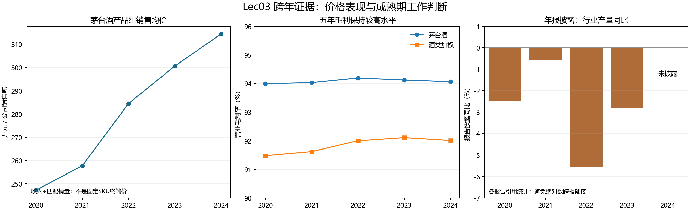
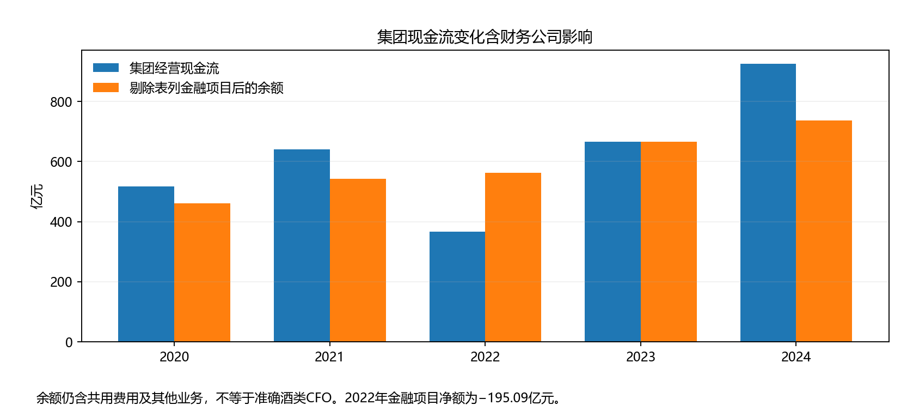

# 贵州茅台证券投资分析报告

状态：证据与研究草稿的确定性汇编；结论、预测和最终决定等待人工审阅。本版保存生成时的核验状态，后续复用需再次调用当前事实接口。

研究主体：贵州茅台；信息截止：Unknown（待确定）。

## 研究意见摘要

截至2024年，茅台酒的高毛利和增收能力保持，2024年增收更多体现为销量扩张；同时，直销组合均价和“21年飞天散瓶”现货价格走弱。因此，品牌支撑收益的解释可以暂定保留，但“品牌定价权全面持续增强”缺乏充分支持。

## 研究范围与依据

当前有效Fact 183条，Unknown 46条。事实有效性以当前核验接口为准；原值、计算、研究意见和假设分别保留。

## 商业模式与收入来源

原项目研究底稿：outputs/task05-business-model-map.md；SHA-256 83060b134626d67a469a52ea1955fe06816ba4e5f2233fcb0fe7c767bad78127。本节保留原文及其状态，来源有效性见当前接口，不因重新汇编新增核准。

# 贵州茅台商业模式四环节图与核验结果

执行/复核日期：2026-10-10。核心判断：公司酒类销售收入和高毛利有披露支持；品牌、渠道和储存如何形成长期超额净收益仍是待检验解释。年度合并现金受金融业务影响，不能用高利润或集团CFO直接证明轻资本模式。最终解释由人工敲定。

## 四环节图

~~~mermaid
flowchart LR
 R[收入：产品与渠道结构有披露] -->|销量与产品组ASP；纯价格效应未知| C[成本：对应销售成本和毛利]
 C -->|储存及扩产可能占资本；准确归属未知| I[投入：库存与三项目]
 I -->|回收有时间差；分部现金未知| F[现金：集团CFO含金融项]
~~~

箭头为研究顺序及待检验关系，节点所用数字见下表，不宣称完整因果成立。

| 环节 | 可以确认的输入/计算 | 可能关系与替代解释 | 不能确认及后续表附注 |
| --- | --- | --- | --- |
| 收入 | 2024营业收入1708.99亿元，茅台1459.28、系列246.84、其他2.87；合并总收入1741.44另含利息32.45亿元（C01/C03/C04，PDF63；N组PDF108） | 茅台组2023/24收入+15.28%、公司销量+10.22%、组ASP+4.59%（新增复算参考）；规格/渠道组合也能影响ASP | 行业需求和市场份额Unknown，不能用公司销售吨÷行业生产千升；同SKU净价与终端量待取 |
| 成本 | 茅台/系列销售毛利94.06%/79.87%，直销/批发代理95.33%/89.42%；原成本与收入见N组、M01计算和L03-A2024-B，PDF9/108 | 高毛利与组ASP、成本、销售组合相关；不能只归因品牌或规模 | 固定/变动拆分、准确生产成本和渠道净贡献Unknown；需成本构成、存货滚动及费用分配 |
| 投入 | 成品17,760吨、半成品292,248.02吨；披露储存至少五年；三项目本期投资26.14235亿元（L03-A2024-B/P，PDF14—15） | 时间/库存/设施可能为品质与供给配套，陈酿未必积压 | 实物吨非金额、项目非全部Capex；净再投资/增量销售资本效率停止，需存货价值/酒龄、在建工程与投入归属 |
| 现金 | CFO924.64亿元/合并全部净利润893.35亿元=103.50%；显式金融净额188.09亿元，剔除余额736.55亿元（L03-A2024-C，PDF64、66—67） | 2024公司说明现金增长同时受销售收款和成员资金归集影响（PDF9），自述不等于完整因果 | 剔除余额非准确酒类CFO；CFO−购建长期资产现金877.85亿元仅代理，非FCFE/FCFF；需现金补充资料及金融分摊 |

金额展示为亿元、四舍五入两位；精确人民币元/原值/公式/来源SHA见[核验底稿](../work/task05-business-model-checks.md)、[机器可复算结果](../work/20261010-recheck/results.json)及[原报告附录A](lec03-final-results.md)。本页原输入依据旧有效Fact；新增量价算术和趋势信号为Agent参考，未登记新的学生亲查Fact。

## 替代解释与反方

1. ASP上升可由产品规格、渠道组合和供给约束产生，不能单独辨认同款提价或品牌效应。需要同SKU、同渠道净价与终端销量。
2. 高毛利未扣完整期间费用、税费及资本成本，渠道差异也有商品组合干扰。需要同商品净贡献和直接经营资本。
3. 成品库存同比+26.99%是排查信号（2023/24年度B原披露），可能有储备/节奏/可售积压等不同解释；没有酒龄与价值资料，不选择一种原因。
4. 集团CFO高于净利润不证明酒类现金持续稳定：2022转换率56.14%，显式金融净额−195.09亿元；2024金融净額+188.09亿元。参见[年度变化](../work/yearly-changes.md)。

## 交给下一合同的具体问题卡

第六、七次原合同尚未提供，以下仅为研究交接，不宣布其完成。竞争分析应取得中国高端酱香白酒相同销售口径分母和同规格竞品价格/成本，回答价格溢价、销量韧性及费用资本后回报。叙事分析应核公司品牌表述和工艺安排，检验替代解释与模仿路径，观察同款净溢价、终端量、可售库存三项；当前没有自动预警阈值。

财务后续需核2023PDF86页会计政策变更及2022重述桥接，明确存货、合同负债、在建工程及现金补充资料的直接经营范围。未具备输入时不计算ROIC、完整FCF或预测估值。

## 执行与验收边界

四环节内容、过程和停止记录已完成。两份第五次原稿要求本任务新增事实学生本人亲查，本轮采用用户认可旧有效记录的方式，未发生新的本人亲查，严格该项仍待补；执行签署与新解释的人工敲定分开。原稿及旧历史没有改写。

执行人签署：lxy；复核人签署：lxy；日期：2026-10-10。签署由Agent依据本人明确聊天授权填写，为同人复核，不宣称独立审阅。授权见[evidence记录](../evidence/20261010-execution-authorization.json)。

## 2026-10-12 H01本人新增核验已完成

R2024-08已由本人在窗口确认，当前ReviewStore.facts()有效；2024PDF104页附注26预收货款：期末9,592,453,014.66元，期初14,125,755,802.29元；人民币元、合并口径、同2024报告比较列。窗口事件18，2026-10-12T20:28:01+08:00，保存核验名Leo，原样保留；本人聊天明确反馈核对一致及已在窗口确认。见[真实核验衔接记录](../work/h01-20261012/human-confirmation-receipt.json)。

它补收入确认/营运资本/现金问题，两份第五合同分别引用同一真实事件，不制造两次核验。余额差和−32.09%仍为Agent复算参考，不自动成为新增人工变化Fact；原因、需求和品牌不由本次确认推定。第七次本次新核验与最终裁决仍待补。

## 2026-10-14 两层商业模式增强（本轮草稿，未新增签署）

新增附件要求连接四环中的经营关系，再以价值创造、交付、获取解释它们。[当前研究计划与指标参数](../docs/20261014-指标与参数核验清单.md)引用原接口实时有效记录；新解释为Interpretation草稿，原签署仅覆盖原版本。

收入形成单位毛利，还要扣税费与组织投入；增长需要提前形成库存和产能，利润经过营运资本与投资才形成现金。2024平台收入下降与直销整体增长同时成立，不能由数字平台名称推定净价值回收。R2024-09—15已实际核原值，研发和税金合计仍待核；不能重复加商标费或第三方代收手续费。

价值主张：客户持续认可产品的支付意愿待验证。价值创造：生产/贮存和质量活动可能形成产品供给，也占用资本；库存增长仍有储备与积压替代解释。价值交付：批发、直销与平台有不同分工，渠道迁移不等于新增需求。价值获取：高毛利必须经过税费、费用、资本回报及实体现金验证，未具备输入不命名完整FCFF。

截至2024已采纳的品牌工作判断保持原范围；新2025收入转折及2026Q1恢复候选单独跟踪，未自动认可新机制。若同SKU净价/终端量/净贡献同步走弱，或库存和资本不能形成后续收益，应修改价值主张/交付/获取的具体解释。

后续第六七合同已实际提供并完成原映射节点；上文早期“未提供/待新亲查”为历史，不作为当前状态。新补充不改变原合同原件、真实核验或原签署日期。

## 成本、资本与现金回报

原项目研究底稿：outputs/channel-expense-capital-analysis.md；SHA-256 b3a6e481a0c13e3eb76277011698b6df55a471d8185aa586175ed5eb4e588fc2。本节保留原文及其状态，来源有效性见当前接口，不因重新汇编新增核准。

# 渠道费用、资本占用与净收益

更新2026-10-24。现有原数显示：市场拓展/商标使用支出增加，但销售、管理、研发三项费用合计的收入占比下降；不能仅凭销售费用上涨就认定整体盈利恶化。集团税后净利润仍增长，净利率略降；i茅台收入下降与直销整体收入增长并存。资本占用需要另算，渠道和纯品牌净利润仍缺直接归属。销售费用总额、市场推广及服务费已本人窗口核为Fact（R2024-09、R2024-10），广告费、商标许可费、i茅台平台收入、第三方手续费及管理费用合计已本人聊天核为Fact（R2024-11—R2024-15，leo）；B01补充八项原披露已由leo整批核为Fact（R2024-16—23，review27—34）；当前原数68项。新计算与解释不因原数核准而自动成为Fact。

| 合并指标 | 2023 | 2024 | 同比 | 原页 |
| --- | ---: | ---: | ---: | --- |
| 营业收入（亿元） | 1476.94 | 1708.99 | 15.71% | 2024PDF63/108 |
| 销售费用（亿元） | 46.49 | 56.39 | 21.31% | 2024PDF63/109/110 |
| 市场推广及服务费（亿元） | 28.14 | 37.45 | 33.09% | 2024PDF109 |
| 广告宣传费（亿元） | 13.66 | 13.35 | -2.27% | 2024PDF109 |
| 管理费用（亿元） | 97.29 | 93.16 | -4.25% | 2024PDF63/110 |
| 商标许可使用费（亿元） | 18.06 | 24.66 | 36.56% | 2024PDF110/128 |
| 研发费用（亿元） | 1.57 | 2.18 | 38.76% | 2024PDF63/110 |
| 合并全部净利润（亿元） | 775.21 | 893.35 | 15.24% | 2024PDF64 |

销售费用率＝销售费用÷合并营业收入：3.15%→3.30%；三项费用合计145.35→151.73亿元，增长4.39%，费用率9.84%→8.88%。销售费用增加的94.01%为同一2024报告比较列的市场推广及服务费增量；不把全部销售费用称为品牌维护费。管理费用中薪酬科目下降与商标许可增加同时列示，原因未核，不推定裁员或纯效率改善。

集团净利率＝合并全部净利润÷营业总收入，51.49%→51.30%，变化-0.19个百分点。这是包括金融/其他业务和少数股东的集团口径，不能贴给酒类、直销或品牌。商标许可使用费在管理费用和128页关联交易金额一致，44页明确使用母公司注册商标；上市合并主体的这项费用仍需扣除，不因关联方身份假设已在本合并范围抵销。

## 年度分类变化先桥接

2023原报110页广告宣传及市场拓展36.41亿元；2024报告109—110页的2023比较列改为广告13.66＋市场推广及服务28.14＝41.81亿元。两版2023销售费用合计均46.49亿元；合并类增加5.40亿元，恰等于旧其他减少5.23亿元＋旧运输0.17亿元。只确认金额桥接，逐笔改列路径Unknown。按2024报告同表比较得到市场推广及服务+33.09%、广告-2.27%，不得把2024广告13.35与旧合并36.41直接比作广告下降63%。

## 渠道和资本分别核算

i茅台收入223.74→200.24亿元，变化-10.51%；披露毛利率94.50%。44页贵州银行代收的第三方支付渠道手续费0.988205亿元（不是银行自身收入），除以该平台年度披露收入为0.49%：仅说明一项可定位成本的规模，不代表实际收费合同费率/净利润率；费用是否已列入销售或其他成本未知，不能再次扣除。直销整体不是i茅台，旧R2024-07及年度B渠道收入/成本继续使用其真实边界。

生产性存货账面余额430.72→512.49亿元，增加81.77亿元、18.99%；购建长期资产现金46.79亿元，均复用当前有效旧来源。资本存量、存量变化、资本现金与期间费用不混加。缺直销/批发费用归属和匹配经营资本，不能按收入比例分摊后冒称真实渠道净利润或ROIC。

## 已完成本人核验与下一项

R2024-09：2024本期5,639,300,059.49元／2023比较列4,648,613,585.82元，合并销售费用年度流量，已在原核验窗口确认。真实事件20、actor Leo、2026-10-13T13:19:33+08:00；[核验回执](../work/e04-20261013/human-confirmation-receipt.json)。不覆盖旧窗口身份，不把总额核验扩大到分项、渠道归属、费用原因或21.31%新运算。

R2024-10：市场推广及服务费两期原值已确认，事件21、actor Leo、2026-10-14T18:47:01+08:00；[真实回执](../work/e04-20261014/human-confirmation-receipt.json)。按2024报告同表本期／比较列复算，增加931,298,587.51元（9.31亿元），增长33.09%；占销售费用总增量94.01%。[输入绑定与精确运算](../work/e04-20261014/calculations.json)保留AgentCalculated状态，未自动写为新增变化Fact，不能据此确认纯品牌投入或增长原因。

R2024-11：广告宣传费已本人在聊天明确核为正确Fact，核验人leo，实际聊天保存为中性review事件22，不冒充窗口操作；[实际确认回执](../evidence/20261014-r2024-11-chat-confirmation.json)。原值复算减少30,963,632.86元（约0.31亿元），下降2.27%，新算术保持AgentCalculated。市场服务费增加与广告费减少同时存在，不把单个广告分项当全部品牌维护费用。

R2024-12：商标许可使用费两期原数已本人聊天确认，核验人沿用leo，中性review事件23；[真实回执](../evidence/20261014-r2024-12-chat-confirmation.json)。原数复算增加660,233,639.36元，即6.60亿元，增长36.56%；[精确运算与绑定](../work/e04-20261014/chat-r2024-12/calculations.json)为AgentCalculated，不自动核为变化Fact或品牌净贡献。

R2024-13：i茅台平台两期销售收入已本人聊天确认，核验人沿用leo，中性review事件24；[真实回执](../evidence/20261014-r2024-13-chat-confirmation.json)。原单位人民币万元：本期2,002,366.62／上期2,237,432.35。复算减少235,065.73万元（23.51亿元），同比下降10.51%；[运算及换算](../work/e04-20261014/chat-r2024-13/calculations.json)为AgentCalculated。平台收入不能替代全部直销收入，也不自动确认原表毛利率或品牌因果。

R2024-14：9,882.05万元已本人聊天核验，核验人leo，事件25；[真实回执](../evidence/20261014-r2024-14-chat-confirmation.json)。本人强调为贵州银行代收的第三方手续费，原文“代收代付”保留。银行自身收入、平台全部成本、合同费率及会计列支位置不能据此确认；[口径澄清SC16](../work/20261012-supplement/conflict-register.md)。与平台收入的描述性比例为0.49%，[精确复算](../work/e04-20261014/chat-r2024-14/calculations.json)保持AgentCalculated。

R2024-15：管理费用两期合计已本人聊天确认，leo、review事件26；[真实回执](../evidence/20261014-r2024-15-chat-confirmation.json)。同比下降4.25%为[Agent复算](../work/e04-20261014/chat-r2024-15/calculations.json)，不能推定费用下降原因。2026-10-14启动补充材料2学习与全合同优化；本轮B01补齐费用，下一批为B02数量与阶段定义。

完整原数、原页、分类桥接、公式及精确值见[计算底稿](../work/e04-20261013/calculations.json)。商标许可、平台两期收入及此项第三方手续费已核；管理／研发费用及税金及附加原数已补核；当前仍缺资本匹配及正式实体FCFF口径。按同来源和口径分批推进，不重复确认既有有效数据。

## 2026-10-22 B01八项原披露核验后的集中补充

B01八项16金额已由leo真实聊天确认，原披露review27—34；[真实回执](../evidence/20261022-b01-chat-confirmation.json)。本文件已更新待核提示，历史时点记录仍保留在原回执和归档中，当前以facts()为准。[税费与费用集中分析](../work/e04-20261022-b01/expense-analysis.md)给出销售明细精确勾稽、管理费用抵消、税费分解及毛利后分析小计；全部新运算为AgentCalculated。当前原数68项，不扩大为人工变化Fact或新签署。下一批见[B02](../work/review-batches/20261022-B02.md)。

## 支持哪些具体判断

1. 销售费用增加9.91亿元，其中市场推广及服务费增加9.31亿元，解释其净增额的94.01%。广告宣传费下降被其他分项增长抵消。四个销售分项在两期分别精确勾稽为合计，差额残差为0。该分解没有证明推广效果、需求或渠道归属。

2. 管理费用减少4.14亿元。职工薪酬费用减少6.53亿元，其他减少5.07亿元；商标许可使用费增加6.60亿元，剩余管理费用分项净增0.85亿元。不能据此认定裁员、效率提升或全公司人工成本下降。

3. 税金及附加增加46.92亿元，其中消费税增加38.64亿元，占其净增额82.36%。这不是所得税率变化或现金缴税变化的证明。

4. 税金及附加、销售、管理和研发四项合计较比较列增加53.30亿元；财务费用负值绝对额缩小，相应净收益减少3.19亿元（17.84%）。这五项在其他项目不变时合计使税前结果减少56.49亿元，不是实际税后利润归因。

## 2024年毛利之后的分析小计

营业收入170899152276.34元−营业成本13789482367.98元＝157109669908.36元；再扣税金及附加、销售／管理／研发共42099487067.73元，余115010182840.63元（1150.10亿元）。

不是报表营业利润、正式实体EBIT/NOPAT、渠道净利润或FCFF。加财务费用的变化仅为其他项目不变的税前算术影响；不把它称为净利润实际归因。

## 2026-10-22 B02数量定义与时间资本研究

B02六项原披露由leo确认，review35—40；B02节点原数39项（历史）。2016年16,168.33吨成品＋236,337.83吨半成品＝252,506.16吨独立报告总量，残差0；半成品占93.60%，为AgentCalculated。2015仅成品库存，不与2016含半成品总库存直接求同口径增长。

[生产库存滞后合同工作稿](student-lag-check.md)复用2020—2024有效年度组，按真实年份配对k=0…7，列每项n及实际年对；B02时尚缺年度；B03已补齐完整十年输入，旧样本保留在work/lag-20261022/history。2020—2024独立总量未单独核，分项相加不能当独立勾稽。工作稿给出N02/N05候选解释、替代解释和反证；新内容未自动继承旧采纳、教师批准或签署。下一批[B03](../work/review-batches/20261022-B03.md)。

## 2026-10-23 B03完整十年数量与后验变化

B03九项29数由leo真实聊天确认，review41—49，[回执](../evidence/20261022-b03-chat-confirmation.json)；原披露Fact48。完整十年半成品库存数量占比92.71%—96.66%，五组t+5数量/收入并列和两产品16项k诊断已完成；茅台酒k=6的r=0.9891仅n=4，不能据此认定六年成熟期。

2025后验：公司成品库存17,760.00→24,770.35吨，增加39.47%；两产品组公司销售/出货83,332.76→85,104.14吨，增加2.13%。成品库存增长快于出货是应核查库龄、包装/投放与需求的线索，不等于已认定积压或终端需求恶化。上述变化为AgentCalculated，2025不回填FY2024信息集。

[合同工作稿](student-lag-check.md)、[CSV](student-lag-diagnostics.csv)、[电子表格](生产库存销售滞后复算.xlsx)保留全过程。电子表格引擎已与Python核对10项占比、16项相关和5组收入，未冒称本人原生Excel操作。B03节点时2020—2024五个独立报告总量待B04；现已由leo确认，见[B04回执](../evidence/20261023-b04-chat-confirmation.json)；原成品/半成品不重复核。最终内容、资本回报、教师验收和新签署仍分开。

## 2026-10-23 B04完成独立库存勾稽

本人实际答复“B04全部核验正确，核验人leo”，原披露review50—54，B04节点有效原数53项（历史）。五个独立报告总量已接入模型与工作簿，FY2016—FY2025十年报告总库存减成品及半成品差额全部0吨，运算仍AgentCalculated。此前滞后相关、五组t+5及年度变化结果未变。

[七项B05](../work/review-batches/20261023-B05.md)已由leo确认原披露（review55—61），只覆盖产能和资本披露；设计能力与实际基酒产量、公司预计释放与实际实现、期末资产与年度现金分别处理。库存勾稽成立只证明数量一致，不能证明库存有经济价值或高资本回报。

## 2026-10-24 B05：第五次生产库存延伸合同G5

B05节点原披露Fact60（历史）；[B05真实回执](../evidence/20261024-b05-chat-confirmation.json)保留完整原话、leo身份及来源。当前是《第五次任务延伸合同：贵州茅台生产—库存—销售滞后验证》G5连接产能和资本投入，B05是批次号。

[G5连接分析](student-capacity-capital-bridge.md)已将设计能力/实际基酒产量、投产/预计释放、期末资产/年度现金分开，复算2024/25变化。原数确认不代表预计释放实现或资本回报获证。尚缺项目级转固、折旧、付款调节及销售现金映射；[B06八项](../work/review-batches/20261024-B06.md)现已由leo确认，可核数字连接已完成，[G6两项已获本人采纳](student-lag-conclusion.md)；未获证现金与实际释放归因保留Unknown。G6最终观点审阅和G0修订版映射/教师批准仍未完成。

## 2026-10-24 B06完成：G5可核数字连接与G6待采纳判断

G6节点原披露Fact68（历史），review62—69为leo真实聊天核验。固定资产净增616,675,557.21元与已核余额差一致；重要在建已列四项勾稽差额0元，空白保持空白。全部与重要项目转固列示差额544,875,347.29元不强行解释；同民坝跨年累计投资勾稽差额−0.01万元保留原数和Unknown原因。

[产能资本连接稿](student-capacity-capital-bridge.md)保留精确式、单位及绑定；[G6两项意见](student-lag-conclusion.md)已由本人采纳，仍为有范围Interpretation。长周期工艺、库存阶段和前置产能/时间投入有范围支持，不证明库存未来经济价值、独有壁垒、实际项目释放贡献或高资本回报。无新原数批次，无新签署，G0版本核对与最终验收另列。

## 2026-10-24 G6已采纳，转入渠道净贡献验证

本人真实答复“认可G6两项判断”，[独立回执](../evidence/20261024-g6-chat-adoption.json)与动态校验保留来源和计算语义。长周期生产/贮存机制及前置产能/时间投入的有范围Interpretation已采纳，未来库存价值、独有壁垒和项目高资本回报仍Unknown。研究成果与内容审阅已完成，正式教师材料/版本批准和最终验收未发生，不造签署。

2007/2010指定修订PDF与MD的配对技术检查已记录，数字集合相等不冒充全文一致，原件不改，2010单元格数字空白仅修复检索视图。下一份《第五次任务延伸合同：贵州茅台渠道净贡献验证》按[B07](../work/review-batches/20261024-B07.md)补五年主营渠道收入/成本；2020—2024复用有效组。渠道费用、回款和库存不足时净贡献Unknown，禁止按收入比例分摊费用。

## 2026-10-24 B07：十年渠道结构复算

B07节点原披露Fact73（历史），B07由leo真实聊天确认review70—74。主渠道2016—2025输入齐备，2020—2024有效组复用；[渠道工作稿](student-channel-net-check.md)与精确运算账本保留。2025直销份额50.09%，比2024提高6.2247个百分点；合计直接毛利率变化−0.7837个百分点，结构效应＋0.3934、渠道内毛利效应−1.1771个百分点。此为披露分类的代数分解，不证明因果或净贡献。

[B08](../work/review-batches/20261024-B08.md)一次补费用率有效输入、2022定义和2025附注范围。B07节点费用率完整年对n=1（历史）；B08现已补齐n=10并完成分段敏感性检查；不能把主渠道收入或营业总收入替代公司营业收入。2025附注含其他业务，与主营面板分开。按渠道费用/回款/库存不足，净贡献继续Unknown。

## 2026-10-24 B08：费用率及范围核对完成，转N03审阅

原披露当前Fact85，B08由leo确认review75—86。十年公司销售费用率输入齐备；全窗r=−0.2533(n10)、2016—2021 r=−0.5815(n6)、2022—2025 r=+0.9485(n4)，不能择段解释直销费用因果。2025销售费用率由3.2998%升至4.2961%，增加0.9963个百分点；未将公司费用全部归给直销。

2025合并附注较主营渠道收入/成本多63,517,327.14/86,377,431.32元，附注收入与独立公司营业收入勾稽差额0元。两个范围分开，[渠道完整工作稿](student-channel-net-check.md)保留全部原数、来源ID与公式。[N03意见](student-channel-conclusion.md)已获本人有范围采纳：结构正效应未抵消渠道内毛利下降；缺归属费用/回款/库存，净贡献增减方向Unknown。

## 2026-10-24 N03已采纳，转入现金与资本回报

本人真实答复“认可N03判断”，独立账本和动态校验保存实际采纳、原展示及数值语义，Interpretation不升级Fact，净贡献方向Unknown。原披露仍85，未造签署或教师验收。

[现金阶段性稿](student-cash-capital-check.md)已建立25年面板，当前完整合并现金有效年度2020—2024共5年，其余字段逐年保留未核；2025购建现金/公司营业收入已有Fact，独立复用。CFO减购建现金为算术观察，不是正式FCFF；金融行净额不等于完整财务公司贡献。下一步[B09](../work/review-batches/20261024-B09.md)补近十年现金/账面存货，随后按合同继续2007—2012资本代理和多年增量窗口，不用静态高ROIC或教师包结果代证。

## 2026-10-25 当前现金节点：B14已核，P02待审

上面2026-10-24转入B09的段落为历史进度，当前以本节及[现金计算工作稿](student-cash-capital-check.md)为准。B09—B14均已由本人实际确认；B14核验人leo、review125—131，原披露Fact130。当前完整合并现金基础为2012及2016—2025共11个有效年度，非连续11年，其他缺口显式Unknown。

| 2012合并观察 | 结果 | 含义 |
| --- | ---: | --- |
| CFO／合并净利润 | 0.8510084993倍 | 含少数股东的合并净利润，不是实体转换率 |
| CFO−购建长期资产现金 | 7,709,409,801.34元 | 算术剩余，不是FCFF/可分配现金 |
| 购建现金／营业收入 | 15.9208% | 原表购建现金，不是全部现金再投资 |
| 账面存货／营业收入 | 36.5360% | 账面元口径，不是实物吨数 |
| 基准／整行／明细利润公式÷平均选定资本 | 112.96%／110.41%／110.41% | 已含财务公司，均非实体ROIC |

2016—2025连续十年合并CFO519,175,618,319.76元、净利润551,522,210,638.18元，合计比0.9413503360；单年约0.5614—2.0887倍。2007／2011资本主窗、分类及2025调节保持原结果。2012汇兑本期原表空白保持null；财务明细与净额勾稽差0不等于汇兑披露0。不从剔现金的资本再扣金融子公司完整净资产，不把跨合并断点的比率变化归因为酒类新增回报。

[P02：N06／N07两项阶段性判断](student-cash-conclusion-review.md)现已集中展示支持、替代解释、反证和停止边界，待本人意见审阅；“多年合并现金支撑”与“稳定实体兑现”、“端点代理改善”与“成熟新增回报”分别判断。当前未获P02采纳，未正式验收或新签署。2008—2010中间年、经济范围/税率、净值/用途/期初、成熟再投资及金融抵销仍待必要补证，完整实体回报与分配现金Unknown。

[B14真实确认回执](../evidence/20261025-b14-chat-confirmation.json)；[精确运算与来源绑定](../work/cash-20261024/calculations.json)；[当前反馈与缺口](../docs/20261025-b14-progress.md)。新增分析经Decimal48/Fraction核对，旧工作簿只含截至B12基础公式，不宣称已包含B13/B14或原生Excel人工复算。

## 2026-10-25 当前进度更新：P02已采纳，B15待核

本人真实答复“认可P02两项判断”，N06/N07阶段性意见已独立采纳，详见[当前现金结论](student-cash-conclusion.md)和[真实回执](../evidence/20261025-p02-chat-adoption.json)。上面的P02待审段是历史节点。原披露Fact仍130，原现金/资本运算不变，未正式验收或新签署。当前[B15六项27金额](../work/review-batches/20261025-B15.md)补2008—2010利润与现金，候选尚未核，不入计算；资本范围、税率与成熟再投资等缺口继续保留。

## 2026-10-25 当前节点：B15已核，B16待核

B15由leo确认review132—137，原披露Fact136；2008/2009/2010现金转换1.3116/0.9277/1.1614倍，三年净利润勾稽差均0。完整现金为2008—2010、2012及2016—2025共14有效年度，非连续；原十年/2007—2011端点/2012敏感性数值保持。P02原意见认可保留，新增整包版本变化及未人审分析独立标明，详见[当前现金意见](student-cash-conclusion.md)。[B16六项26金额](../work/review-batches/20261025-B16.md)补中间资本与两端现金，未核不入计算；旧工作簿只截至B12基础公式。

## 2026-10-25 当前节点：B16已核，B17解决2008基期分类

B16由leo确认review138—143，原披露Fact142，完整现金为2007—2012及2016—2025共16有效年度，非连续。2007—2011五年合并CFO/净利润合计1.0557倍，购建现金仍非全部再投资；年度选定资本余额差与两端差勾稽0。发现预付/CIP在2007原报与2008调整后年初等额反向变化632,936,687.20元，候选政策说明已定位，入SC37；[B17两项三金额](../work/review-batches/20261025-B17.md)待核。相关2008平均/同口径NCWC变动暂止。P02原认可保留，新年度路径待桥接后集中评估，未新增意见认可/签署/正式验收。详见[当前计算](student-cash-capital-check.md)与[当前意见进度](student-cash-conclusion.md)。

## 2026-10-25 当前节点：B17已核，P03一项增量意见

B17由leo确认review144—145，原Fact144；2008期初重分类桥接完成，平均选定资本4,283,583,760.875元，选定NCWC同报账面变化−902,975,871.48元，对跨报原值差−270,039,184.28元，差−632,936,687.20元。原值/两算法保留，分类调整不是现金释放。2007—2011基准代理依次86.42%/93.49%/89.26%/80.78%/116.84%，不是实体ROIC。当前[P03只审一项年度路径增量判断](student-cash-path-review.md)，旧认可不重复；[合同完成/停止账本](student-cash-contract-status.md)分清会计算术完成、真实指标Unknown、意见和正式验收待完。

## 2026-10-25 当前节点：P03已认可，新版第六七增量待审

本人真实答复“认可P03判断”，年度路径Interpretation已独立采纳，原Fact144及会计算术保持，真实经营ROIC/成熟回报仍Unknown、正式验收另列。当前[现金意见](student-cash-conclusion.md)和[逐条账本](student-cash-contract-status.md)已更新。新版第六七已补2024费用原数及21.31%/33.09%同比、五标签独立机制与替代解释、代理正名及财务交接，费用原数不当纯品牌成本，旧范围/判断和来源复用；[P04只审两项增量内容](../docs/20261025-task06-task07-review.md)，无新数字需核。

## 行业、竞争与优势

原项目研究底稿：outputs/task06-industry-advantage.md；SHA-256 cec803f66e6fe17a76501e98cf7d9f7207fc1adbfe964e6e11d542e10ad3d9d1。本节保留原文及其状态，来源有效性见当前接口，不因重新汇编新增核准。

> 2026-10-13当前研究意见：本人已认可修订后的判断并授权写入。截至2024年，茅台酒的高毛利和增收能力保持，2024年增收更多体现为销量扩张；同时，直销组合均价和“21年飞天散瓶”现货价格走弱。因此，品牌支撑收益的解释可以暂定保留，但“品牌定价权全面持续增强”缺乏充分支持。 这是本人采纳的Interpretation，数字来源/计算与机制判断分别记录；旧待裁决文字保留为历史。[真实采纳记录](../evidence/20261013-research-opinion-adoption.json)。

# 贵州茅台行业竞争与竞争优势（第六次）

2026-10-12。结论范围：公司高毛利、产品组销量与均价表现支持品牌候选优势的研究价值；现有附件还不能确认高端酱香生命周期、市场份额、品牌独立因果或未来持续年限。新增市场报价给出了应主动复查的挑战，不能只挑公司有利数字。2026-10-13本人已采纳本版研究范围：大陆高端酱香为主、飞天53度500ml为重点、其他高端白酒作替代对照；价格带/客户分布仍Unknown，优势机制与最终结论另待人工。真实答复见[范围采纳记录](../work/20261012-supplement/market-boundary-acceptance-20261013.json)。

## 行业竞争五步

| 步骤 | 具体问题、当前边界/判断 | 依据、缺口与动作 |
| --- | --- | --- |
| 定边界 | 本人已采纳中国大陆高端酱香为主要研究范围，飞天53度500ml为重点样本，其他高端白酒作替代对照；海外另列，整体公司/产品组及金融边界继续分析 | 2024酒类产品/渠道披露、CSV对应产品名。价格带数值边界、客户场景分布和可比竞品清单Unknown；需相同净价层级的区间与实际客户/地域定义，不能以品牌身份替代分母 |
| 分阶段 | 宽白酒存在存量竞争/调整的解释线索；高端酱香具体阶段Unknown，未预设成熟/衰退 | 旧年度I公司自述不是独立行业分母；新白酒产量报告负同比仍有基数冲突，宽行业不等于细分消费。需同范围需求/渗透/进入退出/集中度序列 |
| 核心矛盾 | 公司取得的价格和收益能否持续，价值究竟归公司、渠道还是消费者？扩张是否增加资本占用？ | 第五次四环图有毛利/库存/项目/现金，缺固定SKU净价、渠道净贡献、终端销出与分部资本回报；市场价格高不等于公司保留全部收益 |
| 验逻辑 | 品牌假设应伴随同SKU净溢价、提价后终端量/份额韧性、费用资本后相对收益 | 公司组ASP2024+4.59%，销量+10.22%；21年散瓶行情候选2023末2810→2024末2400，-14.59%（不同对象）。高毛利非纯品牌识别；需同SKU/同层级/同业证据 |
| 防风险 | ①同字段净报价与价差持续收窄；②终端销出/可售库存恶化；③维护投入/金融现金剔除后回收不足 | 不设无依据阈值，不称日频先行。①先补取价单位/样本，②CSV成品标签与年报分类冲突、缺终端量，③集团CFO受金融项影响；触发复查时不自动产生买卖指令 |

完整取证、原行/页和停止理由见[第六次底稿](../work/task06-industry-advantage-checks.md)、[附件数据审查](../work/20261012-supplement/data-guide.md)及[修正冲突登记](../work/20261012-supplement/conflict-register.md)。高端酱香没有同口径分母，本轮没有计算市场份额或同业利润排名。五粮液普5与飞天的不同香型/度数/年份不得视为同SKU净溢价识别。

## 深入检验一项候选优势：品牌

| 环节 | 当前证据状态 | 替代/反证及待补 |
| --- | --- | --- |
| 来源 | 公司把品牌列为五大核心竞争力之一，旧本人披露Fact M01-D01，2024PDF8页 | 品质、工艺、环境和文化共同作用；品牌排他心智及付费意愿未直接测量 |
| 机制 | Interpretation：品牌认可可能降低价格敏感度并帮助公司保持价格/销售与收益 | 稀缺供给、陈酿、规格/渠道组合也能解释；市场溢价可能归中间渠道 |
| 结果 | 旧年度B五年公司产品组ASP/量、高毛利；新增特定SKU报价候选存在下降 | 支持公司盈利表现；没有同商品终端量和费用资本后净超额收益，不能量化纯品牌大小 |
| 壁垒 | 至少五年储存/勾兑是旧披露Fact，时间和品质配套为解释 | 竞品库存储备、替代消费、绕开路线与消费者忠诚Unknown，不断言不可复制 |
| 反证 | 同SKU相对净溢价走弱、提价后终端量相对下降、资本/营销投入吞噬收益 | 数据方向只是复查标准，未证实全部风险发生；价格下跌不自动否定品牌存在 |

| 护城河三问 | 现有支持 | 目前能否确认 |
| --- | --- | --- |
| 多大 | 公司组毛利约94%、公司销量和ASP统计 | 相对同行费用资本后超额收益Unknown，不把组高毛利直接当品牌溢价百分比 |
| 多久 | 五年公司观察窗、储存安排；特定年份报价在2024有下降候选 | 未来持续年限Unknown，旧暂定判断需纳入新挑战 |
| 扩大规模能否保持 | 公司产品销售扩张，系列酒、渠道结构不同 | 增量净回报与分部投入Unknown；不能从规模增长推无成本扩张 |

## 新增证据或完整缺口

新行业分母/同业比较缺口已完整登记：已查CSV六批538序列及旧年报行业页，缺高端酱香终端需求量/收入、取价单位/定义、可比公司财务及真实公开日；宽行业和产量无法替代。按第六次允许的完整缺口路径交付，新CSV算术不冒充新学生Fact。库存分类冲突连续五年有数值交叉，原件保持。

## 交第七次

选2024PDF8页公司品牌原表述M01-D01，拆成“品牌认可→支付意愿→净价/量→公司费用资本后收益→可复制性”命题。支持为旧公司销量/ASP/毛利，挑战为特定行情下降、渠道结构、库存及资本现金；缺口为同SKU终端量/净溢价/行业分母/模仿路径。第七次将支持、挑战和未决分栏并写最大可辩护表述。

本轮执行人签署：lxy；复核人签署：lxy；日期2026-10-12。Agent按本人继续此前要求的真实授权填写，同人复核；签署不冒充新CSV亲查、教师批准或新机制最终采纳。

2026-10-13价格口径更新：本人确认S005977087为人民币元/500ml瓶，并说明其反映市场上可交易的现货价。历史行按观测期解释；同字段年末2810→2400、Agent变化-14.59%可作价格端挑战，不能据此单独识别终端量或净品牌因果。其他价格字段/买卖侧/样本/税费仍缺。第七次新亲查准备条目R2024-07，真实确认前不关闭T7-3。

## 2026-10-14 补充材料2研究增强（Agent草稿待人工内容审阅）

本轮把管理层原话、市场研报叙事与研究者机制解释分开。R2024-09—15实际核验补齐费用与平台收入/第三方手续费；第六的行业分母、同SKU相对差异、终端需求与复制壁垒仍Unknown。A主动出清、B核心产品韧性、C渠道重构与D结构性需求为新读本提供的竞争假说，不能用44份研报重复或后续观点证明2024机制。

两层商业模式说明嵌入[第五次原成果](task05-business-model-map.md)；当前引用/反证/资本现金边界及下一项参数见[方法与补证清单](../docs/20261014-指标与参数核验清单.md)。原内容采纳仅限此前实际版本；本轮增强、新2025—26候选未新增Fact、内容认可或签署。旧“待采纳/未提供”段为历史，当前节点以[学习反馈](../docs/20261014-supplement2-feedback.md)与真实接口为准。

## 2026-10-25 新版合同增量接续

本节对应2026-10-21版第六合同，旧2026-10-12签署与2026-10-13范围/意见采纳只保留其原版本，不移植为新版签名。继续沿用已采纳“中国大陆高端酱香为主、飞天53度500ml为重点、其他高端白酒作替代对照”的研究边界和品牌候选，不重复让本人选题。细分阶段仍Unknown，无同口径分母时不算份额/同业排名。

### 只补费用与收益归属的当前证据

| 2024合并原文项目 | 2024金额（元） | 2023比较金额（元） | 当前来源 |
| --- | ---: | ---: | --- |
| 销售费用 | 5,639,300,059.49 | 4,648,613,585.82 | R2024-09，年报物理109—110页 |
| 市场推广及服务费 | 3,745,440,527.81 | 2,814,141,940.30 | R2024-10，年报物理109页 |

AgentCalculated：销售费用同比21.31%，市场推广及服务费同比33.09%；销售费用/同年合并营业收入3.2998%（分母C01：170,899,152,276.34元）。费用为公司整体，不分摊给特定渠道/品牌；市场推广服务费不当全部品牌维护成本或供应商“广告费”单字段。高毛利仍须经过费用及资本检验，不能直接当纯品牌净超额收益。

当前R2024-07仍有效，2024直销收入74,843,327,030.79元、营业成本3,493,952,839.59元，Agent会计毛利率95.33%；它不包含完整渠道费用/回款/资本归属，不能改称净贡献。管理层原话M01-D01、公司组观察L03-A2024-B、现金组L03-A2024-C均已通过当前独立API复核。依据及运算见[当前核对底稿](../work/task67-20261025/current-inputs-and-calculations.json)，不新增Fact或人审事件。

### 新版五步法和证据缺口处理

上面的五步表、品牌五环节与护城河三问继续为实际提交内容。将费用和价值归属补入“核心矛盾/验逻辑”：同SKU净溢价、终端量/同口径份额、费用与资本后的相对收益须相互匹配。风险仍只跟踪三组：①同对象现货净价/相对价差，②终端销出/可售库存，③同范围费用资本后现金回收；材料不齐时不设无依据阈值，不合成指数。

独立行业缺口路径继续保留：已登记的CSV六批及原年报行业页缺大陆高端酱香需求/销量分母、进入退出/集中度、同SKU净价和可比公司完整口径。宽白酒产量的两种同比口径分别保留，不能顶替细分市场。公司增长或高毛利不据此升级为行业阶段/品牌独立因果Fact。本节不冒称新增独立行业材料。

### 代理名称与交第七次

S003840406仅称“公司产品库存总量”，不是成品/渠道库存；供应商广告字段称“广告宣传及市场推广合计”，不与年报市场推广及服务费自动等同；三条iFinD基酒字段注明百吨级约数，不覆盖年报精确吨数。既有S005977087可交易现货与新包京东挂牌序列分开，精确SKU净实现价/终端需求保持Unknown。

交第七次的问题仍是“品牌认可能否通过同对象净价/量留存到费用和资本后的收益”。支持用公司组量/价/毛利，挑战加入公司费用、现货层级差异与渠道组合；替代解释包括品质、稀缺供给、酒龄及规格/渠道结构。G6/N03/P03已采纳成果用于方法和财务问题交接，其2025后验或其他年案例不回填本任务2024因果。新版内容审阅与严格亲查条款兼容性/正式签署另列。

## 管理层叙事与反证

原项目研究底稿：outputs/lec03-final-results.md；SHA-256 f6ec6fa8cc9198e61676e021bbc060c2deeef4f40bebb060b2afe82b95fc2a73。本节保留原文及其状态，来源有效性见当前接口，不因重新汇编新增核准。

> 2026-10-13当前研究意见：本人已认可修订后的判断并授权写入。截至2024年，茅台酒的高毛利和增收能力保持，2024年增收更多体现为销量扩张；同时，直销组合均价和“21年飞天散瓶”现货价格走弱。因此，品牌支撑收益的解释可以暂定保留，但“品牌定价权全面持续增强”缺乏充分支持。 这是本人采纳的Interpretation，数字来源/计算与机制判断分别记录；旧待裁决文字保留为历史。[真实采纳记录](../evidence/20261013-research-opinion-adoption.json)。

> 2026-10-13最新：本人指出旧结论含糊，Agent已补数字和分层判断，见文末结论细化；当前新表述尚待人工采纳，旧审核范围/有效Fact不扩大。

> 2026-10-12补充研究入口：[第六次行业/优势](task06-industry-advantage.md)、[第七次审计底稿](../work/task07-narrative-audit.md)、[修正冲突登记](../work/20261012-supplement/conflict-register.md)。下文原报告和此前本人审核保留；新价格/行业/库存冲突进入现有矩阵及五项成果，新增解释待本人最终采纳，不能把旧章节核准扩大到新内容。

# Lec03最终研究结果与验收依据

**任务内容已完成并按本轮授权验收。** 本人已审核通过上一版第3节品牌逻辑、第4节数据及三路径资本现金解释；本轮由Agent核准2020—2024年报补证、计算与完善内容。本人暂定行业为成熟期，补证后的工作判断为“成熟期，以存量竞争、结构升级为主，叠加调整周期”。研究判断均为 **Interpretation**；执行人、复核人与签署按此前约定留空。

## 1. 三个问题的直接回答

| 维度 | 结论 | 对实际研究的含义 |
| --- | --- | --- |
| 品牌定价权M01 | 暂时认定有效，五年证据加强该解释；持续性与纯品牌因果尚未完全识别 | 保留品牌作为主要优势主张。成本路径证据不足不自动否定品牌路径；后续用同款净价、终端量及净收益反证 |
| 商业模式B01 | 收入、营业成本能区分酒类、其他业务及金融业务；资本能列直接归属项目，现金能剥出表列金融影响 | 已完成三路径分析及现金桥接。没有完整分部报表的资本/费用/现金列为未分配，不按收入占比虚造酒类ROIC或CFO |
| 行业竞争I01 | 广义白酒采用成熟期工作判断，并存在结构升级与调整周期；茅台内部量价与毛利表现具有韧性 | 研究重点转向溢价维护、竞争替代、库存与资本效率。未取得竞品/细分分母，不把公司增长写成市占率提升或高端酱香生命周期Fact |

信息截止教师指定2024年报版本；使用2020—2024五份原报的当期数据，不混入后来经营结果。本人本轮扩大材料与操作边界，现金分解作为明确授权的补充分析，原教师条款仍保留在[任务合同](../tasks/05-lec03-business-model.md)。本报告不形成估值或证券买卖Decision。

## 2. 品牌：五步链条及持续表现

| 环节 | 本轮结论与证据 | 替代解释、反方证据与支持边界 |
| --- | --- | --- |
| 优势来源 | Interpretation：品牌认知与消费场景认可；Fact：公司明确把品牌列为核心竞争力（D01） | 品质、工艺、环境和文化共同作用；消费者忠诚及支付意愿尚未直接测量 |
| 影响机制 | Interpretation：品牌认可→支付意愿/较低价格敏感性→价格及真实需求→公司保留收益 | 品质、稀缺供给、规格升级、渠道组合可解释表现；公司销售量不是终端售出量 |
| 可观察结果 | Fact：2020—2024茅台酒产品组均价与公司销量均增加，毛利率持续约94%；年度结果见下表 | 产品组统计没有固定SKU；毛利未扣全部期间费用、税费及资本成本，不单独识别品牌因果 |
| 模仿壁垒 | Interpretation：长期品牌心智，品质/储存/勾兑的配套；Fact：连续五份年报披露五年储存及跨年份勾兑安排 | 时间与资本门槛具有合理性；工艺独有性、竞品储备和绕过路径Unknown，不能断言不可复制 |
| 反证条件 | Interpretation：同款净溢价持续收窄、提价后终端量相对下降、维护费用/库存资本吞噬收益或替代品被同等接受时重评 | 检验同规格、渠道、地区与时点，区分正常陈酿和可售品积压；不声称风险已经发生 |

| 年度 | 茅台酒收入（亿元） | 公司销量（吨） | 均价（万元/销售吨） | 茅台酒毛利率 | 系列酒毛利率 | 酒类加权毛利率 |
| --- | --- | --- | --- | --- | --- | --- |
| 2020 | 848.31 | 34312.53 | 247.23 | 93.99% | 70.14% | 91.48% |
| 2021 | 934.65 | 36261.31 | 257.75 | 94.03% | 73.69% | 91.62% |
| 2022 | 1078.34 | 37901.39 | 284.51 | 94.19% | 77.22% | 92.00% |
| 2023 | 1265.89 | 42109.50 | 300.62 | 94.12% | 79.76% | 92.11% |
| 2024 | 1459.28 | 46412.95 | 314.41 | 94.06% | 79.87% | 92.01% |

均价=匹配产品组销售收入÷公司销量÷10,000；毛利率=(收入−对应营业成本)÷收入。原币种人民币元，均价展示万元/销售吨；计算用原值，展示统一四舍五入到两位。2020—2024茅台酒收入累计增长72.02%、销量增长35.27%、产品组均价增长27.17%。这是公司产品组名义表现，未控制规格/酒龄/渠道，不解释为纯提价或纯品牌价值。

茅台酒毛利率五年稳定于约94%，系列酒毛利率上升，酒类加权毛利率亦保持较高水平。这比单一年份更支持“价格收益和利润空间得以维持”的解释，但仍不是全费用后利润、资本回报或消费者忠诚的直接测量。

已有2023—2024成本核验表仍有效：茅台酒单位销售成本上升、基酒产量下降，不能支持简单规模经济路径；生产成本桥接依赖五项假设，真值仍Unknown。参见[成本报告](m01-scale-and-production-cost.md)。不把营业成本/生产吨当作同年实际生产单位成本，也不把品牌优势绑定为必须同时有成本下降。

## 3. 商业模式：业务分开，三路径落到资本与现金

### 3.1 收入与营业成本的业务边界

2024年合并收入、对应营业成本（亿元）如下；精确元值在本人已认可的[整合分析第4节](lec03-integrated-analysis.md#4-b01分开收入成本资本占用与现金转换)：

| 对象 | 收入 | 营业成本 | 处理 |
| --- | --- | --- | --- |
| 酒类 | 1,706.12 | 136.30 | 分为茅台酒与其他系列酒；其他系列酒仍属于酒类 |
| 其他业务 | 2.87 | 1.59 | 酒店与冰淇淋等业务，未硬拆各自费用/资本/现金 |
| 商品及服务营业收入合计 | 1,708.99 | 137.89 | C01范围，不加入财务费用抵减的利息收入 |
| 金融业务利息收入 | 32.45 | 金融支出单列，未作为上述营业成本 | C04组成项；不是酒类收入，不可独立代表全集团收入 |
| 营业总收入 | 1,741.44 | 不与营业成本作无差别对应 | C03范围，保留不同收入定义 |

产品与渠道是同一酒类收入的不同切面，不能相加。渠道金额采用酒类表，避免混入第108页全营业收入的其他业务。2024第16页万元显示值与第9页直销精确元值相差69.21元，两版原值均保留；本轮跨年渠道均价采用“渠道精确元值÷本期渠道销量”，不覆盖此前已人工认可的万元表计算。

### 3.2 渠道：价值获取增强，但净利润仍要扣费用

| 年度 | 直销酒类收入占比 | 直销毛利率 | 批发代理毛利率 | 直销均价（万元/销售吨） | 批发代理均价（同单位） |
| --- | --- | --- | --- | --- | --- |
| 2020 | 13.96% | 95.62% | 90.80% | 336.73 | 135.69 |
| 2021 | 22.66% | 96.12% | 90.30% | 418.94 | 135.13 |
| 2022 | 39.89% | 96.20% | 89.22% | 441.41 | 130.54 |
| 2023 | 45.67% | 95.46% | 89.29% | 430.02 | 138.77 |
| 2024 | 43.87% | 95.33% | 89.42% | 410.73 | 147.09 |

Fact：直销酒类收入占比由2020年的13.96%上升至2023年的45.67%，2024回落为43.87%；2024直销毛利率95.33%，高于批发代理89.42%。Interpretation：企业可借直销提高对消费者的触达和对渠道利润的获取。对照是2024直销占比、组均价及毛利率均回落，不能认定直销扩张永远提高收益。

两渠道组没有控制相同产品组合；直销还承担推广、履约和服务投入，因此毛利差并非同款渠道净贡献差。回款条款、退货和经销商库存未单独披露，本轮不填写虚构的回款天数或“先款后货”Fact。

### 3.3 资本：能直接识别项目，尚不能精确拆出分部存量

Fact：2024第14页列示3万吨系列酒配套项目、习水同民坝一期及茅台酒十四五建设项目，当期投入分别为12.195468、8.332528、5.614354亿元，合计26.14235亿元。这些项目可直接归属酒类，证明增长同时需要先期资本投入；它们是所列项目当期投资额，**不是全部酒类资本支出、资产存量或集团现金表资本支出**。

Fact：五份年报连续披露茅台酒至少五年的工艺储存安排，并说明跨年份/轮次/浓度基酒勾兑。储存造成生产投入与销售结转的时间差，也使新进入者需要时间和资金储备；独有壁垒仍需竞品对照。实物库存如下，不能以吨直接转为账面资本，也不能以全部存货认定全部酒类投入资本。

| 年度 | 成品酒（吨） | 半成品酒含基础酒（吨） | PDF页 |
| --- | --- | --- | --- |
| 2020 | 8314.11 | 240921.41 | 12 |
| 2021 | 10282.35 | 250463.82 | 13 |
| 2022 | 12495.28 | 264127.89 | 14 |
| 2023 | 13985.07 | 279804.96 | 15 |
| 2024 | 17760.00 | 292248.02 | 14 |

Interpretation：半成品储备与工艺时滞相容，成品酒增加值得跟踪，但正常陈酿不等于滞销，增加亦不能直接认定渠道积压。酒店、冰淇淋、金融及共享资本继续列“未分配”，详细分部ROIC/周转待有成本和资本归属数据后再算。

### 3.4 现金：集团表现与酒类表现须分开

下表金额为亿元；现金转换分母使用**合并全部净利润（含少数股东）**匹配集团CFO。C09在此可作集团现金转换分母，但仍不能替代C02归母净利润用于股东盈利分析。各年用当年原报当前列，2022原报与2023重述比较数不暗中混接。

| 年度 | 集团CFO | 表列金融项目净额 | 剔除表列金融项目后的余额 | 购建长期资产现金 | CFO减该支出 | CFO/集团净利润 |
| --- | --- | --- | --- | --- | --- | --- |
| 2020 | 516.69 | 54.85 | 461.84 | 20.90 | 495.79 | 104.33% |
| 2021 | 640.29 | 98.50 | 541.79 | 34.09 | 606.20 | 114.91% |
| 2022 | 366.99 | -195.09 | 562.08 | 53.07 | 313.92 | 56.14% |
| 2023 | 665.93 | 0.48 | 665.46 | 26.20 | 639.73 | 85.90% |
| 2024 | 924.64 | 188.09 | 736.55 | 46.79 | 877.85 | 103.50% |

表列金融项目净额=客户存款和同业存放净增加额+收取利息/手续费/佣金现金−客户贷款及垫款净增加额−存放央行和同业净增加额−拆出资金净增加额−支付利息/手续费/佣金现金。剔除余额=集团CFO−上述净额，且另以销售收款、退税、其他经营收款减采购、职工、税费及其他经营付款交叉算得，两条路径精确勾稽。

**剔除余额仍包含其他业务及共用费用、金融业务分摊薪酬税费等，不是准确酒类CFO。** CFO减购建长期资产现金只是简化现金代理，不是完整FCFF/FCFE，亦不代表可全部分配的现金。

2022集团CFO仅366.99亿元，表列金融项目净流出195.09亿元，剔除后的余额562.08亿元；2023前述金融项目净额接近零，2024净流入188.09亿元。Interpretation：2022低现金转换不能直接归因于酒类品牌失效，2024强CFO也不能全归因于品牌收现。公司2022第8页、2023第9页、2024第9页分别解释吸收存款减少/同业存款增加、不可提前支取存款净增加减少、成员单位资金归集增加，独立现金分解与该叙事相容；公司原因解释仍不是完整因果证明。

三条路径的最终判断：**品牌**有价格和较高毛利线索，但维护费与实际净收益另检；**渠道**提供触达和价值分配能力，但组合与履约投入必须控制；**储存**支持品质和供给时滞，同时带来库存、资本及现金占用，不以时间长自动证明护城河。三路径互相配合，没有把同一收益重复归因。

## 4. 行业：按五步给出成熟期及竞争位置结果

### 定边界

行业阶段先回答年报有证据的“全国规模以上白酒”广义范围；茅台酒/高端酱香属于公司研究工作边界，不能把广义统计当细分市场数据。公司销量单位吨，行业产量万千升，且一个是销售、一个是生产，不能直接相除为份额。公司、经销商及终端用户也须分别识别。

### 分阶段

**Interpretation：采用成熟期（存量竞争、结构升级），叠加调整周期。** 本人作出暂定成熟期判断，Agent以五年报告补证。下面是每份报告各自引用的原披露，不是已桥接一致的时间序列：

| 年度 | 产量（万千升） | 收入（亿元） | 利润总额（亿元） | 原报产量同比 | 原报收入同比 | 原报利润同比 | PDF页 |
| --- | --- | --- | --- | --- | --- | --- | --- |
| 2020 | 740.73 | 5836.39 | 1585.41 | -2.46% | 4.61% | 13.35% | 12 |
| 2021 | 715.63 | 6033.48 | 1701.94 | -0.59% | 18.6% | 32.95% | 13 |
| 2022 | 671.24 | 6626.45 | 2201.72 | -5.58% | 9.64% | 29.36% | 14 |
| 2023 | 449.2 | 7563 | 2328 | -2.8% | 9.7% | 7.5% | 14 |
| 2024 | 414.5 | 7963.84 | 2508.65 | 未披露 | 未披露 | 未披露 | 14 |

证据路径：2020—2023四份报告披露产量同比均为负，和规模快速扩张的简单成长期解释不相容；同期收入及利润同比为正，与“总量承压但价值升级/头部集中”的解释相容。2020第16页描述市场向头部集中，2021第16—17页描述产销趋稳、向优势品牌/企业/产区集中，2022第18页强调马太效应，2023第19页明确2016年以来进入存量竞争，2024第20页提出宏观与产业调整双周期。这些跨年表述与数量信息一起，较强支持广义成熟期工作判断。

反方与边界：收入利润增长说明成熟并不等于全面衰退；高端酱香可能有不同细分阶段；宏观调整可能是周期因素。上述是同一家公司年报引用国家统计局/酒业协会并作出的叙事，五年重复披露不是五个独立研究来源。缺少终端消费、同口径企业数/集中度和进入退出资料，生命周期没有升级为Fact。

### 找核心

成熟期核心问题转为：公司能否以品牌支持支付意愿，以渠道获取价格收益，并承担多年储存和先期扩产占用，从行业价值分配中保持收益？茅台酒五年公司量价及毛利表现比“行业是否总量扩张”更直接；行业收入利润增长也可以来自价格、结构和头部集中，不证明全体企业同样受益。

### 验逻辑

公司2020—2024茅台酒销量与产品组均价均增加，毛利持续约94%，因此采用“在成熟行业背景下具有品牌相关的内部竞争韧性”Interpretation。2024直销占比下降、单位销售成本上升、资本及存货增加是约束条件；未有竞品净价、终端量和匹配分母，不能认定份额增长、成本第一、纯品牌溢价或细分阶段已经证实。

### 防风险

优先观察同款净溢价/终端量、正常陈酿与可售品库存、扣履约费用后的渠道收益和酒类资本回报。偏好/收入下降→支付意愿弱化→公司/渠道库存承压→费用增加或现金/资本回报下滑是一条可反证的机制安排。出现信号时缩小或撤回品牌解释，重新评估细分阶段，不把条件预警当已发生Forecast。

## 5. 核准方式、缺证及合同验收

本人真实审核第3节逻辑和第4节数据/路径的原话、所指提交及章节文本摘要绑定见[本轮内容审核](../evidence/lec03-content-review.json)与[被审核章节快照](../evidence/lec03-approved-sections.md)。本人审核Unknown的记录仅覆盖上一版明确列出的缺证，不伪造额外人工核验。

新增16组年度资料核准由Agent执行，身份为“本人明确授权Agent”，不是16次本人点击；它们与旧39条人工分域记录有部分内容重叠，不报告为55个独立证据。使用新事实须调用ReviewStore.lec03_agent_facts()重新核PDF、代码、真实授权、输入及结果；旧五接口与原47 Unknown/17窗口事件保持权威和历史。阶段判断、因果与壁垒仍用Interpretation/Unknown。

| 保留Unknown | 已解决的部分 | 下一验证 |
| --- | --- | --- |
| 品牌净溢价的独立因果、终端忠诚、壁垒独有性 | 公司品牌自述与五年量价毛利已经核准，链条及反证完整 | 同SKU/渠道/地区实际净价与终端量、竞品/消费者对照 |
| 酒类准确生产成本、分部平均资本/ROIC/现金净额 | 既有成本统计、项目用途、储存披露及表列金融现金桥接完成 | 成本滚动与酒龄/存货价值，费用资本现金直接归属；延续Lec04—05 |
| 高端酱香阶段、可比市占率和同行相对溢价 | 广义白酒成熟期判断已有跨年支持 | 匹配细分市场的连续终端与竞品分母，不硬接广义绝对数 |

本课五项成果均完成；前10项内容条件核准完成，最后签署条件待本人统一填写。[逐项验收](../docs/lec03-acceptance.md)记录每项依据与责任。[阶段成果](lec03-stage-deliverables.md)、[矩阵](lec03-evidence-matrix.md)及[过程底稿](../work/lec03-claim-notes.md)已同步。无需再次核准已经认可的第3、4节及旧数字；以后材料或公式变更时才重新检查有效性。未收到Lec04—05独立任务合同，不虚构后续合同或投资Decision。

## 附录A：可复核来源与计算

| 年度原件 | 行业/叙事页 | 产品金额/销量页 | 渠道金额/销量页 | 集团净利润页 | 现金读取页 | 来源SHA-256 |
| --- | --- | --- | --- | --- | --- | --- |
| [2020年报](../sources/annual_reports/pdf/600519_2020_贵州茅台_贵州茅台2020年年度报告_2021-03-30.pdf) | 12 / 16 | 8 / 13 | 14 / 13 | 54 | 56,57,58,59 | 464e4c179a18ebea566c5ddc5a4dbcfb83824227e9a10eb1ba0baa23c9d58d2c |
| [2021年报](../sources/annual_reports/pdf/600519_2021_贵州茅台_贵州茅台2021年年度报告_2022-03-30.pdf) | 13 / 16,17 | 8 / 14 | 15 / 15 | 55 | 57,58,59,60 | f65effdde58bcea99fd6bdb53f61b31d5c432e6dfb2661e5caf05156a433ea5a |
| [2022年报](../sources/annual_reports/pdf/600519_2022_贵州茅台_贵州茅台2022年年度报告_2023-03-30.pdf) | 14 / 18 | 9 / 14,15 | 16 / 15 | 59 | 61,62,63,64 | de394171306b9f2c7d79f54990de2a9e9c99feb54413150180179e24f0d83358 |
| [2023年报](../sources/annual_reports/pdf/600519_2023_贵州茅台_贵州茅台2023年年度报告_2024-04-03.pdf) | 14 / 19 | 9 / 15 | 17 / 16 | 64 | 66,67,68,69 | 2125ff97a452ea79b0d784e2432f7d224b6aecc330b644b593477d69e22f4ed1 |
| [2024年报](../sources/annual_reports/pdf/600519_2024_贵州茅台_贵州茅台2024年年度报告_2025-04-03.pdf) | 14 / 20 | 9 / 15 | 9 / 16 | 64 | 66,67,68,69 | 5299f4940e2ce4e91084b73dc457d558b9d335fa76fbfee6227e4254eb7f4a30 |

输入[lec03-agent-inputs.json](../work/lec03-agent-inputs.json)、结果[lec03-agent-results.json](../work/lec03-agent-results.json)、核准缓存[lec03-agent-facts.json](../evidence/lec03-agent-facts.json)、重核代码[lec03_agent_analysis.py](../scripts/lec03_agent_analysis.py)。计算按Decimal原值执行；原表空白为该项算术0，保留blank标记，未将上年数挪入当年。2022拆出资金本期空白、上期−4亿元；2024退税本期空白、上期1,500,047.04元，均已按列位置对照原PDF核准。

独立核验方法为pypdf与PyMuPDF双引擎原文一致性、现金空间列定位、产品/渠道合计及现金两路径算术校验，再查看原页图像。保留原件，原报引用不因计算冲突被替改。[五年行业原页摘图](../docs/images/lec03-industry-source-crops.png)可直接查看，原PDF仍为来源。

## 附录B：行业口径冲突保留

| 年度 | 变量 | 跨原报绝对值简单重算同比 | 该年度报告披露同比 | 采用原则 |
| --- | --- | --- | --- | --- |
| 2021 | 行业产量 | -3.39% | -0.59% | 保留原披露；采用报告披露同比，禁止硬接统一序列 |
| 2021 | 行业收入 | 3.38% | 18.6% | 保留原披露；采用报告披露同比，禁止硬接统一序列 |
| 2021 | 行业利润 | 7.35% | 32.95% | 保留原披露；采用报告披露同比，禁止硬接统一序列 |
| 2022 | 行业产量 | -6.20% | -5.58% | 保留原披露；采用报告披露同比，禁止硬接统一序列 |
| 2022 | 行业收入 | 9.83% | 9.64% | 保留原披露；采用报告披露同比，禁止硬接统一序列 |
| 2023 | 行业产量 | -33.08% | -2.8% | 保留原披露；采用报告披露同比，禁止硬接统一序列 |
| 2023 | 行业收入 | 14.13% | 9.7% | 保留原披露；采用报告披露同比，禁止硬接统一序列 |
| 2023 | 行业利润 | 5.74% | 7.5% | 保留原披露；采用报告披露同比，禁止硬接统一序列 |

例如2023产量449.2÷2022产量671.24−1约为−33.08%，但2023原报披露−2.8%。样本/基数桥接未披露，本轮不认定报告错，也不填补外部数。图中使用每份报告披露同比，2024没有同比就标未披露；不把这些绝对数硬拼成行业CAGR、连续量降幅或市占率。

## 附录C：工作流程与存放原因

1. 保存本人原话及上一版章节快照，区分本人审核与本轮Agent授权核准。
2. 从五年原报告指定页面提取数据，双引擎核对，现金按空间列解决空白与上期数错位。
3. 用原值计算产品/渠道单位经济、集团现金转换和金融现金桥接，保留统计冲突及Unknown。
4. 完成三维结论、证据矩阵、五项成果与10项内容验收，保护原核验账本、源文件及签署空栏。
5. 自动检查后提交中文Git记录并推送，更新会话交接入口；下次先读CURRENT，按需读取本报告及当前事实接口。

outputs/存研究成果，work/存可复算输入结果与底稿，evidence/存真实答复和核准绑定，docs/存验收及图片，scripts/存重核代码，../会话交接/存精简当前摘要。准备日志与备份只放会话交接/tmp、课件与任务文件/acceptance-prep等被Git忽略目录，不作为新会话必读上下文。

## 2026-10-13品牌结论细化：经营表现、机制与边际变化

截至2024年，茅台酒产品组维持高毛利，并在销量增长的同时提高平均每销售吨收入，企业端营业毛利和收入获取表现保持较强。将品牌作为重要解释暂定保留，但现有证据不支持2024年“全面持续增强”的说法：公司产品组均价上涨，与直销组合均价和21年飞天散瓶现货价格下降并存，表现出不同经营层级的分化。纯品牌贡献大小、同SKU净溢价及未来持续性仍待证据。

这是Agent修订后的Interpretation，尚未由本人采纳。原先含糊表述及本人质疑、当前有效来源记录、精确公式见[修订底稿](../work/20261012-supplement/brand-conclusion-revision-20261013.json)。

| 依据 | 已核数字／计算 | 支持与限制 |
| --- | --- | --- |
| 五年经营表现 | 2020→2024茅台酒收入848.31→1459.28亿元，销量34312.53→46412.95吨，均价247.23→314.41万元/销售吨；累计分别+72.02%/+35.27%/+27.17% | 多年经营收入获取表现维持，不以单年高毛利作为唯一理由；价格和组合未分离 |
| 2024增长来源 | 茅台酒收入+15.28%，销量+10.22%，组均价+4.59% | 增收兼有量与均价变化；销量不是终端消费，同款价格不由组ASP代替 |
| 毛利保持 | 五年茅台酒披露毛利率93.99%—94.19%；2023/24为94.12%/94.06% | 2024没有毛利率崩塌，披露差额-0.06个百分点；营业毛利不是扣费用/税费/资本成本后的品牌净收益 |
| 渠道分化 | 直销组均价2024-4.48%，批发代理+5.99%；直销收入占比45.67%→43.87% | “所有渠道价格能力均增强”不能由现有数据支持；不是同SKU净价比较，不能把渠道毛利差当品牌溢价 |
| 市场现货价挑战 | S005977087：2023/24末2810→2400元/500ml瓶，变化-14.59%，本人已说明可交易现货性质 | 该标签酒品的市场价格确实走弱，挑战全面增强叙事；不直接证明全公司销量或品牌消失 |

收入分解：2024茅台酒收入增加193.39亿元；按固定顺序公式，销量项129.37亿元（66.90%），组均价及组合项64.02亿元（33.10%）。两项精确相加等于收入变化；交互项归均价项，换顺序会改变分配，故不是品牌因果贡献百分比。计算均使用原值，不用展示舍入数。

来源：2020年报8/13页，2021年报8/14页，2022年报9/14—15页，2023年报9/15—17页，2024年报8/9/15/16页；对应当前有效L03-A2020—2024-B、M01-D01/D02、M01-C01/C02/S01/S02/G01。现货CSV为S005977087、原行44447/44088，本人确认单位和字段性质；金额来源是附件、百分比是Agent复算，不扩写为新增人工数值核准。

反证和下一步：若同规格净售价、终端销量和扣费用后的渠道收益同步走弱，应下调企业端收益保持及品牌解释；若市场现货价在相同取价范围恢复、终端量及净贡献同步改善，才加强“定价能力增强”的解释。观察方向不设置无依据阈值或形成买卖结论。

## 预测与情景假设

Unknown：本部分尚无研究意见；需补对应材料和过程底稿。

## 估值与证券权利

Unknown：本部分尚无研究意见；需补对应材料和过程底稿。

## 风险、替代解释与跟踪条件

Unknown：本部分尚无研究意见；需补对应材料和过程底稿。

## 研究命题与反证

Unknown：尚未登记研究命题。

## 预测与估值计算底稿

Unknown：没有情景模型。不得用缺省折现率、增长率和股数补出价格。

## 已核验数据与运算

| 编号 | 主张 | 数值 | 期间／主体／口径／单位 | 核准身份 | 来源与计算 |
| --- | --- | --- | --- | --- | --- |
| C01 | 其中：营业收入披露值 | 170,899,152,276.34 | 2024年度；当前项目披露主体；人民币元；合并；酒类及其他业务，不含利息收入；其中：营业收入披露值；人民币元 | Leo | sources/annual_reports/pdf/600519_2024_贵州茅台_贵州茅台2024年年度报告_2025-04-03.pdf PDF／报告63页 |
| C03 | 一、营业总收入披露值 | 174,144,069,958.25 | 2024年度；当前项目披露主体；人民币元；合并；营业收入及金融业务利息收入；一、营业总收入披露值；人民币元 | Leo | sources/annual_reports/pdf/600519_2024_贵州茅台_贵州茅台2024年年度报告_2025-04-03.pdf PDF／报告63页 |
| C04 | 利息收入披露值 | 3,244,917,681.91 | 2024年度；当前项目披露主体；人民币元；合并；营业总收入中的利息收入，不是财务费用利息收入；利息收入披露值；人民币元 | Leo | sources/annual_reports/pdf/600519_2024_贵州茅台_贵州茅台2024年年度报告_2025-04-03.pdf PDF／报告63页 |
| C05 | 一、营业收入披露值 | 94,526,736,836.41 | 2024年度；当前项目披露主体；人民币元；母公司；公司单体报表；一、营业收入披露值；人民币元 | Leo | sources/annual_reports/pdf/600519_2024_贵州茅台_贵州茅台2024年年度报告_2025-04-03.pdf PDF／报告65页 |
| C06 | 主营业务披露值 | 170,611,838,052.02 | 2024年度；当前项目披露主体；人民币元；合并附注；酒类主营业务，不含其他业务；主营业务披露值；人民币元 | Leo | sources/annual_reports/pdf/600519_2024_贵州茅台_贵州茅台2024年年度报告_2025-04-03.pdf PDF／报告108页 |
| C07 | 其他业务披露值 | 287,314,224.32 | 2024年度；当前项目披露主体；人民币元；合并附注；注释主要为酒店及冰淇淋业务；其他业务披露值；人民币元 | Leo | sources/annual_reports/pdf/600519_2024_贵州茅台_贵州茅台2024年年度报告_2025-04-03.pdf PDF／报告108页 |
| C08 | 财务费用中的利息收入披露值 | 1,476,991,223.18 | 2024年度；当前项目披露主体；人民币元；合并；财务费用列示，与C04不同；财务费用中的利息收入披露值；人民币元 | Leo | sources/annual_reports/pdf/600519_2024_贵州茅台_贵州茅台2024年年度报告_2025-04-03.pdf PDF／报告63页 |
| C09 | 五、净利润披露值 | 89,334,728,025.90 | 2024年度；当前项目披露主体；人民币元；合并；母公司股东与少数股东全部归属；五、净利润披露值；人民币元 | Leo | sources/annual_reports/pdf/600519_2024_贵州茅台_贵州茅台2024年年度报告_2025-04-03.pdf PDF／报告64页 |
| C02 | 归属于母公司股东的净利润披露值 | 86,228,146,421.62 | 2024年度；当前项目披露主体；人民币元；合并；不含少数股东损益；归属于母公司股东的净利润披露值；人民币元 | Leo | sources/annual_reports/pdf/600519_2024_贵州茅台_贵州茅台2024年年度报告_2025-04-03.pdf PDF／报告64页 |
| C10 | 少数股东损益披露值 | 3,106,581,604.28 | 2024年度；当前项目披露主体；人民币元；合并；非母公司股东的损益；少数股东损益披露值；人民币元 | Leo | sources/annual_reports/pdf/600519_2024_贵州茅台_贵州茅台2024年年度报告_2025-04-03.pdf PDF／报告64页 |
| C11 | 四、净利润披露值 | 76,370,303,842.59 | 2024年度；当前项目披露主体；人民币元；母公司；母公司单体净利润；四、净利润披露值；人民币元 | Leo | sources/annual_reports/pdf/600519_2024_贵州茅台_贵州茅台2024年年度报告_2025-04-03.pdf PDF／报告66页 |
| C12 | 归属于上市公司股东的扣除非经常性损益的净利润披露值 | 86,240,905,977.42 | 2024年度；当前项目披露主体；人民币元；合并摘要；已扣除非经常性损益；归属于上市公司股东的扣除非经常性损益的净利润披露值；人民币元 | Leo | sources/annual_reports/pdf/600519_2024_贵州茅台_贵州茅台2024年年度报告_2025-04-03.pdf PDF／报告5页 |
| N2024-01 | 茅台酒收入与成本 | 145,928,075,955.31／8,662,079,388.78 | 2024年度；当前项目披露主体；人民币元；合并附注：全部营业收入（主营业务+其他业务），不含利息收入；茅台酒收入与成本；人民币元 | Leo | sources/annual_reports/pdf/600519_2024_贵州茅台_贵州茅台2024年年度报告_2025-04-03.pdf PDF／报告108页 |
| N2024-02 | 其他系列酒收入与成本 | 24,683,762,096.71／4,967,916,424.11 | 2024年度；当前项目披露主体；人民币元；合并附注：全部营业收入（主营业务+其他业务），不含利息收入；其他系列酒收入与成本；人民币元 | Leo | sources/annual_reports/pdf/600519_2024_贵州茅台_贵州茅台2024年年度报告_2025-04-03.pdf PDF／报告108页 |
| N2024-03 | 其他业务收入与成本 | 287,314,224.32／159,486,555.09 | 2024年度；当前项目披露主体；人民币元；合并附注：全部营业收入（主营业务+其他业务），不含利息收入；其他业务收入与成本；人民币元 | Leo | sources/annual_reports/pdf/600519_2024_贵州茅台_贵州茅台2024年年度报告_2025-04-03.pdf PDF／报告108页 |
| N2024-08 | 合计收入与成本 | 170,899,152,276.34／13,789,482,367.98 | 2024年度；当前项目披露主体；人民币元；合并附注：全部营业收入（主营业务+其他业务），不含利息收入；合计收入与成本；人民币元 | Leo | sources/annual_reports/pdf/600519_2024_贵州茅台_贵州茅台2024年年度报告_2025-04-03.pdf PDF／报告63,108页 |
| R2024-07 | 直销收入与成本 | 74,843,327,030.79／3,493,952,839.59 | 2024年度；当前项目披露主体；人民币元；管理层讨论与分析：酒类主营业务分解；不是全部营业收入；直销收入与成本；人民币元 | Leo | sources/annual_reports/pdf/600519_2024_贵州茅台_贵州茅台2024年年度报告_2025-04-03.pdf PDF／报告9,17页 |
| R2024-08 | 合同负债（预收货款）期末／期初余额 | 期末9,592,453,014.66／期初14,125,755,802.29 | 2024-12-31期末／2023-12-31比较列（2024期初）；当前项目披露主体；人民币元；合并财务报表附注；预收货款余额，非本年收款流量；合同负债（预收货款）期末／期初余额；人民币元 | Leo | sources/annual_reports/pdf/600519_2024_贵州茅台_贵州茅台2024年年度报告_2025-04-03.pdf PDF／报告104页附注26；58页表头／60页合并表交叉 |
| R2024-09 | 销售费用本期／上期发生额 | 本期5,639,300,059.49／上期4,648,613,585.82 | 2024年度本期／2023年度比较列；当前项目披露主体；人民币元；合并销售费用年度流量，非现金支付额；不分配到直销或品牌；销售费用本期／上期发生额；人民币元 | Leo | sources/annual_reports/pdf/600519_2024_贵州茅台_贵州茅台2024年年度报告_2025-04-03.pdf PDF／报告109页附注43表头、110页合计；63页合并利润表交叉 |
| R2024-10 | 市场推广及服务费本期／上期发生额 | 本期3,745,440,527.81／上期2,814,141,940.30 | 2024年度本期／2023年度比较列；当前项目披露主体；人民币元；合并销售费用年度流量；按2024报告本期及比较列分类；市场推广及服务费本期／上期发生额；人民币元 | Leo | sources/annual_reports/pdf/600519_2024_贵州茅台_贵州茅台2024年年度报告_2025-04-03.pdf PDF／报告109页附注43销售费用分项 |
| R2024-11 | 广告宣传费本期／上期发生额 | 本期1,335,427,201.68／上期1,366,390,834.54 | 2024年度本期／2023年度比较列；当前项目披露主体；人民币元；合并广告宣传费年度流量；按2024报告本期及比较列分类；广告宣传费本期／上期发生额；人民币元 | leo | sources/annual_reports/pdf/600519_2024_贵州茅台_贵州茅台2024年年度报告_2025-04-03.pdf PDF／报告109页附注43销售费用分项 |
| R2024-12 | 商标许可使用费本期／上期发生额 | 本期2,466,052,249.25／上期1,805,818,609.89 | 2024年度本期／2023年度比较列；当前项目披露主体；人民币元；合并管理费用年度流量，非现金支付额；商标许可使用费本期／上期发生额；人民币元 | leo | sources/annual_reports/pdf/600519_2024_贵州茅台_贵州茅台2024年年度报告_2025-04-03.pdf PDF／报告110页附注44管理费用；128页本期关联交易交叉 |
| R2024-13 | i茅台数字营销平台本期／上期销售收入 | 本期2,002,366.62／上期2,237,432.35 | 2024年度本期／2023年度比较列；当前项目披露主体；人民币万元；i茅台平台年度销售收入；非直销整体；i茅台数字营销平台本期／上期销售收入；人民币万元 | leo | sources/annual_reports/pdf/600519_2024_贵州茅台_贵州茅台2024年年度报告_2025-04-03.pdf PDF／报告16页线上销售情况，i茅台数字营销平台行及单位表头 |
| R2024-14 | i茅台第三方支付渠道交易手续费 | 9,882.05 | 2024年度本报告期；当前项目披露主体；人民币万元；报告披露委托贵州银行代收代付的i茅台第三方支付渠道交易手续费；i茅台第三方支付渠道交易手续费；人民币万元 | leo | sources/annual_reports/pdf/600519_2024_贵州茅台_贵州茅台2024年年度报告_2025-04-03.pdf PDF／报告44页与其他关联方的关联交易，贵州银行代收代付段 |
| R2024-15 | 管理费用本期／上期发生额 | 本期9,315,650,060.38／上期9,729,389,252.31 | 2024年度本期／2023年度比较列；当前项目披露主体；人民币元；合并管理费用；年度发生额；管理费用本期／上期发生额；人民币元 | leo | sources/annual_reports/pdf/600519_2024_贵州茅台_贵州茅台2024年年度报告_2025-04-03.pdf PDF／报告110页管理费用合计，63页合并利润表交叉核对 |
| R2024-16 | 研发费用本期／上期发生额 | 本期218,375,472.87／上期157,371,873.01 | 2024年度本期／2023年度比较列；当前项目披露主体；人民币元；合并研发费用；年度发生额；研发费用本期／上期发生额；人民币元 | leo | sources/annual_reports/pdf/600519_2024_贵州茅台_贵州茅台2024年年度报告_2025-04-03.pdf PDF／报告110页附注45研发费用合计，63页合并利润表 |
| R2024-17 | 税金及附加本期／上期发生额 | 本期26,926,161,474.99／上期22,234,175,898.60 | 2024年度本期／2023年度比较列；当前项目披露主体；人民币元；合并税金及附加；年度发生额；税金及附加本期／上期发生额；人民币元 | leo | sources/annual_reports/pdf/600519_2024_贵州茅台_贵州茅台2024年年度报告_2025-04-03.pdf PDF／报告109页附注42税金及附加合计，63页合并利润表 |
| R2024-18 | 税金及附加—消费税本期／上期发生额 | 本期21,489,513,090.84／上期17,625,306,476.94 | 2024年度本期／2023年度比较列；当前项目披露主体；人民币元；合并税金及附加中的消费税分项；年度发生额；税金及附加—消费税本期／上期发生额；人民币元 | leo | sources/annual_reports/pdf/600519_2024_贵州茅台_贵州茅台2024年年度报告_2025-04-03.pdf PDF／报告109页附注42对应行 |
| R2024-19 | 管理费用—职工薪酬费用本期／上期发生额 | 本期3,697,487,910.65／上期4,350,082,411.58 | 2024年度本期／2023年度比较列；当前项目披露主体；人民币元；合并管理费用中的职工薪酬费用分项；年度发生额；管理费用—职工薪酬费用本期／上期发生额；人民币元 | leo | sources/annual_reports/pdf/600519_2024_贵州茅台_贵州茅台2024年年度报告_2025-04-03.pdf PDF／报告110页附注44对应行 |
| R2024-20 | 管理费用—其他本期／上期发生额 | 本期1,434,036,365.41／上期1,940,651,668.78 | 2024年度本期／2023年度比较列；当前项目披露主体；人民币元；合并管理费用中的其他分项；年度发生额；管理费用—其他本期／上期发生额；人民币元 | leo | sources/annual_reports/pdf/600519_2024_贵州茅台_贵州茅台2024年年度报告_2025-04-03.pdf PDF／报告110页附注44对应行 |
| R2024-21 | 销售费用—其他本期／上期发生额 | 本期468,459,319.63／上期381,270,757.83 | 2024年度本期／2023年度比较列；当前项目披露主体；人民币元；合并销售费用中的其他分项；109页表头、110页续表；年度发生额；销售费用—其他本期／上期发生额；人民币元 | leo | sources/annual_reports/pdf/600519_2024_贵州茅台_贵州茅台2024年年度报告_2025-04-03.pdf PDF／报告110页附注43对应行 |
| R2024-22 | 销售费用—营销办公及差旅费本期／上期发生额 | 本期89,973,010.37／上期86,810,053.15 | 2024年度本期／2023年度比较列；当前项目披露主体；人民币元；合并销售费用中的营销办公及差旅费分项；年度发生额；销售费用—营销办公及差旅费本期／上期发生额；人民币元 | leo | sources/annual_reports/pdf/600519_2024_贵州茅台_贵州茅台2024年年度报告_2025-04-03.pdf PDF／报告109页附注43对应行 |
| R2024-23 | 财务费用合计本期／上期发生额 | 本期-1,470,219,863.34／上期-1,789,503,701.48 | 2024年度本期／2023年度比较列；当前项目披露主体；人民币元；合并财务费用合计；负号保留；非附注41金融业务利息收支；年度发生额；财务费用合计本期／上期发生额；人民币元 | leo | sources/annual_reports/pdf/600519_2024_贵州茅台_贵州茅台2024年年度报告_2025-04-03.pdf PDF／报告110页附注46对应行 |
| R2015-01 | 2015产销存及成品定义 | 生产量29,650.57；销售量27,517.33；库存量9,867.79；注：本表销售量、生产量及库存量均指成品酒。 | 2015年度／期末，按本行存流量区分；当前项目披露主体；吨；公司酒类销售；生产／销售为年度流量，库存为期末存量；本表三项均为成品酒；2015产销存及成品定义；吨 | leo | sources/annual_reports/pdf/600519_2015_贵州茅台_2015年年度报告.pdf PDF／报告8页；产销量情况分析表及表下注 |
| R2016-01 | 2016产销存总量 | 生产量59,887.97；销售量36,944.36；库存量252,506.16 | 2016年度／期末，按本行存流量区分；当前项目披露主体；吨；2016酒类总量；生产为基酒、销售为产品销售流量，库存需结合12页成品／半成品拆分；不同阶段不得直接相减；2016产销存总量；吨 | leo | sources/annual_reports/pdf/600519_2016_贵州茅台_2016年年度报告.pdf PDF／报告8（生产量可交叉7页）页；产销量情况分析表；7页主要经营情况交叉基酒生产总量 |
| R2016-02 | 2016期末库存组成及成品含义 | 成品酒16,168.33；半成品酒（含基础酒）236,337.83；注：成品酒为公司已包装的库存商品（含酱香系列酒）。 | 2016年度／期末，按本行存流量区分；当前项目披露主体；吨；期末数量存量；公司成品与半成品（含基础酒）；非财务报表存货金额；2016期末库存组成及成品含义；吨 | leo | sources/annual_reports/pdf/600519_2016_贵州茅台_2016年年度报告.pdf PDF／报告12页；酒制造行业经营性信息分析第3项产品期末库存量及注 |
| R2016-03 | 2016茅台酒产量与销量 | 产量39,312.53；销量22,917.66 | 2016年度／期末，按本行存流量区分；当前项目披露主体；吨；茅台酒基酒生产流量与成品销售流量；非同一批次转化；2016茅台酒产量与销量；吨 | leo | sources/annual_reports/pdf/600519_2016_贵州茅台_2016年年度报告.pdf PDF／报告12页；第4项产品情况茅台酒行；产量单位吨、销量单位吨；实际产能按基酒产量计算的说明 |
| R2016-04 | 2016其他系列酒产量与销量 | 产量20,575.44；销量14,026.70 | 2016年度／期末，按本行存流量区分；当前项目披露主体；吨；其他系列酒基酒生产流量与成品销售流量；非同一批次转化；2016其他系列酒产量与销量；吨 | leo | sources/annual_reports/pdf/600519_2016_贵州茅台_2016年年度报告.pdf PDF／报告12页；第4项产品情况其他系列酒行；产量和销量各自单位为吨 |
| R2016-05 | 最少五年、跨年勾兑及产销率限制 | 当年生产的茅台酒最少五年后才能销售；茅台酒由不同年份、不同轮次、不同浓度的基酒相互勾兑；某一年份基酒可能在未来数年作为产品出现；成品率具有一定波动性；茅台酒产销率不能精准计算；系列酒产品形成过程近似于茅台酒。 | 2016年度／期末，按本行存流量区分；当前项目披露主体；公司工艺文字披露；茅台酒最少年限，不是每批固定五年全部转化；系列酒只披露过程近似；最少五年、跨年勾兑及产销率限制；公司工艺文字披露 | leo | sources/annual_reports/pdf/600519_2016_贵州茅台_2016年年度报告.pdf PDF／报告12—13页；第4项产品情况注1—3及续页产销率说明 |
| R2017-01 | 2017产品产量与销量 | 茅台酒基酒产量42,828.59／销量30,205.52；其他系列酒基酒产量20,959.02／销量29,902.84 | 2017年度或期末，按本行流量／存量区分；当前项目披露主体；吨；年度基酒生产量与成品销售量分别列示；两产品分组，不是同批次转化；2017产品产量与销量；吨 | leo | sources/annual_reports/pdf/600519_2017_贵州茅台_2017年年度报告.pdf PDF／报告11页；产品情况／产销量情况／期末库存对应行 |
| R2017-02 | 2017期末库存组成与总量 | 成品酒13,309.48；半成品酒（含基础酒）222,689.39；产销量表库存总量235,998.87 | 2017年度或期末，按本行流量／存量区分；当前项目披露主体；吨；期末数量存量；成品指已包装库存商品（含酱香系列酒）；非财报存货金额；2017期末库存组成与总量；吨 | leo | sources/annual_reports/pdf/600519_2017_贵州茅台_2017年年度报告.pdf PDF／报告7、11页；产品情况／产销量情况／期末库存对应行 |
| R2018-01 | 2018产品产量与销量 | 茅台酒基酒产量49,671.69／销量32,463.95；其他系列酒基酒产量20,545.06／销量29,774.46 | 2018年度或期末，按本行流量／存量区分；当前项目披露主体；吨；年度基酒生产量与成品销售量分别列示；两产品分组，不是同批次转化；2018产品产量与销量；吨 | leo | sources/annual_reports/pdf/600519_2018_贵州茅台_2018年年度报告.pdf PDF／报告14（产能单位与定义13页）页；产品情况／产销量情况／期末库存对应行 |
| R2018-02 | 2018期末库存组成与总量 | 成品酒14,409.19；半成品酒（含基础酒）222,118.11；产销量表库存总量236,527.30 | 2018年度或期末，按本行流量／存量区分；当前项目披露主体；吨；期末数量存量；成品指已包装库存商品（含酱香系列酒）；非财报存货金额；2018期末库存组成与总量；吨 | leo | sources/annual_reports/pdf/600519_2018_贵州茅台_2018年年度报告.pdf PDF／报告9、13—14页；产品情况／产销量情况／期末库存对应行 |
| R2019-01 | 2019产品产量与销量 | 茅台酒基酒产量49,922.71／销量34,562.46；其他系列酒基酒产量25,122.02／销量30,082.84 | 2019年度或期末，按本行流量／存量区分；当前项目披露主体；吨；年度基酒生产量与成品销售量分别列示；两产品分组，不是同批次转化；2019产品产量与销量；吨 | leo | sources/annual_reports/pdf/600519_2019_贵州茅台_2019年年度报告.pdf PDF／报告13—14页；产品情况／产销量情况／期末库存对应行 |
| R2019-02 | 2019期末库存组成与总量 | 成品酒11,311.61；半成品酒（含基础酒）230,356.74；产销量表库存总量241,668.35 | 2019年度或期末，按本行流量／存量区分；当前项目披露主体；吨；期末数量存量；成品指已包装库存商品（含酱香系列酒）；非财报存货金额；2019期末库存组成与总量；吨 | leo | sources/annual_reports/pdf/600519_2019_贵州茅台_2019年年度报告.pdf PDF／报告9、13页；产品情况／产销量情况／期末库存对应行 |
| R2025-01 | 2025产品产量与销量 | 茅台酒基酒产量58,473.16／销量46,750.66；其他系列酒基酒产量57,650.57／销量38,353.48 | 2025年度或期末，按本行流量／存量区分；当前项目披露主体；吨；年度基酒生产量与成品销售量分别列示；两产品分组，不是同批次转化；2025产品产量与销量；吨 | leo | sources/annual_reports/pdf/600519_2025_贵州茅台_2025年年度报告.pdf PDF／报告16（单位与产能定义15页）页；产品情况／产销量情况／期末库存对应行 |
| R2025-02 | 2025期末库存组成与总量 | 成品酒24,770.35；半成品酒（含基础酒）315,207.51；产销量表库存总量339,977.86 | 2025年度或期末，按本行流量／存量区分；当前项目披露主体；吨；期末数量存量；成品指已包装库存商品（含酱香系列酒）；非财报存货金额；2025期末库存组成与总量；吨 | leo | sources/annual_reports/pdf/600519_2025_贵州茅台_2025年年度报告.pdf PDF／报告10、15—16页；产品情况／产销量情况／期末库存对应行 |
| R2025-03 | 2025茅台酒产品营业收入 | 146,499,906,480.49 | 2025年度或期末，按本行流量／存量区分；当前项目披露主体；人民币元；2025年度茅台酒产品营业收入；不是公司营业收入总额；使用10页精确元数而非16页万元舍入数；2025茅台酒产品营业收入；人民币元 | leo | sources/annual_reports/pdf/600519_2025_贵州茅台_2025年年度报告.pdf PDF／报告10页；产品情况／产销量情况／期末库存对应行 |
| R2020-08 | 2020产销量表期末库存总量 | 249,235.52 | 2020年期末；当前项目披露主体；吨；酒类期末数量存量；产销量情况分析表库存量列；非财务报表存货金额；2020产销量表期末库存总量；吨 | leo | sources/annual_reports/pdf/600519_2020_贵州茅台_贵州茅台2020年年度报告_2021-03-30.pdf PDF／报告9页；产销量情况分析表，酒类行库存量列 |
| R2021-08 | 2021产销量表期末库存总量 | 260,746.17 | 2021年期末；当前项目披露主体；吨；酒类期末数量存量；产销量情况分析表库存量列；非财务报表存货金额；2021产销量表期末库存总量；吨 | leo | sources/annual_reports/pdf/600519_2021_贵州茅台_贵州茅台2021年年度报告_2022-03-30.pdf PDF／报告9页；产销量情况分析表，酒类行库存量列 |
| R2022-08 | 2022产销量表期末库存总量 | 276,623.17 | 2022年期末；当前项目披露主体；吨；酒类期末数量存量；产销量情况分析表库存量列；非财务报表存货金额；2022产销量表期末库存总量；吨 | leo | sources/annual_reports/pdf/600519_2022_贵州茅台_贵州茅台2022年年度报告_2023-03-30.pdf PDF／报告9页；产销量情况分析表，酒类行库存量列 |
| R2023-08 | 2023产销量表期末库存总量 | 293,790.03 | 2023年期末；当前项目披露主体；吨；酒类期末数量存量；产销量情况分析表库存量列；非财务报表存货金额；2023产销量表期末库存总量；吨 | leo | sources/annual_reports/pdf/600519_2023_贵州茅台_贵州茅台2023年年度报告_2024-04-03.pdf PDF／报告10页；产销量情况分析表，酒类行库存量列 |
| R2024-24 | 2024产销量表期末库存总量 | 310,008.02 | 2024年期末；当前项目披露主体；吨；酒类期末数量存量；产销量情况分析表库存量列；非财务报表存货金额；2024产销量表期末库存总量；吨 | leo | sources/annual_reports/pdf/600519_2024_贵州茅台_贵州茅台2024年年度报告_2025-04-03.pdf PDF／报告9—10页；产销量情况分析表，酒类行库存量列 |
| R2024-25 | 2024两车间设计产能与产能计算标准 | 茅台酒44,595.00；系列酒52,460.00；设计产能按生产工艺、厂房规格及窖池数量计算；实际产能按报告期实际基酒产量计算。实际基酒产量复用已有Fact，不重复核数。 | 按本行2024/2025年度或期末/比较列分别列示；当前项目披露主体；吨；2024报告现有产能，按两车间分别列示；不是成品销量；2024两车间设计产能与产能计算标准；吨 | leo | sources/annual_reports/pdf/600519_2024_贵州茅台_贵州茅台2024年年度报告_2025-04-03.pdf PDF／报告14页；对应表名与行名见指标名称 |
| R2025-04 | 2025两车间设计产能与产能计算标准 | 茅台酒46,395.00；系列酒59,400.00；设计产能按生产工艺、厂房规格及窖池数量计算；实际产能按报告期实际基酒产量计算。实际基酒产量复用已有Fact，不重复核数。 | 按本行2024/2025年度或期末/比较列分别列示；当前项目披露主体；吨；2025报告现有产能，按两车间分别列示；不是成品销量；2025两车间设计产能与产能计算标准；吨 | leo | sources/annual_reports/pdf/600519_2025_贵州茅台_2025年年度报告.pdf PDF／报告15页；对应表名与行名见指标名称 |
| R2024-26 | 2024新增产能投产月份与公司预计释放年度 | 茅台酒新增1,800.00吨，2024年10月投产；系列酒新增8,000.00吨，2024年11月投产；公司均说明将在2025年释放 | 按本行2024/2025年度或期末/比较列分别列示；当前项目披露主体；新增基酒设计产能吨；投产月份与公司披露的未来释放年度，非实际新增产量；2024新增产能投产月份与公司预计释放年度；新增基酒设计产能吨 | leo | sources/annual_reports/pdf/600519_2024_贵州茅台_贵州茅台2024年年度报告_2025-04-03.pdf PDF／报告14页；对应表名与行名见指标名称 |
| R2025-05 | 2025新增产能投产月份与公司预计释放年度 | 茅台酒新增1,800.00吨，2025年10月投产；系列酒新增6,940.00吨，2025年12月投产；公司均说明将在2026年释放 | 按本行2024/2025年度或期末/比较列分别列示；当前项目披露主体；新增基酒设计产能吨；投产月份与公司披露的未来释放年度，非实际新增产量；2025新增产能投产月份与公司预计释放年度；新增基酒设计产能吨 | leo | sources/annual_reports/pdf/600519_2025_贵州茅台_2025年年度报告.pdf PDF／报告15页；对应表名与行名见指标名称 |
| R2025-06 | 合并资产负债表固定资产列报金额 | 2025年末22,488,122,304.35；2024年末比较列21,871,446,747.14 | 按本行2024/2025年度或期末/比较列分别列示；当前项目披露主体；人民币元；合并；期末账面列报金额；表头56页；不是当年新增投资；合并资产负债表固定资产列报金额；人民币元 | leo | sources/annual_reports/pdf/600519_2025_贵州茅台_2025年年度报告.pdf PDF／报告57页；对应表名与行名见指标名称 |
| R2025-07 | 合并资产负债表在建工程列报金额 | 2025年末2,471,886,030.58；2024年末比较列2,149,619,937.05 | 按本行2024/2025年度或期末/比较列分别列示；当前项目披露主体；人民币元；合并；期末账面列报金额；表头56页；不是当年工程现金支出；合并资产负债表在建工程列报金额；人民币元 | leo | sources/annual_reports/pdf/600519_2025_贵州茅台_2025年年度报告.pdf PDF／报告57页；对应表名与行名见指标名称 |
| R2025-08 | 2025购建固定资产、无形资产和其他长期资产支付的现金 | 3,127,594,916.41 | 按本行2024/2025年度或期末/比较列分别列示；当前项目披露主体；人民币元；合并现金流量表2025年度现金流出；表头64页；2025购建固定资产、无形资产和其他长期资产支付的现金；人民币元 | leo | sources/annual_reports/pdf/600519_2025_贵州茅台_2025年年度报告.pdf PDF／报告65页；对应表名与行名见指标名称 |
| R2025-09 | 3万吨酱香系列酒技改工程及其配套设施项目当期及累积投资 | 报告期内投资35,642.58；累积投资707,713.26 | 2025年度或期初/期末，按本行分别列示；当前项目披露主体；人民币万元；2025年度当期投资及截至期末累积投资，按在建产能表项目列示；3万吨酱香系列酒技改工程及其配套设施项目当期及累积投资；人民币万元 | leo | sources/annual_reports/pdf/600519_2025_贵州茅台_2025年年度报告.pdf PDF／报告15页；对应表及合计列见指标名称 |
| R2025-10 | “十四五”酱香酒习水同民坝一期建设项目当期及累积投资 | 报告期内投资48,520.12；累积投资220,005.39 | 2025年度或期初/期末，按本行分别列示；当前项目披露主体；人民币万元；2025年度当期投资及截至期末累积投资，按在建产能表项目列示；“十四五”酱香酒习水同民坝一期建设项目当期及累积投资；人民币万元 | leo | sources/annual_reports/pdf/600519_2025_贵州茅台_2025年年度报告.pdf PDF／报告15页；对应表及合计列见指标名称 |
| R2025-11 | 茅台酒“十四五”技改建设项目当期及累积投资 | 报告期内投资66,063.42；累积投资242,494.96 | 2025年度或期初/期末，按本行分别列示；当前项目披露主体；人民币万元；2025年度当期投资及截至期末累积投资，按在建产能表项目列示；茅台酒“十四五”技改建设项目当期及累积投资；人民币万元 | leo | sources/annual_reports/pdf/600519_2025_贵州茅台_2025年年度报告.pdf PDF／报告15页；对应表及合计列见指标名称 |
| R2025-12 | 固定资产账面原值本期增加及减少合计 | 本期增加2,521,749,733.63；本期减少89,929,631.81 | 2025年度或期初/期末，按本行分别列示；当前项目披露主体；人民币元；2025年度合并固定资产附注账面原值，合计列；不是净额或购建现金；固定资产账面原值本期增加及减少合计；人民币元 | leo | sources/annual_reports/pdf/600519_2025_贵州茅台_2025年年度报告.pdf PDF／报告97页；对应表及合计列见指标名称 |
| R2025-13 | 累计折旧本期增加及减少合计 | 本期增加1,898,931,275.86；本期减少83,786,731.25 | 2025年度或期初/期末，按本行分别列示；当前项目披露主体；人民币元；2025年度合并固定资产附注累计折旧，合计列；累计折旧本期增加及减少合计；人民币元 | leo | sources/annual_reports/pdf/600519_2025_贵州茅台_2025年年度报告.pdf PDF／报告97页；对应表及合计列见指标名称 |
| R2025-14 | 固定资产原值增加及折旧增加的关键分项 | 原值购置56,287,269.83；原值在建工程转入2,450,719,871.89；累计折旧本期计提1,892,648,387.59 | 2025年度或期初/期末，按本行分别列示；当前项目披露主体；人民币元；2025年度；前两项属账面原值增加分项，第三项属累计折旧增加分项，均合计列；固定资产原值增加及折旧增加的关键分项；人民币元 | leo | sources/annual_reports/pdf/600519_2025_贵州茅台_2025年年度报告.pdf PDF／报告97页；对应表及合计列见指标名称 |
| R2025-15 | 固定资产减值准备期初及期末合计 | 期初1,067,216.80；期末1,067,216.80 | 2025年度或期初/期末，按本行分别列示；当前项目披露主体；人民币元；合并固定资产附注减值准备，期初/期末存量，合计列；固定资产减值准备期初及期末合计；人民币元 | leo | sources/annual_reports/pdf/600519_2025_贵州茅台_2025年年度报告.pdf PDF／报告97页；对应表及合计列见指标名称 |
| R2025-16 | 重要在建工程项目变动合计 | 期初1,843,910,238.77；本期增加2,207,257,316.57；本期转入固定资产1,905,844,524.60；期末2,145,323,030.74；本期其他减少列空白 | 2025年度或期初/期末，按本行分别列示；当前项目披露主体；人民币元；2025年度；重要在建工程项目本期变动情况合计，原表转固合计末位0换行；其他减少列为空白，非原表明示0；重要在建工程项目变动合计；人民币元 | leo | sources/annual_reports/pdf/600519_2025_贵州茅台_2025年年度报告.pdf PDF／报告98页；对应表及合计列见指标名称 |
| R2016-06 | 2016主营业务按销售渠道收入及营业成本 | 直销收入3,484,895,916.38／成本212,963,457.18；批发收入35,356,078,689.16／成本3,160,454,366.93 | 2016年度；当前项目披露主体；人民币元；年度流量；主营业务构成的按销售渠道／销售模式表，直销与批发分别列收入/营业成本，不是公司全部收入或附注合同收入分解；2016主营业务按销售渠道收入及营业成本；人民币元 | leo | sources/annual_reports/pdf/600519_2016_贵州茅台_2016年年度报告.pdf PDF／报告14页；主营业务构成按销售渠道对应行 |
| R2017-03 | 2017主营业务按销售渠道收入及营业成本 | 直销收入6,247,060,753.21／成本407,407,670.86；批发收入51,921,529,539.18／成本5,507,255,055.93 | 2017年度；当前项目披露主体；人民币元；年度流量；主营业务构成的按销售渠道／销售模式表，直销与批发分别列收入/营业成本，不是公司全部收入或附注合同收入分解；2017主营业务按销售渠道收入及营业成本；人民币元 | leo | sources/annual_reports/pdf/600519_2017_贵州茅台_2017年年度报告.pdf PDF／报告13页；主营业务构成按销售渠道对应行 |
| R2018-03 | 2018主营业务按销售渠道收入及营业成本 | 直销收入4,375,853,481.50／成本263,074,799.85；批发收入69,188,816,466.75／成本6,173,779,097.22 | 2018年度；当前项目披露主体；人民币元；年度流量；主营业务构成的按销售渠道／销售模式表，直销与批发分别列收入/营业成本，不是公司全部收入或附注合同收入分解；2018主营业务按销售渠道收入及营业成本；人民币元 | leo | sources/annual_reports/pdf/600519_2018_贵州茅台_2018年年度报告.pdf PDF／报告16页；主营业务构成按销售渠道对应行 |
| R2019-03 | 2019主营业务按销售渠道收入及营业成本 | 直销收入7,248,659,732.50／成本361,480,841.16；批发收入78,095,908,608.73／成本7,003,336,780.12 | 2019年度；当前项目披露主体；人民币元；年度流量；主营业务构成的按销售渠道／销售模式表，直销与批发分别列收入/营业成本，不是公司全部收入或附注合同收入分解；2019主营业务按销售渠道收入及营业成本；人民币元 | leo | sources/annual_reports/pdf/600519_2019_贵州茅台_2019年年度报告.pdf PDF／报告15—16页；主营业务构成按销售渠道对应行 |
| R2025-17 | 2025主营业务按销售渠道收入及营业成本 | 直销收入84,543,031,854.63／成本4,579,568,698.41；批发代理收入84,231,553,333.02／成本10,226,331,441.18 | 2025年度；当前项目披露主体；人民币元；年度流量；主营业务构成的按销售渠道／销售模式表，直销与批发分别列收入/营业成本，不是公司全部收入或附注合同收入分解；2025主营业务按销售渠道收入及营业成本；人民币元 | leo | sources/annual_reports/pdf/600519_2025_贵州茅台_2025年年度报告.pdf PDF／报告10页；主营业务构成按销售渠道对应行 |
| R2016-07 | 2016合并营业收入及销售费用 | 营业收入38,862,189,993.84；销售费用1,681,052,022.90 | 2016年度；当前项目披露主体；人民币元；合并；年度发生额；营业收入为合并利润表“其中：营业收入”，不含单列金融利息；销售费用为同表费用，不是现金付款或渠道专属费用；2016合并营业收入及销售费用；人民币元 | leo | sources/annual_reports/pdf/600519_2016_贵州茅台_2016年年度报告.pdf PDF／报告45页；合并利润表或合并附注/定义，见本行指标名 |
| R2017-04 | 2017合并营业收入及销售费用 | 营业收入58,217,861,314.17；销售费用2,986,068,544.99 | 2017年度；当前项目披露主体；人民币元；合并；年度发生额；营业收入为合并利润表“其中：营业收入”，不含单列金融利息；销售费用为同表费用，不是现金付款或渠道专属费用；2017合并营业收入及销售费用；人民币元 | leo | sources/annual_reports/pdf/600519_2017_贵州茅台_2017年年度报告.pdf PDF／报告48—49页；合并利润表或合并附注/定义，见本行指标名 |
| R2018-04 | 2018合并营业收入及销售费用 | 营业收入73,638,872,388.03；销售费用2,572,076,872.16 | 2018年度；当前项目披露主体；人民币元；合并；年度发生额；营业收入为合并利润表“其中：营业收入”，不含单列金融利息；销售费用为同表费用，不是现金付款或渠道专属费用；2018合并营业收入及销售费用；人民币元 | leo | sources/annual_reports/pdf/600519_2018_贵州茅台_2018年年度报告.pdf PDF／报告55—56页；合并利润表或合并附注/定义，见本行指标名 |
| R2019-04 | 2019合并营业收入及销售费用 | 营业收入85,429,573,467.25；销售费用3,278,990,982.26 | 2019年度；当前项目披露主体；人民币元；合并；年度发生额；营业收入为合并利润表“其中：营业收入”，不含单列金融利息；销售费用为同表费用，不是现金付款或渠道专属费用；2019合并营业收入及销售费用；人民币元 | leo | sources/annual_reports/pdf/600519_2019_贵州茅台_2019年年度报告.pdf PDF／报告56页；合并利润表或合并附注/定义，见本行指标名 |
| R2020-09 | 2020合并营业收入及销售费用 | 营业收入94,915,380,916.72；销售费用2,547,745,650.95 | 2020年度；当前项目披露主体；人民币元；合并；年度发生额；营业收入为合并利润表“其中：营业收入”，不含单列金融利息；销售费用为同表费用，不是现金付款或渠道专属费用；2020合并营业收入及销售费用；人民币元 | leo | sources/annual_reports/pdf/600519_2020_贵州茅台_贵州茅台2020年年度报告_2021-03-30.pdf PDF／报告53页；合并利润表或合并附注/定义，见本行指标名 |
| R2021-09 | 2021合并营业收入及销售费用 | 营业收入106,190,154,843.76；销售费用2,737,369,434.78 | 2021年度；当前项目披露主体；人民币元；合并；年度发生额；营业收入为合并利润表“其中：营业收入”，不含单列金融利息；销售费用为同表费用，不是现金付款或渠道专属费用；2021合并营业收入及销售费用；人民币元 | leo | sources/annual_reports/pdf/600519_2021_贵州茅台_贵州茅台2021年年度报告_2022-03-30.pdf PDF／报告54页；合并利润表或合并附注/定义，见本行指标名 |
| R2022-09 | 2022合并营业收入及销售费用 | 营业收入124,099,843,771.99；销售费用3,297,724,190.94 | 2022年度；当前项目披露主体；人民币元；合并；年度发生额；营业收入为合并利润表“其中：营业收入”，不含单列金融利息；销售费用为同表费用，不是现金付款或渠道专属费用；2022合并营业收入及销售费用；人民币元 | leo | sources/annual_reports/pdf/600519_2022_贵州茅台_贵州茅台2022年年度报告_2023-03-30.pdf PDF／报告58—59页；合并利润表或合并附注/定义，见本行指标名 |
| R2023-09 | 2023合并营业收入（销售费用复用已核比较列） | 营业收入147,693,604,994.14 | 2023年度；当前项目披露主体；人民币元；合并；年度发生额；营业收入为合并利润表“其中：营业收入”，不含单列金融利息；销售费用为同表费用，不是现金付款或渠道专属费用；2023合并营业收入（销售费用复用已核比较列）；人民币元 | leo | sources/annual_reports/pdf/600519_2023_贵州茅台_贵州茅台2023年年度报告_2024-04-03.pdf PDF／报告63页；合并利润表或合并附注/定义，见本行指标名 |
| R2025-18 | 2025合并营业收入及销售费用 | 营业收入168,838,102,514.79；销售费用7,253,499,600.68 | 2025年度；当前项目披露主体；人民币元；合并；年度发生额；营业收入为合并利润表“其中：营业收入”，不含单列金融利息；销售费用为同表费用，不是现金付款或渠道专属费用；2025合并营业收入及销售费用；人民币元 | leo | sources/annual_reports/pdf/600519_2025_贵州茅台_2025年年度报告.pdf PDF／报告61页；合并利润表或合并附注/定义，见本行指标名 |
| R2022-10 | FY2022直销和批发代理的原文定义 | 公司产品通过直销和批发代理渠道进行销售。直销渠道指自营和“i茅台”数字营销平台渠道，批发代理渠道指社会经销商、商超、电商等渠道。 | 2022年度；当前项目披露主体；2022年报销售模式原文；直销含自营及i茅台；批发代理包括经销商、商超和电商等；FY2022直销和批发代理的原文定义；2022年报销售模式原文 | leo | sources/annual_reports/pdf/600519_2022_贵州茅台_贵州茅台2022年年度报告_2023-03-30.pdf PDF／报告15页；合并利润表或合并附注/定义，见本行指标名 |
| R2025-19 | 2025合并附注收入分解—直销 | 收入84,587,347,014.89；营业成本4,661,072,149.33 | 2025年度；当前项目披露主体；人民币元；2025年度；合并附注44(2)按销售渠道分类，覆盖全部营业收入，商品类型含其他业务；与10页酒类主营渠道表分开；2025合并附注收入分解—直销；人民币元 | leo | sources/annual_reports/pdf/600519_2025_贵州茅台_2025年年度报告.pdf PDF／报告107页；合并利润表或合并附注/定义，见本行指标名 |
| R2025-20 | 2025合并附注收入分解—批发代理 | 收入84,250,755,499.90；营业成本10,231,205,421.58 | 2025年度；当前项目披露主体；人民币元；2025年度；合并附注44(2)按销售渠道分类，覆盖全部营业收入，商品类型含其他业务；与10页酒类主营渠道表分开；2025合并附注收入分解—批发代理；人民币元 | leo | sources/annual_reports/pdf/600519_2025_贵州茅台_2025年年度报告.pdf PDF／报告107页；合并利润表或合并附注/定义，见本行指标名 |
| R2016-08 | 2016合并现金基础四项 | 合并净利润17,930,643,109.88；合并CFO37,451,249,647.05；长期资产购建现金1,019,178,136.92；期末账面存货20,622,251,825.55 | 年度流量/期末存量及比较列按本行分别列示；当前项目披露主体；人民币元；合并。净利润含少数股东损益，非归母；净利润/CFO/购建现金为年度流量，账面存货为年末存量，非吨数；2016合并现金基础四项；人民币元 | leo | sources/annual_reports/pdf/600519_2016_贵州茅台_2016年年度报告.pdf PDF／报告41、46、48页；合并报表对应行或管理层说明，表头见B09 JSON |
| R2017-05 | 2017合并现金基础四项 | 合并净利润29,006,423,236.00；合并CFO22,153,036,084.13；长期资产购建现金1,125,017,192.45；期末账面存货22,057,481,376.46 | 年度流量/期末存量及比较列按本行分别列示；当前项目披露主体；人民币元；合并。净利润含少数股东损益，非归母；净利润/CFO/购建现金为年度流量，账面存货为年末存量，非吨数；2017合并现金基础四项；人民币元 | leo | sources/annual_reports/pdf/600519_2017_贵州茅台_2017年年度报告.pdf PDF／报告45、49、52页；合并报表对应行或管理层说明，表头见B09 JSON |
| R2018-05 | 2018合并现金基础四项 | 合并净利润37,829,617,756.81；合并CFO41,385,234,406.72；长期资产购建现金1,606,750,226.28；期末账面存货23,506,950,842.22 | 年度流量/期末存量及比较列按本行分别列示；当前项目披露主体；人民币元；合并。净利润含少数股东损益，非归母；净利润/CFO/购建现金为年度流量，账面存货为年末存量，非吨数；2018合并现金基础四项；人民币元 | leo | sources/annual_reports/pdf/600519_2018_贵州茅台_2018年年度报告.pdf PDF／报告52、56、58、59页；合并报表对应行或管理层说明，表头见B09 JSON |
| R2019-05 | 2019合并现金基础四项 | 合并净利润43,970,000,792.51；合并CFO45,210,612,632.56；长期资产购建现金3,148,864,661.38；期末账面存货25,284,920,806.33 | 年度流量/期末存量及比较列按本行分别列示；当前项目披露主体；人民币元；合并。净利润含少数股东损益，非归母；净利润/CFO/购建现金为年度流量，账面存货为年末存量，非吨数；2019合并现金基础四项；人民币元 | leo | sources/annual_reports/pdf/600519_2019_贵州茅台_2019年年度报告.pdf PDF／报告52、57、59、60页；合并报表对应行或管理层说明，表头见B09 JSON |
| R2025-21 | 2025合并净利润和CFO | 合并净利润85,310,324,833.67；合并CFO61,522,204,989.35 | 年度流量/期末存量及比较列按本行分别列示；当前项目披露主体；人民币元；合并2025年度流量。净利润含少数股东，非归母；利润表头61页，现金流表头64页；2025合并净利润和CFO；人民币元 | leo | sources/annual_reports/pdf/600519_2025_贵州茅台_2025年年度报告.pdf PDF／报告62、65页；合并报表对应行或管理层说明，表头见B09 JSON |
| R2025-22 | 2025/2024合并账面存货 | 2025年末61,427,421,796.18；2024年末比较列54,343,285,157.47 | 年度流量/期末存量及比较列按本行分别列示；当前项目披露主体；人民币元；合并资产负债表存货账面金额、期末存量；不是成品/半成品库存吨数；2025/2024合并账面存货；人民币元 | leo | sources/annual_reports/pdf/600519_2025_贵州茅台_2025年年度报告.pdf PDF／报告57页；合并报表对应行或管理层说明，表头见B09 JSON |
| R2023-10 | 2023/2022合并账面存货 | 2023年末46,435,185,061.53；2022年末比较列38,824,374,236.24 | 年度流量/期末存量及比较列按本行分别列示；当前项目披露主体；人民币元；合并资产负债表存货账面金额、期末存量；不是成品/半成品库存吨数；2023/2022合并账面存货；人民币元 | leo | sources/annual_reports/pdf/600519_2023_贵州茅台_贵州茅台2023年年度报告_2024-04-03.pdf PDF／报告59页；合并报表对应行或管理层说明，表头见B09 JSON |
| R2021-10 | 2021/2020合并账面存货 | 2021年末33,394,365,084.83；2020年末比较列28,869,087,678.06 | 年度流量/期末存量及比较列按本行分别列示；当前项目披露主体；人民币元；合并资产负债表存货账面金额、期末存量；不是成品/半成品库存吨数；2021/2020合并账面存货；人民币元 | leo | sources/annual_reports/pdf/600519_2021_贵州茅台_贵州茅台2021年年度报告_2022-03-30.pdf PDF／报告50页；合并报表对应行或管理层说明，表头见B09 JSON |
| R2025-23 | 2025经营现金变化的管理层解释 | 经营活动产生的现金流量净额变动原因说明：主要是本期公司控股子公司贵州茅台集团财务有限公司吸收集团公司成员单位存款减少及不可随时支取的同业存款增加。 | 年度流量/期末存量及比较列按本行分别列示；当前项目披露主体；公司管理层对2025经营活动现金流量净额变化的原文解释，不是新增财务金额；2025经营现金变化的管理层解释；公司管理层对2025经营活动现金流量净额变化的原文解释，不是新增财务金额 | leo | sources/annual_reports/pdf/600519_2025_贵州茅台_2025年年度报告.pdf PDF／报告10页；合并报表对应行或管理层说明，表头见B09 JSON |
| R2025-24 | 信用减值及空白行 | 信用减值损失-17,234,379.37；资产减值准备原表空白；其他原表空白 | 本期金额/年度公司说明，按本行分别列示；当前项目披露主体；人民币元；合并现金流量表补充资料，本期金额2025年度；所有负号按原文保留，不取绝对值；只核本期列；信用减值及空白行；人民币元 | leo | sources/annual_reports/pdf/600519_2025_贵州茅台_2025年年度报告.pdf PDF物理115页；印刷页与表头见B10 JSON |
| R2025-25 | 折旧及摊销四项 | 固定资产折旧、油气资产折耗、生产性生物资产折旧1,893,338,311.91；使用权资产摊销55,797,324.89；无形资产摊销289,613,682.99；长期待摊费用摊销20,637,734.49 | 本期金额/年度公司说明，按本行分别列示；当前项目披露主体；人民币元；合并现金流量表补充资料，本期金额2025年度；所有负号按原文保留，不取绝对值；只核本期列；折旧及摊销四项；人民币元 | leo | sources/annual_reports/pdf/600519_2025_贵州茅台_2025年年度报告.pdf PDF物理115页；印刷页与表头见B10 JSON |
| R2025-26 | 处置报废、公允价值、财务费用和投资损失 | 处置固定资产、无形资产和其他长期资产的损失-3,106,625.19；固定资产报废损失5,491,211.47；公允价值变动损失-76,162,597.66；财务费用28,734,948.29；投资损失-561,176.14 | 本期金额/年度公司说明，按本行分别列示；当前项目披露主体；人民币元；合并现金流量表补充资料，本期金额2025年度；所有负号按原文保留，不取绝对值；只核本期列；处置报废、公允价值、财务费用和投资损失；人民币元 | leo | sources/annual_reports/pdf/600519_2025_贵州茅台_2025年年度报告.pdf PDF物理115页；印刷页与表头见B10 JSON |
| R2025-27 | 递延所得税调整两项 | 递延所得税资产减少-1,082,462,282.39；递延所得税负债增加-27,759,411.59 | 本期金额/年度公司说明，按本行分别列示；当前项目披露主体；人民币元；合并现金流量表补充资料，本期金额2025年度；所有负号按原文保留，不取绝对值；只核本期列；递延所得税调整两项；人民币元 | leo | sources/annual_reports/pdf/600519_2025_贵州茅台_2025年年度报告.pdf PDF物理115页；印刷页与表头见B10 JSON |
| R2025-28 | 存货与经营性应收应付现金调整三项 | 存货的减少-7,084,136,638.71；经营性应收项目的减少-10,983,881,858.27；经营性应付项目的增加-6,806,428,089.04 | 本期金额/年度公司说明，按本行分别列示；当前项目披露主体；人民币元；合并现金流量表补充资料，本期金额2025年度；所有负号按原文保留，不取绝对值；只核本期列；存货与经营性应收应付现金调整三项；人民币元 | leo | sources/annual_reports/pdf/600519_2025_贵州茅台_2025年年度报告.pdf PDF物理115页；印刷页与表头见B10 JSON |
| R2007-01 | 2007首次执行新准则与追溯调整 | 本公司报告期首次执行新《企业会计准则》，对相关项目进行了追溯调整；所得税由应付税款法改为资产负债表债务法；将原未纳入合并的北京茅台神舟、贵州茅台名将酒业有限公司纳入合并报表范围。 | 本期金额/年度公司说明，按本行分别列示；当前项目披露主体；公司2007年度会计政策变更说明；只核上述原文事实，调整金额不在本批确认范围；2007首次执行新准则与追溯调整；公司2007年度会计政策变更说明 | leo | sources/annual_reports/pdf/600519_2007_贵州茅台_2007年年度报告_修订版_2008-03-17.pdf PDF物理48页；印刷页与表头见B10 JSON |
| R2012-01 | 2012财务公司已纳入合并 | 本期合并报表增加新成立控股子公司贵州茅台集团财务有限公司；本期新纳入主体期末净资产800,328,424.84元，本期净利润328,424.84元；注：该本期净利润为银行存款利息收入。 | 本期金额/年度公司说明，按本行分别列示；当前项目披露主体；人民币元；2012年度合并范围变更及新纳入主体说明，PDF物理67页／印刷66页；2012财务公司已纳入合并；人民币元 | leo | sources/annual_reports/pdf/600519_2012_贵州茅台_2012年年度报告.pdf PDF物理67页；印刷页与表头见B10 JSON |
| R2013-01 | 2013取得营业资格正式营业 | 贵州茅台集团财务有限公司2013年3月中旬取得营业执照，并于2013年5月取得相关资格正式开始营业。 | 本期金额/年度公司说明，按本行分别列示；当前项目披露主体；2013年报关联交易说明；PDF物理90页／印刷89页；仅核时间和事项，投资额不在本条确认范围；2013取得营业资格正式营业；2013年报关联交易说明 | leo | sources/annual_reports/pdf/600519_2013_贵州茅台_2013年年度报告.pdf PDF物理90页；印刷页与表头见B10 JSON |
| R2020-10 | 2020新收入准则与预收重分类 | 公司自2020年1月1日起执行新收入准则，不对比较财务报表追溯调整；公司将预收款项按新收入准则调整至合同负债、其他流动负债列报。 | 本期金额/年度公司说明，按本行分别列示；当前项目披露主体；2020重要会计政策变更、首次执行年初合并资产负债表调整说明；只核时间、重分类与不追溯原则，具体重分类金额待后续逐项；2020新收入准则与预收重分类；2020重要会计政策变更、首次执行年初合并资产负债表调整说明 | leo | sources/annual_reports/pdf/600519_2020_贵州茅台_贵州茅台2020年年度报告_2021-03-30.pdf PDF物理73、76页；印刷页与表头见B10 JSON |
| R2007-02 | 2007选择性营运资本六项 | 存货2,304,818,947.92；应收票据101,046,224.00；应收账款46,407,153.34；预付款项6,825,624.62；应付账款59,681,964.50；预收款项1,125,288,196.26 | 2007期末或本期列，按本行分别列示；当前项目披露主体；人民币元；合并资产负债表期末余额，仅本年度末列，不核年初/比较列；科目账面余额，存货非吨数；2007选择性营运资本六项；人民币元 | leo | sources/annual_reports/pdf/600519_2007_贵州茅台_2007年年度报告_修订版_2008-03-17.pdf PDF物理30、31页；逐字段页/表头见B11 JSON |
| R2007-03 | 2007长期资本三项 | 固定资产1,826,983,364.36；在建工程994,453,165.72；无形资产249,274,093.40 | 2007期末或本期列，按本行分别列示；当前项目披露主体；人民币元；合并资产负债表期末账面金额；不是新增现金支出或全部长期经营资产；2007长期资本三项；人民币元 | leo | sources/annual_reports/pdf/600519_2007_贵州茅台_2007年年度报告_修订版_2008-03-17.pdf PDF物理30页；逐字段页/表头见B11 JSON |
| R2007-04 | 2007NOPAT代理利润税费三项 | 三、营业利润4,525,341,001.80；四、利润总额4,522,025,015.93；减：所得税费用1,555,972,506.98 | 2007期末或本期列，按本行分别列示；当前项目披露主体；人民币元；合并利润表本期年度流量，非归母；三科目用途不同不加总；2007NOPAT代理利润税费三项；人民币元 | leo | sources/annual_reports/pdf/600519_2007_贵州茅台_2007年年度报告_修订版_2008-03-17.pdf PDF物理34页；逐字段页/表头见B11 JSON |
| R2011-01 | 2011选择性营运资本六项 | 存货7,187,117,552.86；应收票据252,101,396.08；应收账款2,225,396.48；预付款项1,861,027,424.03；应付账款172,343,585.06；预收款项7,026,648,776.80 | 2011期末或本期列，按本行分别列示；当前项目披露主体；人民币元；合并资产负债表期末余额，仅本年度末列，不核年初/比较列；科目账面余额，存货非吨数；2011选择性营运资本六项；人民币元 | leo | sources/annual_reports/pdf/600519_2011_贵州茅台_2011年年度报告.pdf PDF物理39、40页；逐字段页/表头见B11 JSON |
| R2011-02 | 2011长期资本三项 | 固定资产5,426,012,349.61；在建工程251,446,326.43；无形资产808,425,512.33 | 2011期末或本期列，按本行分别列示；当前项目披露主体；人民币元；合并资产负债表期末账面金额；不是新增现金支出或全部长期经营资产；2011长期资本三项；人民币元 | leo | sources/annual_reports/pdf/600519_2011_贵州茅台_2011年年度报告.pdf PDF物理39、40页；逐字段页/表头见B11 JSON |
| R2011-03 | 2011NOPAT代理利润税费三项 | 三、营业利润12,336,164,425.08；四、利润总额12,334,660,473.80；减：所得税费用3,084,336,666.18 | 2011期末或本期列，按本行分别列示；当前项目披露主体；人民币元；合并利润表本期年度流量，非归母；三科目用途不同不加总；2011NOPAT代理利润税费三项；人民币元 | leo | sources/annual_reports/pdf/600519_2011_贵州茅台_2011年年度报告.pdf PDF物理44、45页；逐字段页/表头见B11 JSON |
| R2007-05 | 2007报告平均资本基期营运六项 | 存货1,980,903,106.21；应收票据185,653,838.47；应收账款68,347,002.70；预付款项3,144,616.20；应付账款41,247,749.99；预收款项2,141,468,768.67 | 实际期间2006；来源报告2007；年初余额；当前项目披露主体；人民币元；合并资产负债表年初余额列，作为上年末的本报告口径值；不与本年末列混用，不自动裁定与上年原年报完全一致；2007报告平均资本基期营运六项；人民币元 | leo | sources/annual_reports/pdf/600519_2007_贵州茅台_2007年年度报告_修订版_2008-03-17.pdf PDF物理30、31页；逐字段表头见B12 JSON |
| R2007-06 | 2007报告平均资本基期长期三项 | 固定资产1,222,898,569.38；在建工程989,033,918.02；无形资产256,943,698.66 | 实际期间2006；来源报告2007；年初余额；当前项目披露主体；人民币元；合并资产负债表年初余额列，作为上年末的本报告口径值；不与本年末列混用，不自动裁定与上年原年报完全一致；2007报告平均资本基期长期三项；人民币元 | leo | sources/annual_reports/pdf/600519_2007_贵州茅台_2007年年度报告_修订版_2008-03-17.pdf PDF物理30页；逐字段表头见B12 JSON |
| R2007-07 | 2007报告利润范围核查两项 | 财务费用-44,743,824.95；投资收益1,814,950.00 | 实际期间2007；来源报告2007；本期金额；当前项目披露主体；人民币元；合并利润表本期年度流量；财务费用保留原负号，投资收益为原表金额，不预先认定均为利息或酒类收益；2007报告利润范围核查两项；人民币元 | leo | sources/annual_reports/pdf/600519_2007_贵州茅台_2007年年度报告_修订版_2008-03-17.pdf PDF物理34页；逐字段表头见B12 JSON |
| R2011-04 | 2011报告平均资本基期营运六项 | 存货5,574,126,083.42；应收票据204,811,101.20；应收账款1,254,599.91；预付款项1,529,868,837.52；应付账款232,013,104.28；预收款项4,738,570,750.16 | 实际期间2010；来源报告2011；年初余额；当前项目披露主体；人民币元；合并资产负债表年初余额列，作为上年末的本报告口径值；不与本年末列混用，不自动裁定与上年原年报完全一致；2011报告平均资本基期营运六项；人民币元 | leo | sources/annual_reports/pdf/600519_2011_贵州茅台_2011年年度报告.pdf PDF物理39、40页；逐字段表头见B12 JSON |
| R2011-05 | 2011报告平均资本基期长期三项 | 固定资产4,191,851,111.97；在建工程263,458,445.10；无形资产452,317,235.72 | 实际期间2010；来源报告2011；年初余额；当前项目披露主体；人民币元；合并资产负债表年初余额列，作为上年末的本报告口径值；不与本年末列混用，不自动裁定与上年原年报完全一致；2011报告平均资本基期长期三项；人民币元 | leo | sources/annual_reports/pdf/600519_2011_贵州茅台_2011年年度报告.pdf PDF物理39、40页；逐字段表头见B12 JSON |
| R2011-06 | 2011报告利润范围核查两项 | 财务费用-350,751,496.92；投资收益3,383,000.00 | 实际期间2011；来源报告2011；本期金额；当前项目披露主体；人民币元；合并利润表本期年度流量；财务费用保留原负号，投资收益为原表金额，不预先认定均为利息或酒类收益；2011报告利润范围核查两项；人民币元 | leo | sources/annual_reports/pdf/600519_2011_贵州茅台_2011年年度报告.pdf PDF物理44页；逐字段表头见B12 JSON |
| R2007-08 | 2007其他应收款中的土地性质两项 | 预付国土资源管理局土地赔偿款50,000,000.00；预付土地收购储备中心新增建设用地有偿使用费11,806,080.00；表内对应坏账金额列两处空白。 | 2007年末存量/年度流量按本行分别列示；当前项目披露主体；人民币元；合并附注其他应收款期末账面余额及性质说明，非预付账款科目；2007其他应收款中的土地性质两项；人民币元 | leo | sources/annual_reports/pdf/600519_2007_贵州茅台_2007年年度报告_修订版_2008-03-17.pdf PDF物理52页；2011页脚比物理页小1 |
| R2007-09 | 2007主要预付材料款四项 | 广东揭阳海润贸易2,478,000.00；仁怀新潮纸箱厂508,151.19；杜国洪423,140.00；贵州银发贸易261,600.00；原文欠款原因均为预付材料款。 | 2007年末存量/年度流量按本行分别列示；当前项目披露主体；人民币元；合并附注预付账款主要单位期末欠款金额；四项原文原因均为预付材料款；2007主要预付材料款四项；人民币元 | leo | sources/annual_reports/pdf/600519_2007_贵州茅台_2007年年度报告_修订版_2008-03-17.pdf PDF物理53页；2011页脚比物理页小1 |
| R2007-10 | 2007服务器预付与主要单位合计 | 预付服务器款165,000.00；主要单位合计3,835,891.19 | 2007年末存量/年度流量按本行分别列示；当前项目披露主体；人民币元；合并附注预付账款主要单位期末金额；服务器款为上述主要单位合计的一部分；2007服务器预付与主要单位合计；人民币元 | leo | sources/annual_reports/pdf/600519_2007_贵州茅台_2007年年度报告_修订版_2008-03-17.pdf PDF物理53页；2011页脚比物理页小1 |
| R2011-07 | 2011仁怀市财政局两笔征地拆迁预付 | 账龄1至2年征地拆迁预付400,000,000.00；账龄1年内征地拆迁预付180,000,000.00；两行原文均为预付征地拆迁款，未完工。 | 2011年末存量/年度流量按本行分别列示；当前项目披露主体；人民币元；合并附注预付款项前五名单位期末金额；两行同一单位仁怀市财政局；2011仁怀市财政局两笔征地拆迁预付；人民币元 | leo | sources/annual_reports/pdf/600519_2011_贵州茅台_2011年年度报告.pdf PDF物理73页；2011页脚比物理页小1 |
| R2011-08 | 2011工程中标单位四项与前五名合计 | 首钢水城钢铁集团赛德建设67,514,646.97；黔西南州方程建筑工程61,551,646.09；福建龙澄建筑33,506,615.60；仁怀市第二建筑工程31,959,963.05；前五名单位合计774,532,871.71；四单位关系均为工程中标单位，未结算原因为未完工。 | 2011年末存量/年度流量按本行分别列示；当前项目披露主体；人民币元；合并附注预付款项前五名单位期末金额；四单位原文关系为工程中标单位，未结算原因为未完工；2011工程中标单位四项与前五名合计；人民币元 | leo | sources/annual_reports/pdf/600519_2011_贵州茅台_2011年年度报告.pdf PDF物理73页；2011页脚比物理页小1 |
| R2011-09 | 2011财务费用本期三项明细 | 利息收入（按费用表符号）-352,218,795.40；汇兑损益1,114,988.48；其他手续费352,310.00；本期净额复用R2011-06，不重复人工确认。 | 2011年末存量/年度流量按本行分别列示；当前项目披露主体；人民币元；合并财务费用附注本期发生额2011年度流量；利息收入按原表负号；2011财务费用本期三项明细；人民币元 | leo | sources/annual_reports/pdf/600519_2011_贵州茅台_2011年年度报告.pdf PDF物理85、86页；2011页脚比物理页小1 |
| R2007-11 | 2007投资收益来源类型 | 投资收益按投资单位分项为国债投资；本期数在右列。 | 2007年末存量/年度流量按本行分别列示；当前项目披露主体；2007合并投资收益附注按投资单位分项；上期在左、本期在右；2007投资收益来源类型；2007合并投资收益附注按投资单位分项 | leo | sources/annual_reports/pdf/600519_2007_贵州茅台_2007年年度报告_修订版_2008-03-17.pdf PDF物理60页；2011页脚比物理页小1 |
| R2011-10 | 2011投资收益来源类型 | 本期投资收益列于持有至到期投资取得的投资收益项目。 | 2011年末存量/年度流量按本行分别列示；当前项目披露主体；2011合并投资收益附注本期发生额项目名称；2011投资收益来源类型；2011合并投资收益附注本期发生额项目名称 | leo | sources/annual_reports/pdf/600519_2011_贵州茅台_2011年年度报告.pdf PDF物理86页；2011页脚比物理页小1 |
| R2012-02 | 2012合并现金与收入四项 | 合并净利润14,008,450,702.17；合并CFO11,921,310,609.25；购建长期资产支付现金4,211,900,807.91；合并营业收入26,455,335,152.99 | 2012年末存量/本期年度流量按本行分别列示；当前项目披露主体；人民币元；2012合并年度流量，净利润含少数股东，非归母；收入用其中营业收入；2012合并现金与收入四项；人民币元 | leo | sources/annual_reports/pdf/600519_2012_贵州茅台_2012年年度报告.pdf PDF物理47、48、50页；印刷页小1，表头/字段见B14 JSON |
| R2012-03 | 2012年末选择性营运资本六项 | 存货9,665,727,593.42；应收票据204,079,117.80；应收账款17,818,147.27；预付款项3,872,870,407.89；应付账款345,280,977.68；预收款项5,091,386,269.55 | 2012年末存量/本期年度流量按本行分别列示；当前项目披露主体；人民币元；合并资产负债表2012年末余额列，非年初列、非吨数；2012年末选择性营运资本六项；人民币元 | leo | sources/annual_reports/pdf/600519_2012_贵州茅台_2012年年度报告.pdf PDF物理43、44页；印刷页小1，表头/字段见B14 JSON |
| R2012-04 | 2012年末长期资本三项 | 固定资产6,807,333,231.09；在建工程392,672,323.95；无形资产862,615,899.20 | 2012年末存量/本期年度流量按本行分别列示；当前项目披露主体；人民币元；合并资产负债表2012年末余额列，非年初列、非吨数；2012年末长期资本三项；人民币元 | leo | sources/annual_reports/pdf/600519_2012_贵州茅台_2012年年度报告.pdf PDF物理43、44页；印刷页小1，表头/字段见B14 JSON |
| R2012-05 | 2012营业利润/利润总额/所得税 | 三、营业利润18,830,739,817.65；四、利润总额18,700,490,469.16；减：所得税费用4,692,039,766.99 | 2012年末存量/本期年度流量按本行分别列示；当前项目披露主体；人民币元；合并利润表2012本期年度流量，非上期列；负号照录；2012营业利润/利润总额/所得税；人民币元 | leo | sources/annual_reports/pdf/600519_2012_贵州茅台_2012年年度报告.pdf PDF物理48页；印刷页小1，表头/字段见B14 JSON |
| R2012-06 | 2012财务费用净额与投资收益 | 财务费用-420,975,922.49；投资收益3,103,250.00 | 2012年末存量/本期年度流量按本行分别列示；当前项目披露主体；人民币元；合并利润表2012本期年度流量，非上期列；负号照录；2012财务费用净额与投资收益；人民币元 | leo | sources/annual_reports/pdf/600519_2012_贵州茅台_2012年年度报告.pdf PDF物理48页；印刷页小1，表头/字段见B14 JSON |
| R2012-07 | 2012财务费用明细及空白 | 利息支出132,222.22；利息收入（按费用表符号）-421,711,334.78；汇兑损益原表空白；其他手续费603,190.07；汇兑损益本期为空白，非上期1,114,988.48元。 | 2012年末存量/本期年度流量按本行分别列示；当前项目披露主体；人民币元；合并财务费用附注2012本期发生额；汇兑本期列空白，上期有数，勿串列；2012财务费用明细及空白；人民币元 | leo | sources/annual_reports/pdf/600519_2012_贵州茅台_2012年年度报告.pdf PDF物理81页；印刷页小1，表头/字段见B14 JSON |
| R2012-08 | 2012投资收益来源类型 | 投资收益明细本期列于持有至到期投资取得的投资收益项目。 | 2012年末存量/本期年度流量按本行分别列示；当前项目披露主体；合并投资收益附注2012本期项目类型；金额复用本批原利润表，不重复列金额；2012投资收益来源类型；合并投资收益附注2012本期项目类型 | leo | sources/annual_reports/pdf/600519_2012_贵州茅台_2012年年度报告.pdf PDF物理81、82页；印刷页小1，表头/字段见B14 JSON |
| R2008-01 | 2008合并净利润/现金/收入四项 | 合并净利润4,000,759,343.11；合并CFO5,247,488,535.74；购建长期资产支付现金1,010,735,786.04；合并营业收入8,241,685,564.11 | 2008年度流量；本期列；当前项目披露主体；人民币元；2008合并年度流量、本期金额列，非母公司/非上期列；净利润含少数股东，财务费用负号照录；2008合并净利润/现金/收入四项；人民币元 | leo | sources/annual_reports/pdf/600519_2008_贵州茅台_2008年年度报告.pdf PDF物理32、34页，表头/逐字段位置见B15 JSON |
| R2008-02 | 2008利润/税费/财务与投资五项 | 三、营业利润5,390,384,855.03；四、利润总额5,385,300,638.16；减：所得税费用1,384,541,295.05；财务费用-102,500,765.33；投资收益1,322,250.00 | 2008年度流量；本期列；当前项目披露主体；人民币元；2008合并年度流量、本期金额列，非母公司/非上期列；净利润含少数股东，财务费用负号照录；2008利润/税费/财务与投资五项；人民币元 | leo | sources/annual_reports/pdf/600519_2008_贵州茅台_2008年年度报告.pdf PDF物理32页，表头/逐字段位置见B15 JSON |
| R2009-01 | 2009合并净利润/现金/收入四项 | 合并净利润4,552,888,944.00；合并CFO4,223,937,144.19；购建长期资产支付现金1,356,601,530.09；合并营业收入9,669,999,065.39 | 2009年度流量；本期列；当前项目披露主体；人民币元；2009合并年度流量、本期金额列，非母公司/非上期列；净利润含少数股东，财务费用负号照录；2009合并净利润/现金/收入四项；人民币元 | leo | sources/annual_reports/pdf/600519_2009_贵州茅台_2009年年度报告.pdf PDF物理34、37页，表头/逐字段位置见B15 JSON |
| R2009-02 | 2009利润/税费/财务与投资五项 | 三、营业利润6,075,520,510.72；四、利润总额6,080,539,884.64；减：所得税费用1,527,650,940.64；财务费用-133,636,115.78；投资收益1,209,447.26 | 2009年度流量；本期列；当前项目披露主体；人民币元；2009合并年度流量、本期金额列，非母公司/非上期列；净利润含少数股东，财务费用负号照录；2009利润/税费/财务与投资五项；人民币元 | leo | sources/annual_reports/pdf/600519_2009_贵州茅台_2009年年度报告.pdf PDF物理34页，表头/逐字段位置见B15 JSON |
| R2010-01 | 2010合并净利润/现金/收入四项 | 合并净利润5,339,761,496.97；合并CFO6,201,476,519.57；购建长期资产支付现金1,731,913,788.52；合并营业收入11,633,283,740.18 | 2010年度流量；本期列；当前项目披露主体；人民币元；2010合并年度流量、本期金额列，非母公司/非上期列；净利润含少数股东，财务费用负号照录；2010合并净利润/现金/收入四项；人民币元 | leo | sources/annual_reports/pdf/600519_2010_贵州茅台_2010年年度报告_修订版_2011-04-08.pdf PDF物理43、44、47页，表头/逐字段位置见B15 JSON |
| R2010-02 | 2010利润/税费/财务与投资五项 | 三、营业利润7,160,906,229.50；四、利润总额7,162,416,731.37；减：所得税费用1,822,655,234.40；财务费用-176,577,024.91；投资收益469,050.00 | 2010年度流量；本期列；当前项目披露主体；人民币元；2010合并年度流量、本期金额列，非母公司/非上期列；净利润含少数股东，财务费用负号照录；2010利润/税费/财务与投资五项；人民币元 | leo | sources/annual_reports/pdf/600519_2010_贵州茅台_2010年年度报告_修订版_2011-04-08.pdf PDF物理43、44页，表头/逐字段位置见B15 JSON |
| R2008-03 | 2008年末周转资本六项 | 存货3,114,567,813.33；应收票据170,612,609.00；应收账款34,825,094.84；预付款项741,638,536.34；应付账款121,289,073.57；预收款项2,936,266,375.10 | 人民币元；2008合并资产负债表期末余额存量，非年初列，存货非吨数；当前项目披露主体；人民币元；2008合并资产负债表期末余额存量，非年初列，存货非吨数；2008年末周转资本六项；人民币元 | leo | sources/annual_reports/pdf/600519_2008_贵州茅台_2008年年度报告.pdf PDF物理28、29页；印刷页=物理页−1；字段/表头见B16 JSON |
| R2008-04 | 2008年末长期资本三项 | 固定资产2,190,171,911.89；在建工程582,860,996.70；无形资产445,207,595.72 | 人民币元；2008合并资产负债表期末余额存量，非年初列，存货非吨数；当前项目披露主体；人民币元；2008合并资产负债表期末余额存量，非年初列，存货非吨数；2008年末长期资本三项；人民币元 | leo | sources/annual_reports/pdf/600519_2008_贵州茅台_2008年年度报告.pdf PDF物理28页；印刷页=物理页−1；字段/表头见B16 JSON |
| R2009-03 | 2009年末周转资本六项 | 存货4,192,246,440.36；应收票据380,760,283.20；应收账款21,386,314.28；预付款项1,203,126,087.16；应付账款139,121,352.45；预收款项3,516,423,880.20 | 人民币元；2009合并资产负债表期末余额存量，非年初列，存货非吨数；当前项目披露主体；人民币元；2009合并资产负债表期末余额存量，非年初列，存货非吨数；2009年末周转资本六项；人民币元 | leo | sources/annual_reports/pdf/600519_2009_贵州茅台_2009年年度报告.pdf PDF物理29、30页；印刷页=物理页−1；字段/表头见B16 JSON |
| R2009-04 | 2009年末长期资本三项 | 固定资产3,168,725,156.29；在建工程193,956,334.39；无形资产465,550,825.17 | 人民币元；2009合并资产负债表期末余额存量，非年初列，存货非吨数；当前项目披露主体；人民币元；2009合并资产负债表期末余额存量，非年初列，存货非吨数；2009年末长期资本三项；人民币元 | leo | sources/annual_reports/pdf/600519_2009_贵州茅台_2009年年度报告.pdf PDF物理29页；印刷页=物理页−1；字段/表头见B16 JSON |
| R2007-12 | 2007合并净利润/现金/收入四项 | 合并净利润2,966,052,508.95；合并CFO1,743,303,211.38；购建长期资产支付现金772,456,652.49；合并营业收入7,237,430,747.12 | 人民币元；2007合并年度流量、本期金额列；五、净利润含少数股东，非归母；当前项目披露主体；人民币元；2007合并年度流量、本期金额列；五、净利润含少数股东，非归母；2007合并净利润/现金/收入四项；人民币元 | leo | sources/annual_reports/pdf/600519_2007_贵州茅台_2007年年度报告_修订版_2008-03-17.pdf PDF物理34、36页；印刷页与物理页相同；字段/表头见B16 JSON |
| R2011-11 | 2011合并净利润/现金/收入四项 | 合并净利润9,250,323,807.62；合并CFO10,148,564,689.53；购建长期资产支付现金2,184,528,163.11；合并营业收入18,402,355,207.30 | 人民币元；2011合并年度流量、本期金额列；五、净利润含少数股东，非归母；当前项目披露主体；人民币元；2011合并年度流量、本期金额列；五、净利润含少数股东，非归母；2011合并净利润/现金/收入四项；人民币元 | leo | sources/annual_reports/pdf/600519_2011_贵州茅台_2011年年度报告.pdf PDF物理44、45、47、48页；印刷页=物理页−1；字段/表头见B16 JSON |
| R2008-05 | 2008报告调整后年初预付及在建工程 | 年初预付账款/预付款项639,762,311.82；年初在建工程361,516,478.52 | 人民币元；2008年报披露的调整后年初余额，对应2007期末比较口径；不是2008年末，不覆盖2007原年报；当前项目披露主体；人民币元；2008年报披露的调整后年初余额，对应2007期末比较口径；不是2008年末，不覆盖2007原年报；2008报告调整后年初预付及在建工程；人民币元 | leo | sources/annual_reports/pdf/600519_2008_贵州茅台_2008年年度报告.pdf PDF物理21、28页；印刷页小1 |
| R2008-06 | 工程预付款会计政策变更说明与期初影响 | 变更影响数632,936,687.20；公司在会计政策变更中说明将进行在建工程预付的工程价款从在建工程-预付工程款调入预付账款，并调整期初余额；同页会计估计变更和会计差错更正列无。 | 人民币元；2008年报列示的会计政策变更及期初分类调整影响数，不是2008年度现金支出；仅核公司披露；当前项目披露主体；人民币元；2008年报列示的会计政策变更及期初分类调整影响数，不是2008年度现金支出；仅核公司披露；工程预付款会计政策变更说明与期初影响；人民币元 | leo | sources/annual_reports/pdf/600519_2008_贵州茅台_2008年年度报告.pdf PDF物理48页；印刷页小1 |
| change_facts:CH01 | 营业收入 | 15.71 | 2024；当前项目披露主体；合并；营业收入；元 |  | sources/annual_reports/pdf/600519_2024_贵州茅台_贵州茅台2024年年度报告_2025-04-03.pdf PDF／报告5,8页（2024报告本期与比较列）；算式 (current-previous)/previous*100 |
| change_facts:CH02 | 归属于上市公司股东的净利润 | 15.38 | 2024；当前项目披露主体；合并；归属于上市公司股东的净利润；元 |  | sources/annual_reports/pdf/600519_2024_贵州茅台_贵州茅台2024年年度报告_2025-04-03.pdf PDF／报告5页（2024报告本期与比较列）；算式 (current-previous)/previous*100 |
| lec03_agent_facts:L03-A2020-I | 年度行业引用与管理层行业叙事 | 未提供 | 2020；当前项目披露主体；证明公司引用这些统计并作出叙事；生命周期为Interpretation，不把管理层预测当期后事实；年度行业引用与管理层行业叙事； | Agent（本人明确授权） | sources/annual_reports/pdf/600519_2020_贵州茅台_贵州茅台2020年年度报告_2021-03-30.pdf  |
| lec03_agent_facts:L03-A2020-B | 产品与渠道单位经济、实物库存及储存披露 | 未提供 | 2020；当前项目披露主体；公司口径单位经济与自述工艺，非固定SKU净价或消费者终端动销，不证明独有壁垒；产品与渠道单位经济、实物库存及储存披露； | Agent（本人明确授权） | sources/annual_reports/pdf/600519_2020_贵州茅台_贵州茅台2020年年度报告_2021-03-30.pdf  |
| lec03_agent_facts:L03-A2020-C | 集团现金转换及金融现金分解 | 未提供 | 2020；当前项目披露主体；集团原报内计算；金融剔除余额非酒类CFO，简化现金代理非完整FCFF/FCFE；集团现金转换及金融现金分解； | Agent（本人明确授权） | sources/annual_reports/pdf/600519_2020_贵州茅台_贵州茅台2020年年度报告_2021-03-30.pdf  |
| lec03_agent_facts:L03-A2021-I | 年度行业引用与管理层行业叙事 | 未提供 | 2021；当前项目披露主体；证明公司引用这些统计并作出叙事；生命周期为Interpretation，不把管理层预测当期后事实；年度行业引用与管理层行业叙事； | Agent（本人明确授权） | sources/annual_reports/pdf/600519_2021_贵州茅台_贵州茅台2021年年度报告_2022-03-30.pdf  |
| lec03_agent_facts:L03-A2021-B | 产品与渠道单位经济、实物库存及储存披露 | 未提供 | 2021；当前项目披露主体；公司口径单位经济与自述工艺，非固定SKU净价或消费者终端动销，不证明独有壁垒；产品与渠道单位经济、实物库存及储存披露； | Agent（本人明确授权） | sources/annual_reports/pdf/600519_2021_贵州茅台_贵州茅台2021年年度报告_2022-03-30.pdf  |
| lec03_agent_facts:L03-A2021-C | 集团现金转换及金融现金分解 | 未提供 | 2021；当前项目披露主体；集团原报内计算；金融剔除余额非酒类CFO，简化现金代理非完整FCFF/FCFE；集团现金转换及金融现金分解； | Agent（本人明确授权） | sources/annual_reports/pdf/600519_2021_贵州茅台_贵州茅台2021年年度报告_2022-03-30.pdf  |
| lec03_agent_facts:L03-A2022-I | 年度行业引用与管理层行业叙事 | 未提供 | 2022；当前项目披露主体；证明公司引用这些统计并作出叙事；生命周期为Interpretation，不把管理层预测当期后事实；年度行业引用与管理层行业叙事； | Agent（本人明确授权） | sources/annual_reports/pdf/600519_2022_贵州茅台_贵州茅台2022年年度报告_2023-03-30.pdf  |
| lec03_agent_facts:L03-A2022-B | 产品与渠道单位经济、实物库存及储存披露 | 未提供 | 2022；当前项目披露主体；公司口径单位经济与自述工艺，非固定SKU净价或消费者终端动销，不证明独有壁垒；产品与渠道单位经济、实物库存及储存披露； | Agent（本人明确授权） | sources/annual_reports/pdf/600519_2022_贵州茅台_贵州茅台2022年年度报告_2023-03-30.pdf  |
| lec03_agent_facts:L03-A2022-C | 集团现金转换及金融现金分解 | 未提供 | 2022；当前项目披露主体；集团原报内计算；金融剔除余额非酒类CFO，简化现金代理非完整FCFF/FCFE；集团现金转换及金融现金分解； | Agent（本人明确授权） | sources/annual_reports/pdf/600519_2022_贵州茅台_贵州茅台2022年年度报告_2023-03-30.pdf  |
| lec03_agent_facts:L03-A2023-I | 年度行业引用与管理层行业叙事 | 未提供 | 2023；当前项目披露主体；证明公司引用这些统计并作出叙事；生命周期为Interpretation，不把管理层预测当期后事实；年度行业引用与管理层行业叙事； | Agent（本人明确授权） | sources/annual_reports/pdf/600519_2023_贵州茅台_贵州茅台2023年年度报告_2024-04-03.pdf  |
| lec03_agent_facts:L03-A2023-B | 产品与渠道单位经济、实物库存及储存披露 | 未提供 | 2023；当前项目披露主体；公司口径单位经济与自述工艺，非固定SKU净价或消费者终端动销，不证明独有壁垒；产品与渠道单位经济、实物库存及储存披露； | Agent（本人明确授权） | sources/annual_reports/pdf/600519_2023_贵州茅台_贵州茅台2023年年度报告_2024-04-03.pdf  |
| lec03_agent_facts:L03-A2023-C | 集团现金转换及金融现金分解 | 未提供 | 2023；当前项目披露主体；集团原报内计算；金融剔除余额非酒类CFO，简化现金代理非完整FCFF/FCFE；集团现金转换及金融现金分解； | Agent（本人明确授权） | sources/annual_reports/pdf/600519_2023_贵州茅台_贵州茅台2023年年度报告_2024-04-03.pdf  |
| lec03_agent_facts:L03-A2024-I | 年度行业引用与管理层行业叙事 | 未提供 | 2024；当前项目披露主体；证明公司引用这些统计并作出叙事；生命周期为Interpretation，不把管理层预测当期后事实；年度行业引用与管理层行业叙事； | Agent（本人明确授权） | sources/annual_reports/pdf/600519_2024_贵州茅台_贵州茅台2024年年度报告_2025-04-03.pdf  |
| lec03_agent_facts:L03-A2024-B | 产品与渠道单位经济、实物库存及储存披露 | 未提供 | 2024；当前项目披露主体；公司口径单位经济与自述工艺，非固定SKU净价或消费者终端动销，不证明独有壁垒；产品与渠道单位经济、实物库存及储存披露； | Agent（本人明确授权） | sources/annual_reports/pdf/600519_2024_贵州茅台_贵州茅台2024年年度报告_2025-04-03.pdf  |
| lec03_agent_facts:L03-A2024-C | 集团现金转换及金融现金分解 | 未提供 | 2024；当前项目披露主体；集团原报内计算；金融剔除余额非酒类CFO，简化现金代理非完整FCFF/FCFE；集团现金转换及金融现金分解； | Agent（本人明确授权） | sources/annual_reports/pdf/600519_2024_贵州茅台_贵州茅台2024年年度报告_2025-04-03.pdf  |
| lec03_agent_facts:L03-A2024-P | 可直接归属的酒类项目投入与经营流程 | 未提供 | 2024；当前项目披露主体；所列酒类项目当期投资与公司经营流程；不是全部酒类资本支出/资本或分部ROIC；可直接归属的酒类项目投入与经营流程； | Agent（本人明确授权） | sources/annual_reports/pdf/600519_2024_贵州茅台_贵州茅台2024年年度报告_2025-04-03.pdf  |
| m01_scale_facts:M01-K01 | 2023—2024单位销售成本、产销量、毛利与组合拆分 | 未提供 | ；当前项目披露主体；仅支持所列两期公司销售口径统计量及大类组合拆分；不是准确单位生产成本；2023—2024单位销售成本、产销量、毛利与组合拆分； |  | 原工作空间独立接口 m01_scale_facts；对应原核验记录，不扩大为独立因果证明 |
| m01_scale_facts:M01-K02 | 酒类营业成本的材料、人工、制造费用等构成 | 未提供 | ；当前项目披露主体；仅支持已结转营业成本的生产相关构成及每销售吨计算；不是当年新投入生产分项；酒类营业成本的材料、人工、制造费用等构成； |  | 原工作空间独立接口 m01_scale_facts；对应原核验记录，不扩大为独立因果证明 |
| m01_scale_facts:M01-K03 | 存货桥接原数、给定公式的附条件算术结果 | 未提供 | ；当前项目披露主体；仅确认原数和附条件算术；实际生产投入、准确单位制造成本与全部桥接假设仍Unknown；存货桥接原数、给定公式的附条件算术结果； |  | 原工作空间独立接口 m01_scale_facts；对应原核验记录，不扩大为独立因果证明 |
| m01_metric_facts:M01-A01 | 茅台酒公司组合均价 | 314.41 | ；当前项目披露主体；产品组；跨规格、渠道和地区组合均价，不是单品成交价；茅台酒公司组合均价；万元/销售吨 |  | ；算式 revenue_yuan/sales_tonnes/10000 |
| m01_metric_facts:M01-G01 | 茅台酒毛利率 | 94.06 | ；当前项目披露主体；营业毛利率；不是净利率、经济利润或ROIC；茅台酒毛利率；% |  | ；算式 (revenue_yuan-cost_yuan)/revenue_yuan*100 |
| m01_metric_facts:M01-A02 | 其他系列酒公司组合均价 | 66.86 | ；当前项目披露主体；产品组；跨规格、渠道和地区组合均价，不是单品成交价；其他系列酒公司组合均价；万元/销售吨 |  | ；算式 revenue_yuan/sales_tonnes/10000 |
| m01_metric_facts:M01-G02 | 其他系列酒毛利率 | 79.87 | ；当前项目披露主体；营业毛利率；不是净利率、经济利润或ROIC；其他系列酒毛利率；% |  | ；算式 (revenue_yuan-cost_yuan)/revenue_yuan*100 |
| m01_metric_facts:M01-A03 | 酒类整体公司组合均价 | 204.74 | ；当前项目披露主体；仅酒类收入与酒类销量匹配；不加其他业务或金融业务利息；酒类整体公司组合均价；万元/销售吨 |  | ；算式 sum(product_revenue_yuan)/sum(product_sales_tonnes)/10000 |
| m01_metric_facts:M01-G03 | 酒类整体加权毛利率 | 92.01 | ；当前项目披露主体；收入加权毛利率；不取两个产品毛利率的简单算术平均；酒类整体加权毛利率；% |  | ；算式 sum(product_revenue_yuan-product_cost_yuan)/sum(product_revenue_yuan)*100 |
| m01_metric_facts:M01-A04 | 直销2024组合均价 | 410.73 | ；当前项目披露主体；同页公司渠道组销售口径；不代表全渠道终端动销或同款成交价；直销2024组合均价；万元/销售吨 |  | ；算式 revenue_wanyuan_2024/sales_tonnes_2024 |
| m01_metric_facts:M01-A04-P | 直销2023比较组合均价 | 430.02 | ；当前项目披露主体；同页2023比较列；相同渠道组仍可能有产品组合变化；直销2023比较组合均价；万元/销售吨 |  | ；算式 revenue_wanyuan_2023/sales_tonnes_2023 |
| m01_metric_facts:M01-C01 | 直销组合均价同比 | -4.48 | ；当前项目披露主体；组合均价变化，不是固定SKU提价或降价幅度；直销组合均价同比；% |  | ；算式 ((revenue24/volume24)/(revenue23/volume23)-1)*100 |
| m01_metric_facts:M01-A05 | 批发代理2024组合均价 | 147.09 | ；当前项目披露主体；同页公司渠道组销售口径；不代表全渠道终端动销或同款成交价；批发代理2024组合均价；万元/销售吨 |  | ；算式 revenue_wanyuan_2024/sales_tonnes_2024 |
| m01_metric_facts:M01-A05-P | 批发代理2023比较组合均价 | 138.77 | ；当前项目披露主体；同页2023比较列；相同渠道组仍可能有产品组合变化；批发代理2023比较组合均价；万元/销售吨 |  | ；算式 revenue_wanyuan_2023/sales_tonnes_2023 |
| m01_metric_facts:M01-C02 | 批发代理组合均价同比 | 5.99 | ；当前项目披露主体；组合均价变化，不是固定SKU提价或降价幅度；批发代理组合均价同比；% |  | ；算式 ((revenue24/volume24)/(revenue23/volume23)-1)*100 |
| m01_metric_facts:M01-C03 | 渠道表酒类组合均价同比 | 1.90 | ；当前项目披露主体；同第16页展示收入/销量口径；万元展示精度保留；渠道表酒类组合均价同比；% |  | ；算式 ((sum(channel_revenue24)/sum(channel_volume24))/(sum(channel_revenue23)/sum(channel_volume23))-1)*100 |
| m01_metric_facts:M01-S01 | 2024直销酒类收入占比 | 43.87 | ；当前项目披露主体；渠道收入组合指标，不等于渠道控制力；2024直销酒类收入占比；% |  | ；算式 direct_revenue24/sum(channel_revenue24)*100 |
| m01_metric_facts:M01-S02 | 2023直销酒类收入占比 | 45.67 | ；当前项目披露主体；同页2023比较列；2023直销酒类收入占比；% |  | ；算式 direct_revenue23/sum(channel_revenue23)*100 |
| m01_disclosure_facts:M01-D01 | 公司将品牌与品质、工艺、环境、文化并列为五大核心竞争力。 | 未提供 | ；当前项目披露主体；只证明公司作出该披露；原因解释本身的真实性、品牌机制及持续性另行验证；公司将品牌与品质、工艺、环境、文化并列为五大核心竞争力。； |  | sources/annual_reports/pdf/600519_2024_贵州茅台_贵州茅台2024年年度报告_2025-04-03.pdf PDF 8页 |
| m01_disclosure_facts:M01-D02 | 公司将营业收入变动主要归因于本期销量增加及茅台酒主要产品销售价格调整。 | 未提供 | ；当前项目披露主体；只证明公司作出该披露；原因解释本身的真实性、品牌机制及持续性另行验证；公司将营业收入变动主要归因于本期销量增加及茅台酒主要产品销售价格调整。； |  | sources/annual_reports/pdf/600519_2024_贵州茅台_贵州茅台2024年年度报告_2025-04-03.pdf PDF 8页 |
| m01_disclosure_facts:M01-D03 | 公司将营业成本变动主要归因于本期销量增加、原材料及人工成本上涨。 | 未提供 | ；当前项目披露主体；只证明公司作出该披露；原因解释本身的真实性、品牌机制及持续性另行验证；公司将营业成本变动主要归因于本期销量增加、原材料及人工成本上涨。； |  | sources/annual_reports/pdf/600519_2024_贵州茅台_贵州茅台2024年年度报告_2025-04-03.pdf PDF 8页 |

## Unknown、待补与停算项

| 编号 | 内容 | 原值／状态 | 当前问题／支持边界 |
| --- | --- | --- | --- |
| N2023-01 | 茅台酒收入与成本 | 126,589,066,691.89／7,445,470,669.11 | 限定范围分解 |
| N2023-02 | 其他系列酒收入与成本 | 20,629,929,589.15／4,174,732,984.21 | 限定范围分解 |
| N2023-03 | 其他业务收入与成本 | 474,608,713.10／247,070,198.46 | 限定范围分解 |
| N2023-04 | 国内收入与成本 | 143,333,311,961.67／11,527,282,749.76 | 限定范围分解 |
| N2023-05 | 国外收入与成本 | 4,360,293,032.47／339,991,102.02 | 限定范围分解 |
| N2023-06 | 批发代理收入与成本 | 80,336,795,633.78／8,699,117,400.66 | 限定范围分解 |
| N2023-07 | 直销收入与成本 | 67,356,809,360.36／3,168,156,451.12 | 限定范围分解 |
| N2023-08 | 合计收入与成本 | 147,693,604,994.14／11,867,273,851.78 | 限定范围分解 |
| N2024-04 | 国内收入与成本 | 165,695,304,320.02／13,377,559,491.36 | 限定范围分解 |
| N2024-05 | 国外收入与成本 | 5,203,847,956.32／411,922,876.62 | 限定范围分解 |
| N2024-06 | 批发代理收入与成本 | 95,987,565,408.52／10,208,844,080.03 | 限定范围分解 |
| N2024-07 | 直销收入与成本 | 74,911,586,867.82／3,580,638,287.95 | 限定范围分解 |
| R2020-01 | 酒类收入与成本 | 94,821,999,102.45／8,083,371,418.24 | 限定范围分解 |
| R2020-02 | 茅台酒收入与成本 | 84,830,936,002.19／5,100,340,201.05 | 限定范围分解 |
| R2020-03 | 其他系列酒收入与成本 | 9,991,063,100.26／2,983,031,217.19 | 限定范围分解 |
| R2020-04 | 国内收入与成本 | 92,389,735,145.96／7,874,927,603.81 | 限定范围分解 |
| R2020-05 | 国外收入与成本 | 2,432,263,956.49／208,443,814.43 | 限定范围分解 |
| R2020-06 | 直销收入与成本 | 13,240,356,503.01／579,663,668.13 | 限定范围分解 |
| R2020-07 | 批发代理收入与成本 | 81,581,642,599.44／7,503,707,750.11 | 限定范围分解 |
| R2021-01 | 酒类收入与成本 | 106,059,290,342.18／8,890,990,510.72 | 限定范围分解 |
| R2021-02 | 茅台酒收入与成本 | 93,464,512,115.94／5,577,910,539.00 | 限定范围分解 |
| R2021-03 | 其他系列酒收入与成本 | 12,594,778,226.24／3,313,079,971.72 | 限定范围分解 |
| R2021-04 | 国内收入与成本 | 103,440,817,492.55／8,649,283,176.18 | 限定范围分解 |
| R2021-05 | 国外收入与成本 | 2,618,472,849.63／241,707,334.54 | 限定范围分解 |
| R2021-06 | 批发代理收入与成本 | 82,029,927,984.26／7,958,382,622.48 | 限定范围分解 |
| R2021-07 | 直销收入与成本 | 24,029,362,357.92／932,607,888.24 | 限定范围分解 |
| R2022-01 | 酒类收入与成本 | 123,772,332,348.71／9,896,113,336.80 | 限定范围分解 |
| R2022-02 | 茅台酒收入与成本 | 107,833,685,277.94／6,265,810,909.88 | 限定范围分解 |
| R2022-03 | 其他系列酒收入与成本 | 15,938,647,070.77／3,630,302,426.92 | 限定范围分解 |
| R2022-04 | 国内收入与成本 | 119,532,752,861.59／9,558,682,149.59 | 限定范围分解 |
| R2022-05 | 国外收入与成本 | 4,239,579,487.12／337,431,187.21 | 限定范围分解 |
| R2022-06 | 批发代理收入与成本 | 74,393,594,687.11／8,021,891,276.89 | 限定范围分解 |
| R2022-07 | 直销收入与成本 | 49,378,737,661.60／1,874,222,059.91 | 限定范围分解 |
| R2023-01 | 酒类收入与成本 | 147,218,996,281.04／11,620,203,653.32 | 限定范围分解 |
| R2023-02 | 茅台酒收入与成本 | 126,589,066,691.89／7,445,470,669.11 | 限定范围分解 |
| R2023-03 | 其他系列酒收入与成本 | 20,629,929,589.15／4,174,732,984.21 | 限定范围分解 |
| R2023-04 | 国内收入与成本 | 142,868,885,823.91／11,280,212,551.30 | 限定范围分解 |
| R2023-05 | 国外收入与成本 | 4,350,110,457.13／339,991,102.02 | 限定范围分解 |
| R2023-06 | 批发代理收入与成本 | 79,986,119,397.90／8,569,360,111.66 | 限定范围分解 |
| R2023-07 | 直销收入与成本 | 67,232,876,883.14／3,050,843,541.66 | 限定范围分解 |
| R2024-01 | 酒类收入与成本 | 170,611,838,052.02／13,629,995,812.89 | 限定范围分解 |
| R2024-02 | 茅台酒收入与成本 | 145,928,075,955.31／8,662,079,388.78 | 限定范围分解 |
| R2024-03 | 其他系列酒收入与成本 | 24,683,762,096.71／4,967,916,424.11 | 限定范围分解 |
| R2024-04 | 国内收入与成本 | 165,423,308,808.24／13,226,875,459.60 | 限定范围分解 |
| R2024-05 | 国外收入与成本 | 5,188,529,243.78／403,120,353.29 | 限定范围分解 |
| R2024-06 | 批发代理收入与成本 | 95,768,511,021.23／10,136,042,973.30 | 限定范围分解 |

## 材料来源目录

| 编号 | 文件 | 角色 | SHA-256 |
| --- | --- | --- | --- |
| sources/annual_reports/pdf/600519_2020_贵州茅台_贵州茅台2020年年度报告_2021-03-30.pdf | 600519_2020_贵州茅台_贵州茅台2020年年度报告_2021-03-30.pdf | 年度报告 | 464e4c179a18ebea566c5ddc5a4dbcfb83824227e9a10eb1ba0baa23c9d58d2c |
| sources/annual_reports/pdf/600519_2021_贵州茅台_贵州茅台2021年年度报告_2022-03-30.pdf | 600519_2021_贵州茅台_贵州茅台2021年年度报告_2022-03-30.pdf | 年度报告 | f65effdde58bcea99fd6bdb53f61b31d5c432e6dfb2661e5caf05156a433ea5a |
| sources/annual_reports/pdf/600519_2022_贵州茅台_贵州茅台2022年年度报告_2023-03-30.pdf | 600519_2022_贵州茅台_贵州茅台2022年年度报告_2023-03-30.pdf | 年度报告 | de394171306b9f2c7d79f54990de2a9e9c99feb54413150180179e24f0d83358 |
| sources/annual_reports/pdf/600519_2023_贵州茅台_贵州茅台2023年年度报告_2024-04-03.pdf | 600519_2023_贵州茅台_贵州茅台2023年年度报告_2024-04-03.pdf | 年度报告 | 2125ff97a452ea79b0d784e2432f7d224b6aecc330b644b593477d69e22f4ed1 |
| sources/annual_reports/pdf/600519_2024_贵州茅台_贵州茅台2024年年度报告_2025-04-03.pdf | 600519_2024_贵州茅台_贵州茅台2024年年度报告_2025-04-03.pdf | 年度报告 | 5299f4940e2ce4e91084b73dc457d558b9d335fa76fbfee6227e4254eb7f4a30 |

## 已有底稿与修正记录

- outputs/lec03-final-results.md（原工作空间版本保留；请结合当前有效事实阅读）
- outputs/channel-expense-capital-analysis.md（原工作空间版本保留；请结合当前有效事实阅读）
- outputs/task06-industry-advantage.md（原工作空间版本保留；请结合当前有效事实阅读）
- outputs/task05-business-model-map.md（原工作空间版本保留；请结合当前有效事实阅读）
- work/20261012-supplement/conflict-register.md（原工作空间版本保留；请结合当前有效事实阅读）
- docs/20261012-next-task-checklist.md（原工作空间版本保留；请结合当前有效事实阅读）
- docs/task-status.md（原工作空间版本保留；请结合当前有效事实阅读）
- work/yearly-changes.md（原工作空间版本保留；请结合当前有效事实阅读）

## 合同执行记录

### 第一次

- 第一次-01 已阅读 `CLAUDE.md` 与本任务合同。；本轮核对通过（旧核验复用/新增底稿或授权签署）；依据 ['work/notes.md', 'work/pending-checks.md', 'outputs/first-analysis.md', 'evidence/evidence-log.md']
- 第一次-02 已确认只读取本合同指定的原始材料。；本轮核对通过（旧核验复用/新增底稿或授权签署）；依据 ['work/notes.md', 'work/pending-checks.md', 'outputs/first-analysis.md', 'evidence/evidence-log.md']
- 第一次-03 已确认不会修改 `sources/` 中的原始材料。；本轮核对通过（旧核验复用/新增底稿或授权签署）；依据 ['work/notes.md', 'work/pending-checks.md', 'outputs/first-analysis.md', 'evidence/evidence-log.md']
- 第一次-04 已确认不会补猜年报未披露的信息。；本轮核对通过（旧核验复用/新增底稿或授权签署）；依据 ['work/notes.md', 'work/pending-checks.md', 'outputs/first-analysis.md', 'evidence/evidence-log.md']
- 第一次-05 已确认不会解释营业收入或净利润变化的原因。；本轮核对通过（旧核验复用/新增底稿或授权签署）；依据 ['work/notes.md', 'work/pending-checks.md', 'outputs/first-analysis.md', 'evidence/evidence-log.md']
- 第一次-06 已确认不会评价公司经营质量、投资价值或形成买卖建议。；本轮核对通过（旧核验复用/新增底稿或授权签署）；依据 ['work/notes.md', 'work/pending-checks.md', 'outputs/first-analysis.md', 'evidence/evidence-log.md']
- 第一次-07 已确认不会进行估值、预测或使用报告期外信息。；本轮核对通过（旧核验复用/新增底稿或授权签署）；依据 ['work/notes.md', 'work/pending-checks.md', 'outputs/first-analysis.md', 'evidence/evidence-log.md']
- 第一次-08 已确认任何无法核验的信息只保留为待核验线索或 `Unknown`。；本轮核对通过（旧核验复用/新增底稿或授权签署）；依据 ['work/notes.md', 'work/pending-checks.md', 'outputs/first-analysis.md', 'evidence/evidence-log.md']
- 第一次-09 已记录使用的关键词。；本轮核对通过（旧核验复用/新增底稿或授权签署）；依据 ['work/notes.md', 'work/pending-checks.md', 'outputs/first-analysis.md', 'evidence/evidence-log.md']
- 第一次-10 已记录合并利润表所在的页码、章节或表格位置。；本轮核对通过（旧核验复用/新增底稿或授权签署）；依据 ['work/notes.md', 'work/pending-checks.md', 'outputs/first-analysis.md', 'evidence/evidence-log.md']
- 第一次-11 已记录“营业收入”所在行的候选位置。；本轮核对通过（旧核验复用/新增底稿或授权签署）；依据 ['work/notes.md', 'work/pending-checks.md', 'outputs/first-analysis.md', 'evidence/evidence-log.md']
- 第一次-12 已记录“归属于上市公司股东的净利润”所在行的候选位置。；本轮核对通过（旧核验复用/新增底稿或授权签署）；依据 ['work/notes.md', 'work/pending-checks.md', 'outputs/first-analysis.md', 'evidence/evidence-log.md']
- 第一次-13 已记录定位失败、歧义或需要人工修正的地方。；本轮核对通过（旧核验复用/新增底稿或授权签署）；依据 ['work/notes.md', 'work/pending-checks.md', 'outputs/first-analysis.md', 'evidence/evidence-log.md']
- 第一次-14 已建立“营业收入”的待核验线索。；本轮核对通过（旧核验复用/新增底稿或授权签署）；依据 ['work/notes.md', 'work/pending-checks.md', 'outputs/first-analysis.md', 'evidence/evidence-log.md']
- 第一次-15 已建立“归属于上市公司股东的净利润”的待核验线索。；本轮核对通过（旧核验复用/新增底稿或授权签署）；依据 ['work/notes.md', 'work/pending-checks.md', 'outputs/first-analysis.md', 'evidence/evidence-log.md']
- 第一次-16 每条线索均保留了候选页码与表名或位置。；本轮核对通过（旧核验复用/新增底稿或授权签署）；依据 ['work/notes.md', 'work/pending-checks.md', 'outputs/first-analysis.md', 'evidence/evidence-log.md']
- 第一次-17 每条线索均说明了尚未确认的内容。；本轮核对通过（旧核验复用/新增底稿或授权签署）；依据 ['work/notes.md', 'work/pending-checks.md', 'outputs/first-analysis.md', 'evidence/evidence-log.md']
- 第一次-18 已核对材料版本与本次任务一致。；本轮核对通过（旧核验复用/新增底稿或授权签署）；依据 ['work/notes.md', 'work/pending-checks.md', 'outputs/first-analysis.md', 'evidence/evidence-log.md']
- 第一次-19 已核对 PDF 页码与报告页码，必要时记录两种页码。；本轮核对通过（旧核验复用/新增底稿或授权签署）；依据 ['work/notes.md', 'work/pending-checks.md', 'outputs/first-analysis.md', 'evidence/evidence-log.md']
- 第一次-20 已核对表名、章节或段落位置。；本轮核对通过（旧核验复用/新增底稿或授权签署）；依据 ['work/notes.md', 'work/pending-checks.md', 'outputs/first-analysis.md', 'evidence/evidence-log.md']
- 第一次-21 已核对报告期，排除比较期、上年同期或期初数混淆。；本轮核对通过（旧核验复用/新增底稿或授权签署）；依据 ['work/notes.md', 'work/pending-checks.md', 'outputs/first-analysis.md', 'evidence/evidence-log.md']
- 第一次-22 已核对表格单位。；本轮核对通过（旧核验复用/新增底稿或授权签署）；依据 ['work/notes.md', 'work/pending-checks.md', 'outputs/first-analysis.md', 'evidence/evidence-log.md']
- 第一次-23 已核对会计口径，排除母公司口径或其他不相符口径。；本轮核对通过（旧核验复用/新增底稿或授权签署）；依据 ['work/notes.md', 'work/pending-checks.md', 'outputs/first-analysis.md', 'evidence/evidence-log.md']
- 第一次-24 已阅读表下注释、脚注和必要上下文。；本轮核对通过（旧核验复用/新增底稿或授权签署）；依据 ['work/notes.md', 'work/pending-checks.md', 'outputs/first-analysis.md', 'evidence/evidence-log.md']
- 第一次-25 已判断原始材料能否支持当前主张。；本轮核对通过（旧核验复用/新增底稿或授权签署）；依据 ['work/notes.md', 'work/pending-checks.md', 'outputs/first-analysis.md', 'evidence/evidence-log.md']
- 第一次-26 无法确认的内容已保留在过程底稿，并说明原因或标记为 `Unknown`。；本轮核对通过（旧核验复用/新增底稿或授权签署）；依据 ['work/notes.md', 'work/pending-checks.md', 'outputs/first-analysis.md', 'evidence/evidence-log.md']
- 第一次-27 已在 `outputs/first-analysis.md` 写入本次阶段成果。；本轮核对通过（旧核验复用/新增底稿或授权签署）；依据 ['work/notes.md', 'work/pending-checks.md', 'outputs/first-analysis.md', 'evidence/evidence-log.md']
- 第一次-28 已核验内容与待核验线索已明确区分。；本轮核对通过（旧核验复用/新增底稿或授权签署）；依据 ['work/notes.md', 'work/pending-checks.md', 'outputs/first-analysis.md', 'evidence/evidence-log.md']
- 第一次-29 阶段成果未加入解释、预测、估值或投资建议。；本轮核对通过（旧核验复用/新增底稿或授权签署）；依据 ['work/notes.md', 'work/pending-checks.md', 'outputs/first-analysis.md', 'evidence/evidence-log.md']
- 第一次-30 尚未解决的问题已明确列出。；本轮核对通过（旧核验复用/新增底稿或授权签署）；依据 ['work/notes.md', 'work/pending-checks.md', 'outputs/first-analysis.md', 'evidence/evidence-log.md']
- 第一次-31 `work/notes.md` 已保留完整的检索路径、修正与遗漏记录。；本轮核对通过（旧核验复用/新增底稿或授权签署）；依据 ['work/notes.md', 'work/pending-checks.md', 'outputs/first-analysis.md', 'evidence/evidence-log.md']
- 第一次-32 `work/pending-checks.md` 已包含两项指标的待核验线索。；本轮核对通过（旧核验复用/新增底稿或授权签署）；依据 ['work/notes.md', 'work/pending-checks.md', 'outputs/first-analysis.md', 'evidence/evidence-log.md']
- 第一次-33 研究者已对每项线索完成必要的证据核验，或明确保留为 `Unknown`。；本轮核对通过（旧核验复用/新增底稿或授权签署）；依据 ['work/notes.md', 'work/pending-checks.md', 'outputs/first-analysis.md', 'evidence/evidence-log.md']
- 第一次-34 已核验记录已按项目规则转入 `evidence/evidence-log.md`。；本轮核对通过（旧核验复用/新增底稿或授权签署）；依据 ['work/notes.md', 'work/pending-checks.md', 'outputs/first-analysis.md', 'evidence/evidence-log.md']
- 第一次-35 `outputs/first-analysis.md` 已形成阶段成果，并写明材料范围与支持边界。；本轮核对通过（旧核验复用/新增底稿或授权签署）；依据 ['work/notes.md', 'work/pending-checks.md', 'outputs/first-analysis.md', 'evidence/evidence-log.md']
- 第一次-36 已检查过程底稿、证据记录与阶段成果的差异，准备纳入版本历史。；本轮核对通过（旧核验复用/新增底稿或授权签署）；依据 ['work/notes.md', 'work/pending-checks.md', 'outputs/first-analysis.md', 'evidence/evidence-log.md']
- 第一次-37 已定位的指标及其证据定位；；本轮核对通过（旧核验复用/新增底稿或授权签署）；依据 ['work/notes.md', 'work/pending-checks.md', 'outputs/first-analysis.md', 'evidence/evidence-log.md']
- 第一次-38 已完成证据核验的内容；；本轮核对通过（旧核验复用/新增底稿或授权签署）；依据 ['work/notes.md', 'work/pending-checks.md', 'outputs/first-analysis.md', 'evidence/evidence-log.md']
- 第一次-39 仍待核验或标记为 `Unknown` 的问题；；本轮核对通过（旧核验复用/新增底稿或授权签署）；依据 ['work/notes.md', 'work/pending-checks.md', 'outputs/first-analysis.md', 'evidence/evidence-log.md']
- 第一次-40 下一步需要补充的原始材料或人工判断。；本轮核对通过（旧核验复用/新增底稿或授权签署）；依据 ['work/notes.md', 'work/pending-checks.md', 'outputs/first-analysis.md', 'evidence/evidence-log.md']

### 第二次

- 第二次-01 每行均可回到 PDF 的页码、表名、表头、行项目和必要脚注；；本轮核对通过（旧核验复用/新增底稿或授权签署）；依据 ['work/revenue-structure-extraction.md', 'work/notes.md', 'work/pending-checks.md', 'outputs/revenue-structure-table.md', 'evidence/evidence-log.md']
- 第二次-02 已核对报告期、单位、币种、报表主体和会计口径；；本轮核对通过（旧核验复用/新增底稿或授权签署）；依据 ['work/revenue-structure-extraction.md', 'work/notes.md', 'work/pending-checks.md', 'outputs/revenue-structure-table.md', 'evidence/evidence-log.md']
- 第二次-03 收入与成本没有跨列、跨行或跨表错位；；本轮核对通过（旧核验复用/新增底稿或授权签署）；依据 ['work/revenue-structure-extraction.md', 'work/notes.md', 'work/pending-checks.md', 'outputs/revenue-structure-table.md', 'evidence/evidence-log.md']
- 第二次-04 分项与合计的关系已经检查，差异没有被擅自修改；；本轮核对通过（旧核验复用/新增底稿或授权签署）；依据 ['work/revenue-structure-extraction.md', 'work/notes.md', 'work/pending-checks.md', 'outputs/revenue-structure-table.md', 'evidence/evidence-log.md']
- 第二次-05 Agent 线索与人工核验结果明确分开；；本轮核对通过（旧核验复用/新增底稿或授权签署）；依据 ['work/revenue-structure-extraction.md', 'work/notes.md', 'work/pending-checks.md', 'outputs/revenue-structure-table.md', 'evidence/evidence-log.md']
- 第二次-06 核验通过的 `Fact` 已写入 `evidence/evidence-log.md` 并取得证据编号；；本轮核对通过（旧核验复用/新增底稿或授权签署）；依据 ['work/revenue-structure-extraction.md', 'work/notes.md', 'work/pending-checks.md', 'outputs/revenue-structure-table.md', 'evidence/evidence-log.md']
- 第二次-07 未解决问题保留在过程底稿并标为 `Unknown`；；本轮核对通过（旧核验复用/新增底稿或授权签署）；依据 ['work/revenue-structure-extraction.md', 'work/notes.md', 'work/pending-checks.md', 'outputs/revenue-structure-table.md', 'evidence/evidence-log.md']
- 第二次-08 没有在阶段成果中加入机制解释、预测、估值或投资建议；；本轮核对通过（旧核验复用/新增底稿或授权签署）；依据 ['work/revenue-structure-extraction.md', 'work/notes.md', 'work/pending-checks.md', 'outputs/revenue-structure-table.md', 'evidence/evidence-log.md']
- 第二次-09 执行人和复核人已签署。；本轮核对通过（旧核验复用/新增底稿或授权签署）；依据 ['work/revenue-structure-extraction.md', 'work/notes.md', 'work/pending-checks.md', 'outputs/revenue-structure-table.md', 'evidence/evidence-log.md']

### 第三次

- 第三次-01 每个候选均有唯一编号和可复核的原文位置；；本轮核对通过（旧核验复用/新增底稿或授权签署）；依据 ['work/metric-scope-candidates.md', 'work/scope-adjudication.md', 'outputs/metric-scope-decision.md', 'docs/third-task-acceptance.md', 'evidence/evidence-log.md']
- 第三次-02 每项采用或排除决定，都能由明确的口径差异或研究用途解释；；本轮核对通过（旧核验复用/新增底稿或授权签署）；依据 ['work/metric-scope-candidates.md', 'work/scope-adjudication.md', 'outputs/metric-scope-decision.md', 'docs/third-task-acceptance.md', 'evidence/evidence-log.md']
- 第三次-03 合并报表、母公司报表和其他主体没有混用；；本轮核对通过（旧核验复用/新增底稿或授权签署）；依据 ['work/metric-scope-candidates.md', 'work/scope-adjudication.md', 'outputs/metric-scope-decision.md', 'docs/third-task-acceptance.md', 'evidence/evidence-log.md']
- 第三次-04 被排除候选和修正历史完整保留；；本轮核对通过（旧核验复用/新增底稿或授权签署）；依据 ['work/metric-scope-candidates.md', 'work/scope-adjudication.md', 'outputs/metric-scope-decision.md', 'docs/third-task-acceptance.md', 'evidence/evidence-log.md']
- 第三次-05 仍然无法确认的内容明确标为 `Unknown`；；本轮核对通过（旧核验复用/新增底稿或授权签署）；依据 ['work/metric-scope-candidates.md', 'work/scope-adjudication.md', 'outputs/metric-scope-decision.md', 'docs/third-task-acceptance.md', 'evidence/evidence-log.md']
- 第三次-06 采用指标已由学生回到 PDF 原文核验；；本轮核对通过（旧核验复用/新增底稿或授权签署）；依据 ['work/metric-scope-candidates.md', 'work/scope-adjudication.md', 'outputs/metric-scope-decision.md', 'docs/third-task-acceptance.md', 'evidence/evidence-log.md']
- 第三次-07 核验通过的 `Fact` 已写入 `evidence/evidence-log.md` 并取得证据编号；；本轮核对通过（旧核验复用/新增底稿或授权签署）；依据 ['work/metric-scope-candidates.md', 'work/scope-adjudication.md', 'outputs/metric-scope-decision.md', 'docs/third-task-acceptance.md', 'evidence/evidence-log.md']
- 第三次-08 没有在阶段成果中加入变化解释、预测、估值或投资建议；；本轮核对通过（旧核验复用/新增底稿或授权签署）；依据 ['work/metric-scope-candidates.md', 'work/scope-adjudication.md', 'outputs/metric-scope-decision.md', 'docs/third-task-acceptance.md', 'evidence/evidence-log.md']
- 第三次-09 执行人和复核人已签署。；本轮核对通过（旧核验复用/新增底稿或授权签署）；依据 ['work/metric-scope-candidates.md', 'work/scope-adjudication.md', 'outputs/metric-scope-decision.md', 'docs/third-task-acceptance.md', 'evidence/evidence-log.md']

### 第四次

- 第四次-01 已核对两期材料、报告期、比较基数、单位和币种；；本轮核对通过（旧核验复用/新增底稿或授权签署）；依据 ['work/change-verification.md', 'outputs/change-verification-record.md', 'docs/fourth-task-acceptance.md', 'evidence/change-review-state.json', 'evidence/evidence-log.md']
- 第四次-02 已核对报表主体、合并范围、指标定义和重述情况；；本轮核对通过（旧核验复用/新增底稿或授权签署）；依据 ['work/change-verification.md', 'outputs/change-verification-record.md', 'docs/fourth-task-acceptance.md', 'evidence/change-review-state.json', 'evidence/evidence-log.md']
- 第四次-03 公式、代入值、结果和舍入规则均可复算；；本轮核对通过（旧核验复用/新增底稿或授权签署）；依据 ['work/change-verification.md', 'outputs/change-verification-record.md', 'docs/fourth-task-acceptance.md', 'evidence/change-review-state.json', 'evidence/evidence-log.md']
- 第四次-04 原文限制、冲突和修正过程完整保留；；本轮核对通过（旧核验复用/新增底稿或授权签署）；依据 ['work/change-verification.md', 'outputs/change-verification-record.md', 'docs/fourth-task-acceptance.md', 'evidence/change-review-state.json', 'evidence/evidence-log.md']
- 第四次-05 不可比或仍无法确认的内容已停止计算并标为 `Unknown`；；本轮核对通过（旧核验复用/新增底稿或授权签署）；依据 ['work/change-verification.md', 'outputs/change-verification-record.md', 'docs/fourth-task-acceptance.md', 'evidence/change-review-state.json', 'evidence/evidence-log.md']
- 第四次-06 `Fact` 只描述变化事实，没有混入机制解释；；本轮核对通过（旧核验复用/新增底稿或授权签署）；依据 ['work/change-verification.md', 'outputs/change-verification-record.md', 'docs/fourth-task-acceptance.md', 'evidence/change-review-state.json', 'evidence/evidence-log.md']
- 第四次-07 核验通过的 `Fact` 已写入 `evidence/evidence-log.md` 并取得证据编号；；本轮核对通过（旧核验复用/新增底稿或授权签署）；依据 ['work/change-verification.md', 'outputs/change-verification-record.md', 'docs/fourth-task-acceptance.md', 'evidence/change-review-state.json', 'evidence/evidence-log.md']
- 第四次-08 没有根据阶段成果直接作出预测、估值或买卖建议；；本轮核对通过（旧核验复用/新增底稿或授权签署）；依据 ['work/change-verification.md', 'outputs/change-verification-record.md', 'docs/fourth-task-acceptance.md', 'evidence/change-review-state.json', 'evidence/evidence-log.md']
- 第四次-09 执行人和复核人已签署。；本轮核对通过（旧核验复用/新增底稿或授权签署）；依据 ['work/change-verification.md', 'outputs/change-verification-record.md', 'docs/fourth-task-acceptance.md', 'evidence/change-review-state.json', 'evidence/evidence-log.md']

### 第五次综合

- 第五次综合-01 已列明实际使用的年报版本、报告期、冻结时点和材料边界；前四次成果只作为方法与少量证据起点，未被当成完整输入包。；本轮核对通过（旧核验复用/新增底稿或授权签署）；依据 ['work/lec03-evidence-expansion.md', 'outputs/lec03-evidence-matrix.md', 'outputs/lec03-stage-deliverables.md', 'outputs/lec03-final-results.md']
- 第五次综合-02 至少两条新问题驱动的证据链有独立取证记录；每条均记录定位、结构化提取、口径判断，以及变化核验或停止计算的理由。；本轮核对通过（旧核验复用/新增底稿或授权签署）；依据 ['work/lec03-evidence-expansion.md', 'outputs/lec03-evidence-matrix.md', 'outputs/lec03-stage-deliverables.md', 'outputs/lec03-final-results.md']
- 第五次综合-03 研究问题明确对应 Lec03 第三、四、五节；收入三乘数、成本与再投资问题、行业竞争五步法及优势来源均已转成可观察变量或明确的证据缺口，没有只罗列术语。；本轮核对通过（旧核验复用/新增底稿或授权签署）；依据 ['work/lec03-evidence-expansion.md', 'outputs/lec03-evidence-matrix.md', 'outputs/lec03-stage-deliverables.md', 'outputs/lec03-final-results.md']
- 第五次综合-04 商业模式梳理覆盖收入、成本、资本投入、现金流四个环节，并区分已知事实与待验证关系。；本轮核对通过（旧核验复用/新增底稿或授权签署）；依据 ['work/lec03-evidence-expansion.md', 'outputs/lec03-evidence-matrix.md', 'outputs/lec03-stage-deliverables.md', 'outputs/lec03-final-results.md']
- 第五次综合-05 已按“定边界 → 分阶段 → 识别核心矛盾 → 验逻辑 → 防风险”提出行业问题；证据不足时阶段与竞争位置保留 `Unknown`，没有预设行业成熟或公司具有护城河。；本轮核对通过（旧核验复用/新增底稿或授权签署）；依据 ['work/lec03-evidence-expansion.md', 'outputs/lec03-evidence-matrix.md', 'outputs/lec03-stage-deliverables.md', 'outputs/lec03-final-results.md']
- 第五次综合-06 已从讲义七类来源中选出一项适用的竞争优势主张，回答护城河三问的证据状态，而非只写“品牌强”或“护城河深”。；本轮核对通过（旧核验复用/新增底稿或授权签署）；依据 ['work/lec03-evidence-expansion.md', 'outputs/lec03-evidence-matrix.md', 'outputs/lec03-stage-deliverables.md', 'outputs/lec03-final-results.md']
- 第五次综合-07 管理层表述可以回到批准 PDF 的原文；至少一项**本任务新增**的相关事实由学生亲自核验，写明版本、页码、期间、单位、主体和口径，并登记证据编号。；2026-10-12 H01本人窗口新增核验完成；R2024-08，事件18及真实聊天反馈；依据 ['work/lec03-evidence-expansion.md', 'outputs/lec03-evidence-matrix.md', 'outputs/lec03-stage-deliverables.md', 'outputs/lec03-final-results.md', 'work/h01-20261012/human-confirmation-receipt.json']
- 第五次综合-08 叙事拆解到来源、机制、结果、模仿壁垒、反证；变量注明方向、期间和口径。；本轮核对通过（旧核验复用/新增底稿或授权签署）；依据 ['work/lec03-evidence-expansion.md', 'outputs/lec03-evidence-matrix.md', 'outputs/lec03-stage-deliverables.md', 'outputs/lec03-final-results.md']
- 第五次综合-09 已把营业收入变化事实与提价、销量、产品结构、渠道或品牌等可能机制分开；至少有一种替代解释或反方证据要求。；本轮核对通过（旧核验复用/新增底稿或授权签署）；依据 ['work/lec03-evidence-expansion.md', 'outputs/lec03-evidence-matrix.md', 'outputs/lec03-stage-deliverables.md', 'outputs/lec03-final-results.md']
- 第五次综合-10 至少一项证据不足的主张保留为 `Unknown`，并写明如何继续核验；结论没有超出证据支持边界。；本轮核对通过（旧核验复用/新增底稿或授权签署）；依据 ['work/lec03-evidence-expansion.md', 'outputs/lec03-evidence-matrix.md', 'outputs/lec03-stage-deliverables.md', 'outputs/lec03-final-results.md']
- 第五次综合-11 阶段成果写入现有 Lec03 文件，Agent 候选与学生核验清晰可分；未形成估值或买卖 `Decision`。；本轮核对通过（旧核验复用/新增底稿或授权签署）；依据 ['work/lec03-evidence-expansion.md', 'outputs/lec03-evidence-matrix.md', 'outputs/lec03-stage-deliverables.md', 'outputs/lec03-final-results.md']
- 第五次综合-12 执行人和复核人签署。；本轮核对通过（旧核验复用/新增底稿或授权签署）；依据 ['work/lec03-evidence-expansion.md', 'outputs/lec03-evidence-matrix.md', 'outputs/lec03-stage-deliverables.md', 'outputs/lec03-final-results.md']

### 第五次第一部分

- 第五次第一部分-01 已明确材料版本、报告期和截止时点；旧输出只在适用口径内复用。；本轮核对通过（旧核验复用/新增底稿或授权签署）；依据 ['work/task05-business-model-checks.md', 'outputs/task05-business-model-map.md', 'work/lec03-evidence-expansion.md']
- 第五次第一部分-02 收入、成本、资本投入、现金流四环节均有已知事实或具体证据缺口；没有把概念图当成事实图。；本轮核对通过（旧核验复用/新增底稿或授权签署）；依据 ['work/task05-business-model-checks.md', 'outputs/task05-business-model-map.md', 'work/lec03-evidence-expansion.md']
- 第五次第一部分-03 至少一条新证据链完成“定位 → 提取 → 口径识别 → 变化核验或说明停止”的全过程。；本轮核对通过（旧核验复用/新增底稿或授权签署）；依据 ['work/task05-business-model-checks.md', 'outputs/task05-business-model-map.md', 'work/lec03-evidence-expansion.md']
- 第五次第一部分-04 新 `Fact` 有学生本人对 PDF 的核验记录和证据编号；Agent 输出未直接写成事实。；2026-10-12 H01本人窗口新增核验完成；R2024-08，事件18及真实聊天反馈；依据 ['work/task05-business-model-checks.md', 'outputs/task05-business-model-map.md', 'work/lec03-evidence-expansion.md', 'work/h01-20261012/human-confirmation-receipt.json']
- 第五次第一部分-05 市场需求、份额与 ASP 分开；成本变化与售价、产品结构的可能作用分开。；本轮核对通过（旧核验复用/新增底稿或授权签署）；依据 ['work/task05-business-model-checks.md', 'outputs/task05-business-model-map.md', 'work/lec03-evidence-expansion.md']
- 第五次第一部分-06 至少一项替代解释、一项 `Unknown` 和一张交给第六次任务的具体问题卡已完成。；本轮核对通过（旧核验复用/新增底稿或授权签署）；依据 ['work/task05-business-model-checks.md', 'outputs/task05-business-model-map.md', 'work/lec03-evidence-expansion.md']
- 第五次第一部分-07 没有把收入增长直接写成定价权、护城河或买卖结论；执行人与复核人签署。；本轮核对通过（旧核验复用/新增底稿或授权签署）；依据 ['work/task05-business-model-checks.md', 'outputs/task05-business-model-map.md', 'work/lec03-evidence-expansion.md']

### 第六次任务合同_贵州茅台行业竞争与竞争优势.md

- T6-1 五步法每步都有具体研究问题、证据或 `Unknown`，未预设行业阶段。；底稿核对完成；依据见对应过程/成果/冲突登记；依据 ['work/task06-industry-advantage-checks.md', 'outputs/task06-industry-advantage.md', 'work/20261012-supplement/conflict-register.md']
- T6-2 市场范围写清产品、价格带、客户与地域；市场份额未在缺少同口径分母时计算。；底稿核对完成；依据见对应过程/成果/冲突登记；依据 ['work/task06-industry-advantage-checks.md', 'outputs/task06-industry-advantage.md', 'work/20261012-supplement/conflict-register.md']
- T6-3 只选择一项最相关的优势深入核验，未机械罗列七类标签。；底稿核对完成；依据见对应过程/成果/冲突登记；依据 ['work/task06-industry-advantage-checks.md', 'outputs/task06-industry-advantage.md', 'work/20261012-supplement/conflict-register.md']
- T6-4 优势来源、作用机制、结果、壁垒、反证与护城河三问都写明证据状态。；底稿核对完成；依据见对应过程/成果/冲突登记；依据 ['work/task06-industry-advantage-checks.md', 'outputs/task06-industry-advantage.md', 'work/20261012-supplement/conflict-register.md']
- T6-5 至少一种非原命题的替代解释和 1—3 个有传导关系的风险观察变量已记录。；底稿核对完成；依据见对应过程/成果/冲突登记；依据 ['work/task06-industry-advantage-checks.md', 'outputs/task06-industry-advantage.md', 'work/20261012-supplement/conflict-register.md']
- T6-6 新 `Fact` 有一手来源与人工核验；材料不足时留下可操作的证据需求。；底稿核对完成；依据见对应过程/成果/冲突登记；依据 ['work/task06-industry-advantage-checks.md', 'outputs/task06-industry-advantage.md', 'work/20261012-supplement/conflict-register.md']
- T6-7 已形成交给第七次的叙事核验问题；没有估值或买卖结论；执行人与复核人签署。；底稿核对完成；依据见对应过程/成果/冲突登记；依据 ['work/task06-industry-advantage-checks.md', 'outputs/task06-industry-advantage.md', 'work/20261012-supplement/conflict-register.md']

### 第七次任务合同_贵州茅台叙事核验.md

- T7-1 管理层原话与机制解释分开；原话可回到批准 PDF 的版本、页码与上下文。；底稿核对完成；依据见对应过程/成果/冲突登记；依据 ['work/task07-narrative-audit.md', 'outputs/lec03-evidence-matrix.md', 'outputs/lec03-stage-deliverables.md']
- T7-2 已引用第五、六次的实际成果及证据编号；未完成的前置任务没有被假定为已完成。；底稿核对完成；依据见对应过程/成果/冲突登记；依据 ['work/task07-narrative-audit.md', 'outputs/lec03-evidence-matrix.md', 'outputs/lec03-stage-deliverables.md']
- T7-3 可观察变量写明方向、期间、产品／渠道口径；新增事实经学生回原文核验。；2026-10-13本人窗口R2024-07新原文核验真实完成，变量及阶段记录已衔接；依据 ['work/task07-narrative-audit.md', 'outputs/lec03-evidence-matrix.md', 'outputs/lec03-stage-deliverables.md', 'work/h03-20261013/human-confirmation-receipt.json']
- T7-4 支持、挑战、未决、替代解释和反证条件均分别记录，没有只找支持性数字。；底稿核对完成；依据见对应过程/成果/冲突登记；依据 ['work/task07-narrative-audit.md', 'outputs/lec03-evidence-matrix.md', 'outputs/lec03-stage-deliverables.md']
- T7-5 最大可辩护表述没有超过现有材料的时间、业务范围和因果支持力度；至少一项不足保留为 `Unknown`。；底稿核对完成；依据见对应过程/成果/冲突登记；依据 ['work/task07-narrative-audit.md', 'outputs/lec03-evidence-matrix.md', 'outputs/lec03-stage-deliverables.md']
- T7-6 已说明哪项问题交给 Lec04—05 继续核验；没有估值或买卖 `Decision`。；底稿核对完成；依据见对应过程/成果/冲突登记；依据 ['work/task07-narrative-audit.md', 'outputs/lec03-evidence-matrix.md', 'outputs/lec03-stage-deliverables.md']
- T7-7 Agent 的检索整理与学生的核验裁决可区分；执行人与复核人签署。；底稿核对完成；依据见对应过程/成果/冲突登记；依据 ['work/task07-narrative-audit.md', 'outputs/lec03-evidence-matrix.md', 'outputs/lec03-stage-deliverables.md']

## 材料管理、复现与代理边界

完整原件留本地；目录哈希、计算复现与人工核验是不同事项。

| 复现包 | 计算结果 | 展示文件 |
| --- | --- | --- |
| 贵州茅台渠道净贡献复现包 | 诊断CSV一致 | 仅换行编码差异；规范文本一致 |
| 贵州茅台现金与资本回报复现包 | 诊断CSV一致 | 仅换行编码差异；规范文本一致 |
| 贵州茅台生产库存销售滞后复现包 | 诊断CSV一致 | 仅换行编码差异；规范文本一致 |
| 贵州茅台管理层叙事核验复现包 | 诊断CSV一致 | 字节一致 |
| 贵州茅台行业竞争与品牌优势复现包 | 诊断CSV一致 | 字节一致 |

| 目标 | 可观察字段 | 代理分级 | 使用边界 |
| --- | --- | --- | --- |
| 当前真实成交定价权 | 历史同日同渠道挂牌价 | S1 | 只描述改名后的窄变量 |
| 终端动销 | 公司销售/出货量 | S1 | 只描述改名后的窄变量 |
| 渠道库存/需求 | 公司成品/半成品库存、合同负债、经销商数量 | S2 | 只能结合独立证据解释，不合成需求/品牌指数 |
| 文化或环境独立经济贡献 | 资产、专利、推广和研发投入等相邻字段 | S3 | 只作背景和取证目录 |
| FY2024正式窗口内机制 | FY2025后验记录或跨类型拼接价 | S4 | 不进入目标计算或正式判断 |
| 同口径原值缺口 | 待取得精确字段并经当前接口人工确认 | S0 | 原值须另经当前核验接口确认；等级标签不产生Fact |

## 两层商业模式研究与核验计划

信息截止：2024-12-31；用途：事后研究。计划不是核验账本，新增解释不继承旧签署。

### 收入

问题：谁购买什么，量、价与结构如何形成收入？

状态：Interpretation；当前有效引用：C01, C03, C04, N2024-01, N2024-02, change_facts:CH01, m01_metric_facts:M01-A01。

解释草稿：截至2024的收入获取保持，茅台酒增收兼有销量与产品组均价变化；同SKU提价与组合贡献尚未分开。

替代解释：产品规格、渠道组合、投放节奏均可改变组均价。

Unknown：细分行业需求/份额分母、同SKU净价、终端销量Unknown。

反证条件：同规格净价与终端量持续走弱，或新增销售仅替代旧渠道时，削弱持续增长解释。

下一步：先复用原值和量价运算；新增2025收入单独核原页，不延伸旧判断。

### 成本

问题：毛利怎样经过税费与组织费用形成经营收益？

状态：Interpretation；当前有效引用：N2024-01, N2024-02, R2024-09, R2024-10, R2024-11, R2024-12, R2024-14, R2024-15, m01_scale_facts:M01-K01, R2024-16, R2024-17, R2024-18, R2024-19, R2024-20, R2024-21, R2024-22, R2024-23。

解释草稿：B01原数已由leo确认。销售费用增加9.91亿元，市场推广及服务费解释其净增约94.01%；税金及附加增加46.92亿元，消费税解释约82.36%；管理费用下降4.14亿元由多分项抵消形成，不能直接视为效率提升。变化为AgentCalculated，不等于人工变化Fact。

替代解释：高毛利还可由结构、低营业成本或成本列报位置形成，并不单独识别品牌。

Unknown：金融/实体范围、渠道费用直接归属与变化原因仍Unknown；新计算及研究结论未随B01原数确认。

反证条件：费用率降低若伴随必要投入减少或终端服务恶化，不能解释为效率提升。

下一步：复用B01八项已核原数与集中运算；按B02核2015—2016数量定义。经营利润、经营税率及资本范围单独建立。

### 资本投入

问题：增长需提前投入哪些库存、产能和经营资金？

状态：Interpretation；当前有效引用：R2024-08, m01_scale_facts:M01-K03, lec03_agent_facts:L03-A2024-P, R2015-01, R2016-01, R2016-02, R2016-03, R2016-04, R2016-05, R2017-01, R2017-02, R2018-01, R2018-02, R2019-01, R2019-02, R2025-01, R2025-02, R2025-03, R2020-08, R2021-08, R2022-08, R2023-08, R2024-24, R2024-25, R2025-04, R2024-26, R2025-05, R2025-06, R2025-07, R2025-08, R2025-09, R2025-10, R2025-11, R2025-12, R2025-13, R2025-14, R2025-15, R2025-16, R2016-08, R2017-05, R2018-05, R2019-05, R2025-21, R2025-22, R2023-10, R2021-10, R2025-23, R2025-24, R2025-25, R2025-26, R2025-27, R2025-28, R2007-01, R2012-01, R2013-01, R2020-10, R2007-02, R2007-03, R2007-04, R2011-01, R2011-02, R2011-03, R2007-05, R2007-06, R2007-07, R2011-04, R2011-05, R2011-06, R2007-08, R2007-09, R2007-10, R2011-07, R2011-08, R2011-09, R2007-11, R2011-10, R2012-02, R2012-03, R2012-04, R2012-05, R2012-06, R2012-07, R2012-08, R2008-01, R2008-02, R2009-01, R2009-02, R2010-01, R2010-02, R2008-03, R2008-04, R2009-03, R2009-04, R2007-12, R2011-11, R2008-05, R2008-06。

解释草稿：长周期投入与销售存在时间差；存货金额、实物吨、项目投入与购建现金分开，不能仅由低Capex贴轻资产标签。

替代解释：存货上升可能为产能配套、结构转换或积压；缺库龄时不能选择唯一原因。

Unknown：经营资产/无息负债范围、维护/扩张Capex、成熟滞后和平均投入资本待裁定。

反证条件：库存与投入长期快于后续销售且回报未兑现，削弱资本效率解释。

下一步：P03已认可，真实指标缺口保持停止、现金正式验收另列；财务问题交新版第六七增量，不补假数。

### 现金流

问题：利润怎样经过营运资本和长期投入转为现金？

状态：Interpretation；当前有效引用：C09, lec03_agent_facts:L03-A2024-C, lec03_agent_facts:L03-A2023-C, lec03_agent_facts:L03-A2022-C, R2016-08, R2017-05, R2018-05, R2019-05, R2025-21, R2025-22, R2023-10, R2021-10, R2025-23, R2025-24, R2025-25, R2025-26, R2025-27, R2025-28, R2007-01, R2012-01, R2013-01, R2020-10, R2007-02, R2007-03, R2007-04, R2011-01, R2011-02, R2011-03, R2007-05, R2007-06, R2007-07, R2011-04, R2011-05, R2011-06, R2007-08, R2007-09, R2007-10, R2011-07, R2011-08, R2011-09, R2007-11, R2011-10, R2012-02, R2012-03, R2012-04, R2012-05, R2012-06, R2012-07, R2012-08, R2008-01, R2008-02, R2009-01, R2009-02, R2010-01, R2010-02, R2008-03, R2008-04, R2009-03, R2009-04, R2007-12, R2011-11, R2008-05, R2008-06。

解释草稿：2024合并现金转换较强但跨年波动且含财务公司影响；已剔除的显式金融项只能形成有边界余额，不是准确酒类CFO。

替代解释：收款节奏、合同负债与集团资金归集均可能改变合并CFO。

Unknown：带合并抵销的金融净贡献、实体利润与受限现金、经营Capex归属Unknown。

反证条件：剔除时点和金融影响后实体现金持续弱于利润，削弱稳定现金创造解释。

下一步：P03已认可，真实指标缺口保持停止、现金正式验收另列；财务问题交新版第六七增量，不补假数。

### 候选价值主张

问题：客户为何持续付费？

状态：Interpretation；当前有效引用：m01_disclosure_facts:M01-D01, m01_metric_facts:M01-G01。

解释草稿：品质、品牌等为管理层自述与客户价值候选；此前已采纳的品牌解释仍限截至2024的证据范围。

替代解释：稀缺、场景、产品组合和渠道安排也可产生支付意愿。

Unknown：客户动机、复购、同SKU净溢价与品牌纯因果Unknown。

反证条件：同规格溢价、真实需求与费用后净贡献同步下滑，应下调当前解释。

下一步：管理层摘录回原PDF；只对具体新增命题补证，不按25年重复原话认定护城河。

### 价值创造

问题：资源、活动与时间如何形成产品？

状态：Interpretation；当前有效引用：lec03_agent_facts:L03-A2024-B, lec03_agent_facts:L03-A2024-P, m01_scale_facts:M01-K03, R2015-01, R2016-01, R2016-02, R2016-03, R2016-04, R2016-05, R2017-01, R2017-02, R2018-01, R2018-02, R2019-01, R2019-02, R2025-01, R2025-02, R2025-03, R2020-08, R2021-08, R2022-08, R2023-08, R2024-24, R2024-25, R2025-04, R2024-26, R2025-05, R2025-06, R2025-07, R2025-08, R2025-09, R2025-10, R2025-11, R2025-12, R2025-13, R2025-14, R2025-15, R2025-16。

解释草稿：2016—2025半成品数量占比92.71%—96.66%；五组t+5及全部k诊断完成。2025成品库存+39.47%，快于公司出货+2.13%，须核库龄/投放节奏及需求，现有资料不能裁定积压。2025仅后验，新运算AgentCalculated，未自动确认新机制。

替代解释：等待时间也可能抬高库存风险与资本需求，不必然产生稀缺收益。

Unknown：十年库存独立勾稽已完成；库龄、可售批次映射、终端需求、产能释放实现与成熟后增量回报仍Unknown。

反证条件：成熟库存长期不能在预期需求下兑现，削弱资源经济价值解释。

下一步：生产库存延伸合同G6两项有范围Interpretation已由本人采纳，current_g6_adoption()须动态验证；完整回报归因保留Unknown，正式材料批准/验收分开。

### 价值交付

问题：渠道、交易及收款安排如何交付？

状态：Interpretation；当前有效引用：R2024-07, R2024-13, R2024-14, R2024-09, m01_metric_facts:M01-C01。

解释草稿：i茅台收入与全部直销必须分开；平台收入下降可与直销整体增长并存，不能只凭渠道份额变化认定净价值回收。

替代解释：收入可能在不同直销渠道迁移，新增用户和真实动销并未同步增加。

Unknown：渠道费用、履约成本、终端复购与直接经营资本Unknown。

反证条件：净新增需求不改善且费用或渠道冲突增加，削弱渠道创造价值叙事。

下一步：补同规格渠道净价/量和费用归属；第三方手续费只描述金额规模，不当真实费率。

### 价值获取

问题：公司保留多少收入、利润、现金与资本回报？

状态：Interpretation；当前有效引用：C01, C09, R2024-12, R2024-15, lec03_agent_facts:L03-A2024-C, R2016-06, R2017-03, R2018-03, R2019-03, R2025-17, R2016-07, R2017-04, R2018-04, R2019-04, R2020-09, R2021-09, R2022-09, R2023-09, R2025-18, R2022-10, R2025-19, R2025-20。

解释草稿：上市公司价值获取应同时看营业毛利、税费、组织成本、资本需求与现金；高毛利不等于可分配FCFF。

替代解释：金融收益、投资/减值、会计分类与收款时点可能解释净利润/现金差异。

Unknown：NOPAT、经营税率、投入资本、完整实体FCFF及证券权利未定。

反证条件：新增资本未形成后续NOPAT且调整现金走弱，削弱可持续回报解释。

下一步：N03已由本人真实采纳为有限Interpretation，current_n03_adoption()核当前来源/计算语义；渠道净贡献方向仍Unknown。

### 尚需核验的指标与参数

| 编号 | 指标／参数 | 类型与状态 | 定位／缺口 | 用途 |
| --- | --- | --- | --- | --- |
| P01 | 研发费用本期／上期发生额 | 原值／Fact | 2024年报PDF/报告110页附注45合计；63页合并利润表 | 补齐销售/管理/研发费用率和成本桥 |
| P02 | 税金及附加本期／上期发生额 | 原值／Fact | 2024年报PDF/报告109页附注42合计；63页合并利润表 | 从毛利连接经营利润，避免高毛利代净收益 |
| P03 | 2025年营业收入与2024比较列 | 原值／Unknown | 补充材料2/贵州茅台定期报告.zip，pdf/600519_贵州茅台_2025Q4.pdf，PDF/报告61页合并利润表；SHA474905deeaf0f875fc0a1b097a626c0c7852c427faadc5d7fc7816cbf45ea288 | 独立跟踪2025经营转折，不把2024判断延伸成持续增收 |
| P04 | 2026Q1收入与同比口径 | 原值／Unknown | 同报告包2026Q1 PDF1页；同季比较，不与全年比较 | 区分阶段恢复和全年修复；季度未经审计 |
| P05 | 新同比/费用率/利润桥结果 | 计算确认／Unknown | work/e04-20261022-b01/calculations.json；当前原披露Fact绑定与精确Decimal运算 | 原值核准与新增算术核准分开 |
| P06 | 实体经营范围、经营税率与金融调整 | 口径裁决／Unknown | 集团/财务公司分部、合并抵销、所得税及经营资产附注 | 为NOPAT、投入资本和实体CFO建立一致范围 |
| P07 | 经营资本、维护/扩张Capex与滞后 | 口径裁决／Unknown | 固定资产/在建工程/存货/合同负债及现金流补充资料 | 区分当年投入、资本存量及后续成熟销售 |
| P08 | 同SKU价格、终端量、渠道库存与费用 | 原值／Unknown | 当前材料不足；CSV现货只是取价序列，研报反馈只是待核观点 | 区分品牌、渠道迁移、主动出清和结构性需求 |
| P09 | 细分需求/份额分母与可比同行 | 口径裁决／Unknown | 大陆高端酱香/53度500ml范围；尚无直接同口径分母和同行原报告 | 优势大小和相对表现；不拿规上全白酒产量当分母 |
| P10 | 预测期、增长、WACC、永续增长与证券权利 | 预测参数／Unknown | 待历史经营/现金口径完成后人工设定 | 全流程估值情景扩展，不是第五至七次原验收要求 |

### 原合同状态与本轮优化

- 第一次：旧状态 原映射条款已完成；已签副本和真实核验保持；不是本輪新内容验收；本轮 原值定位/表头/支持边界继续复用；新年份另建身份卡；待补 新报告年度与累计季度身份，不把文件名当期间
- 第二次：旧状态 原映射条款已完成；已签副本和真实核验保持；不是本輪新内容验收；本轮 产品/地区/渠道分维度数据接力；新材料登记包—成员—转换稿对应；待补 未披露空白不填零，平台不替代全部直销
- 第三次：旧状态 原映射条款已完成；已签副本和真实核验保持；不是本輪新内容验收；本轮 增加金融/实体、存流量、资本现金/资产余额身份卡；待补 经济属性与研究用途裁决，不由金额相近判断等价
- 第四次：旧状态 原映射条款已完成；已签副本和真实核验保持；不是本輪新内容验收；本轮 独立保留可比同比、原量机械变化和来源报告率；待补 新费用结果是AgentCalculated；分类桥接不证明逐笔重列
- 第五次综合：旧状态 原映射条款已完成；已签副本和真实核验保持；不是本輪新内容验收；本轮 两层叙事嵌入原证据矩阵和五项成果；新增费用和后续年份反方；待补 完整实体FCFF/ROIC、行业分母与同SKU因果仍Unknown
- 第五次第一部分：旧状态 原映射条款已完成；已签副本和真实核验保持；不是本輪新内容验收；本轮 把四环指标表升级为相互连接的经济逻辑，再附价值创造/交付/获取综合说明；待补 费用税负、经营资本和金融抵销；新说明待内容审阅
- 第六次：旧状态 原映射条款已完成；已签副本和真实核验保持；不是本輪新内容验收；本轮 管理层25年自述与公司/行业44篇研报分层；保留一项品牌优势深入检查；待补 相对价格/份额/利润与复制成本缺口，不因叙事重复认定壁垒
- 第七次：旧状态 原映射条款已完成；已签副本和真实核验保持；不是本輪新内容验收；本轮 管理层原话、市场叙事、研究者解释并列；A/B/C修复与D结构需求竞争假说；待补 新2025—26观点不继承2024已采纳判断；仍需人工审阅新最大表述

## 内容审阅与签署

本版汇编不新增人工确认、不继承历史签名。原事实的核准身份、时间和原授权保持不变；内容审阅与执行／复核签署分别记录。
